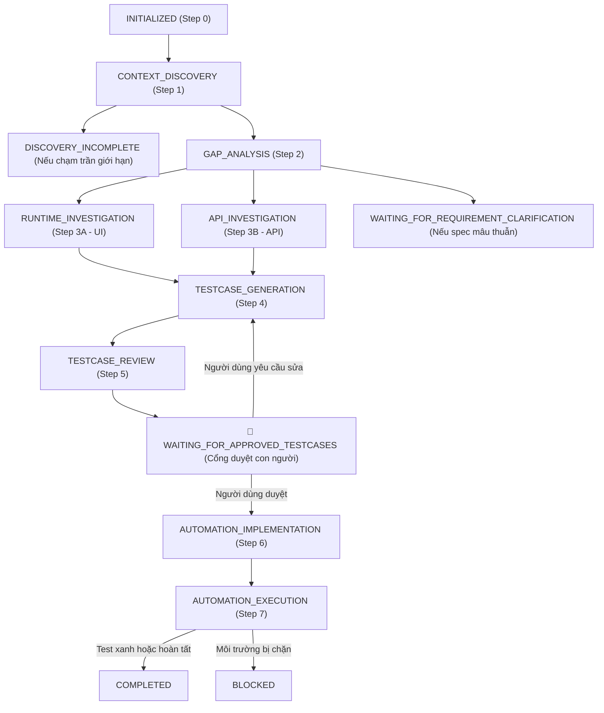

# CODEX.md — BỐI CẢNH DỰ ÁN & QUY TẮC VẬN HÀNH DÀNH CHO CODEX / CODING AGENT

> **Dành cho:** Codex, Claude Code, Antigravity Subagents và các Coding Agents tham gia phát triển, bảo trì hoặc thực thi bộ kỹ năng `qa-agent-system`.
> **Mục tiêu:** Cung cấp đầy đủ bối cảnh kiến trúc, nguyên tắc thép, chuỗi trạng thái và các lệnh kiểm thử để bất kỳ agent nào khi đọc file này đều hiểu ngay hệ thống và làm việc chuẩn xác, không suy đoán.

---

## 1. TỔNG QUAN HỆ THỐNG (SYSTEM OVERVIEW)

- **Tên dự án:** `qa-agent-system`
- **Bản chất:** Hệ thống AI QA Copilot có kỷ luật cao, hoạt động theo nguyên tắc **"Bằng chứng trước, kết luận sau"**, chống báo lỗi ảo, tập trung tìm kiếm **Điểm Bất Cập Kỹ Thuật** và **Điểm Gây Ức Chế Người Dùng (User Friction)**, vận hành dưới sự kiểm soát an toàn của con người (Human Gate).
- **Ngôn ngữ & Nền tảng:** Python 3.12+ (`scripts/`, `tests/`), Node.js v24+ / Playwright CLI (`tests/`, `playwright.config.js`), OpenPyXL (Excel generation), SQLite (CodeGraph AST caching).
- **Vị trí gốc:** `C:\Users\TAN\.gemini\config\plugins\qa-agent-system`
- **Kho mã nguồn:** `https://github.com/Dang-nhut-tan/QA-skill.git` (nhánh `main`)

---

## 2. KIẾN TRÚC THƯ MỤC & TÀI NGUYÊN (REPOSITORY STRUCTURE)

```text
qa-agent-system/
├── skills/                            # 13 Kỹ năng chuyên biệt (mỗi thư mục chứa 1 SKILL.md)
│   ├── module-intake/                 # Step 0: Tiếp nhận module, quét môi trường, brief ngành
│   ├── codegraph-context-discovery/   # Step 1: Quét AST, trích xuất Page Object & vẽ sơ đồ Mermaid
│   ├── requirement-gap-analysis/      # Step 2: Đối chiếu luồng chuẩn ngành, tìm Điểm Bất Cập & Ức Chế
│   ├── playwright-investigation/      # Step 3A: Kiểm chứng giao diện sống qua kiến trúc Lai (CLI + MCP)
│   ├── api-investigation/             # Step 3B: Kiểm chứng API, phát hiện lọt validation, script repro
│   ├── gap-reproduction/              # Step 3 Shared: Quy chuẩn kỹ thuật viết script tái hiện lỗi
│   ├── testcase-design/               # Step 4: Thiết kế test case chuẩn doanh nghiệp (Tier S/M/L)
│   ├── testcase-review-export/        # Step 5: Đánh giá RTM & xuất file Excel 3-sheet 13 cột
│   ├── automation-readiness/          # Step 6.1: Bộ lọc chỉ nhận testcase "Automation Ready = Yes"
│   ├── automation-implementation/     # Step 6.2: Viết test automation Playwright chuẩn Senior Dev
│   ├── test-execution-debugging/      # Step 7: Chạy CLI, tự động sửa lỗi locator tối đa 2 lần
│   ├── continuous-learning/           # Step 7+: Đề xuất bài học kinh nghiệm, chờ Bi duyệt để nạp
│   └── workflow-orchestrator/         # Điều phối toàn bộ vòng đời, quản lý state machine
├── scripts/                           # Bộ công cụ thực thi cốt lõi (Core Python Engines)
│   ├── quality_gate.py                # Cổng kiểm soát chất lượng AI Coding Quality Gate (5 nhóm rules)
│   ├── lint_test_code.py              # Bộ linter tĩnh: PW-001..005, SEC-001..002, PY-001..003, ARCH-001..002
│   ├── quick_audit.py                 # Động cơ Fast-Track QA Audit v2 (JIT AST, 5 nhóm bất cập, <= 60s)
│   ├── state_manager.py               # Quản lý file .qa-state.json, FSM 14 trạng thái, lock file, redaction
│   ├── codegraph_discovery.py         # Engine tìm kiếm Page Object, AST scanner, fallback đa ngôn ngữ
│   ├── export_testcases.py            # Xuất dữ liệu testcase thành file Excel 3-sheet có format Pastel Pill
│   ├── read_approved_testcases.py     # Đọc ngược file Excel sau khi người dùng duyệt và chỉnh sửa
│   ├── traceability_validator.py      # Kiểm toán ma trận truy vết hai chiều (Forward & Backward)
│   └── validate_system.py             # Script kiểm toán kiến trúc 9 bước (0 false PASS)
├── references/                        # Biểu mẫu, schema và tài liệu tham chiếu chuẩn
│   ├── workflow-state-schema.json     # JSON Schema chuẩn hóa cho .qa-state.json
│   ├── excel-testcases-template.xlsx  # File mẫu Excel chuẩn 3 sheets, 13 cột
│   ├── requirement-gaps-template.md   # Biểu mẫu báo cáo GAP, Điểm Bất Cập và Guard
│   └── risk-based-coverage-matrix.md  # Định nghĩa số lượng test case theo độ phức tạp (Tier S/M/L)
├── tests/                             # Bộ kiểm thử hồi quy & kịch bản thực nghiệm (142 bài tests)
│   ├── test_quality_gate_regression.py# 15 bài test hồi quy AI Coding Quality Gate & Lint Rules
│   ├── test_quick_audit_regression.py # 15 bài test hồi quy Fast-Track QA Audit v2
│   ├── test_qa_skills_regression.py   # 56 bài unit test kiểm tra contract của toàn bộ skill
│   ├── test_codegraph_upgrades.py     # 30 bài test AST discovery, classification & token benchmark
│   ├── test_adaptive_level4.py        # 11 bài test cô lập trạng thái đa phân hệ và JIT AST Level 4
│   ├── test_golden_e2e_pipeline.py    # 15 bài kiểm thử hành vi end-to-end trên filesystem thật
│   ├── smoke.spec.js                  # Playwright smoke test khởi chạy trình duyệt thật
│   └── fixtures/                      # App mẫu đối chứng (order-app.html, order.ts, order.page.ts)
├── AGENTS.md                          # Hướng dẫn phân nhiệm agent toàn cục
├── CODEX.md                           # File này — cẩm nang bối cảnh toàn diện cho Codex
└── playwright.config.js               # Cấu hình Playwright CLI (testDir, reporter, parallel)
```

---

## 3. MÁY TRẠNG THÁI & CHUỖI VẬN HÀNH (FSM & WORKFLOW)

Hệ thống lưu trạng thái liên tục trong file `.qa-state.json` (tự động khóa bằng `StateFileLock`, tự ghi nguyên tử qua `.tmp` + `os.replace`).

### 14 Trạng thái chuẩn tắc (Canonical States):


---

## 4. BA CHẾ ĐỘ CHẠY (EXECUTION MODES)

1. **`standard` (Mặc định cốt lõi):**
   - Áp dụng cho mọi module nghiệp vụ thông thường.
   - Bắt buộc đi qua đủ 8 bước.
   - **Giá trị tối thượng:** Đối chiếu chuẩn mực ngành để vạch trần **Điểm Bất Cập Kỹ Thuật** (Inadequacies) và **Điểm Gây Ức Chế Người Dùng** (User Friction) qua 5 giai đoạn: Nhập liệu $\rightarrow$ Gửi yêu cầu $\rightarrow$ Chờ xử lý $\rightarrow$ Báo lỗi $\rightarrow$ Hoàn tất.
   - Xuất file Excel 3-sheet 13 cột và **bắt buộc dừng lại xin duyệt**.

2. **`critical` (Trọng yếu cao cấp):**
   - Dành cho phân hệ Tài chính, Tiền bạc, Thanh toán (Payment/Checkout), Phân quyền tối cao (RBAC), Dữ liệu nhạy cảm.
   - Giống `standard` nhưng kích hoạt thêm:
     * **Production Safety Gate:** Chặn đứng mutation nếu chạy trên URL production.
     * **Giới hạn tương tranh (Concurrency Burst Cap):** Tối đa 5 requests đồng thời để chống DoS và kiểm tra race condition/idempotency.
     * **Dual-Track bắt buộc:** Kiểm tra song song cả giao diện UI (3A) và backend API (3B).

3. **`quick` (Fast-Track QA Audit v2 — Khám nhanh, chẩn đoán trúng, bằng chứng sống):**
   - Áp dụng khi cần kiểm tra nhanh một luồng cụ thể, triage lỗi hoặc hotfix trong ngân sách thời gian $\le 60s$.
   - **Quy trình 4 bước chuẩn mực:**
     1. *Đọc code mục tiêu (Targeted Code Discovery):* Quét AST / CodeGraph JIT với `depth=1` (mở rộng tối đa `depth=3`). Nếu thiếu mã nguồn ghi nhận `DISCOVERY_INCOMPLETE`.
     2. *Quét 5 nhóm bất cập (Flash Friction Audit):* Soi chiếu vào 5 nhóm quy luật cốt lõi (`DATA_LOSS`, `DUPLICATE_ACTION`, `ASYNC_RECOVERY`, `ERROR_CONTRACT`, `HIDDEN_LOGIC`).
     3. *Kiểm chứng thực nghiệm:* Bật Production Safety Gate; dùng Playwright CLI / API tái hiện 1–2 giả thuyết rủi ro cao nhất (xác nhận bug $\rightarrow$ `tests/repro/`, xác nhận guard $\rightarrow$ `tests/guards/`).
     4. *Báo cáo ngắn (Executive QA Flash Report):* Xuất báo cáo Markdown trực tiếp trong chat (Tổng quan, Bảng 5 nhóm, Bằng chứng, Đề xuất xử lý). Không xuất Excel, không tự ý triển khai full automation suite.

---

## 5. CHÍNH SÁCH CÔNG CỤ & KIẾN TRÚC LAI (HYBRID ARCHITECTURE)

### 1. Khám phá mã nguồn bằng CodeGraph (JIT Discovery):
- Được phép duyệt toàn bộ cây dependency nhưng **bắt buộc áp trần an toàn**: `max_depth = 3`, `max_nodes = 50`, timeout tiến trình 60s.
- Nếu chạm trần hoặc parser lỗi, trạng thái ghi nhận là `DISCOVERY_INCOMPLETE` kèm cảnh báo minh bạch; **tuyệt đối không được báo hoàn tất dối**.

### 2. Kiến trúc Lai cho Kiểm chứng Giao diện (Playwright Hybrid):
- **Động cơ chính (Primary Engine) — Playwright CLI:** Dành cho các dự án có mã nguồn, Page Objects, hoặc fixtures. Agent viết script tái hiện ngắn trong `tests/repro/` và chạy lệnh terminal `npx playwright test`. Tốc độ cực nhanh (~1.5s), tiết kiệm ~90% token, sinh file `.spec.ts` sẵn sàng bàn giao cho Dev và CI.
- **Động cơ dự phòng (Fallback Engine) — Playwright MCP:** Chỉ kích hoạt khi kiểm thử hộp đen (black-box), web ngoài không có mã nguồn, hoặc khi selector trên DOM bị dynamic/obfuscate cần mò mẫm qua cây Accessibility Tree (`browser_snapshot`, `browser_click`).

---

## 6. CÁC NGUYÊN TẮC THÉP BẮT BUỘC (NON-NEGOTIABLE GUARDRAILS)

Khi Codex thực thi mã nguồn hoặc kịch bản kiểm thử, **BẮT BUỘC TUÂN THỦ 100% CÁC NGUYÊN TẮC SAU**:

1. **Nguyên tắc Chứng cứ (Zero Hallucination / Evidence-First):**
   - Tuyệt đối CẤM báo test "PASS" nếu chưa chạy CLI và nhận exit code 0.
   - Phân biệt rõ: Điều xác nhận từ code, điều thấy khi chạy thật, và điều chỉ là suy đoán.
2. **Cổng kiểm soát của Con người (Human Gate):**
   - Sau khi xuất file Excel tại Step 5, hệ thống **bắt buộc dừng lại** ở trạng thái `WAITING_FOR_APPROVED_TESTCASES` và hỏi Bi (Tân): *"Bạn có hài lòng với bộ testcase hiện tại không?"*.
   - CẤM tự ý viết mã Playwright automation (Step 6) khi người dùng chưa phê duyệt và cung cấp `approval_token`.
3. **Cơ chế giữ lại Guard (Valuable Guard Retention):**
   - Nếu kịch bản kiểm thử chứng minh hệ thống đã có phòng thủ hợp lệ (ví dụ: server chặn đúng giá âm trả về 400 Bad Request, hoặc nút bị disable khi số lượng $\le 0$):
   - **TUYỆT ĐỐI CẤM BÁO THÀNH BUG.**
   - Di chuyển script vào `tests/guards/<module>-guard-<id>.spec.ts`, đổi ID thành `GUARD-xxx`, ghi nhận vào `.qa-state.json` và giữ làm regression protection vĩnh viễn.
4. **Hệ thống AI Coding Quality Gate & Lint Feedback Loop (`scripts/quality_gate.py` & `scripts/lint_test_code.py`):**
   Mọi mã nguồn tạo mới hoặc chỉnh sửa bắt buộc phải vượt qua Quality Gate trước khi bàn giao:
   - **Nhóm A — Playwright:**
     * `PW-001` (BLOCK): Cấm fixed wait (`waitForTimeout`, `sleep`). Dùng web-first assertions (`await expect(...).toBeVisible()`).
     * `PW-002` (BLOCK): Cấm floating promises (thiếu `await` trước async matcher hoặc Playwright page actions: `click`, `goto`, `fill`).
     * `PW-003` (BLOCK): Bắt buộc mã test có ID truy vết trong tiêu đề (`TC-xxx`, `GAP-xxx`, `GUARD-xxx`).
     * `PW-004` (BLOCK): Cấm focused tests (`test.only()`, `it.only()`) và cấm `test.skip()` không rõ lý do/ticket.
     * `PW-005` (WARNING): Cảnh báo locator dễ vỡ (XPath tuyệt đối `//html/...`, deep DOM chains, `.nth()` không rõ ngữ cảnh).
   - **Nhóm B — Security:**
     * `SEC-001` (BLOCK): Cấm hardcode mật khẩu, token, api_key. Bắt buộc đọc từ biến môi trường (`process.env.TEST_PASSWORD`).
     * `SEC-002` (BLOCK): Cấm in/log token và thông tin nhạy cảm chưa mask ra console/logger.
   - **Nhóm C — Python:**
     * `PY-001` (BLOCK): Cấm bare `except:` và nuốt lỗi (`except Exception: pass`) qua phân tích AST.
     * `PY-002` (BLOCK): Cấm tham số mặc định mutable (`def fn(items=[])`) qua phân tích AST.
     * `PY-003` (BLOCK): Cấm thực thi động không an toàn (`eval()`, `exec()`) qua phân tích AST.
   - **Nhóm D — Architecture:**
     * `ARCH-001` (BLOCK): Cấm vi phạm ranh giới kiến trúc (script trong `scripts/` không được import từ `tests/`).
     * `ARCH-002` (WARNING): Cảnh báo tự viết lại tiện ích đã có sẵn (`expect.poll`, `WorkflowStateManager`).
   - **Nhóm E — QA Workflow Contracts:**
     * `QA-001` (BLOCK): Cấm báo kết quả thực thi PASS khi không có bằng chứng thực thi thành công hợp lệ.
     * `QA-002` (BLOCK): Cấm xác nhận bug nếu thiếu kịch bản tái hiện `tests/repro/` và bằng chứng.
     * `QA-003` (BLOCK): Cấm lưu GUARD nếu chưa có bằng chứng kiểm chứng phòng thủ thành công.
     * `QA-004` (BLOCK): Cấm vượt Human Gate (Step 5) trước khi triển khai full automation; bắt buộc có `approval_token`.
     * `QA-005` (BLOCK): Cấm thực thi mutation không cấp phép trên môi trường production (Production Safety Gate).

5. **Quy trình AI Auto-Fix Feedback Loop:**
   - Vòng lặp: `Tạo code -> Chạy Quality Gate -> Đọc lỗi -> Sửa đúng nguyên nhân -> Chạy lại Quality Gate -> Chạy test`.
   - Giới hạn: Tối đa 2 lần tự sửa cho cùng một nhóm lỗi. Nếu không sửa được, báo cáo lỗi còn tồn tại kèm bằng chứng và dừng lại.
   - Cấm các tiểu xảo né lỗi: CẤM thêm suppression comment (`/* eslint-disable */`, `# noqa`, `// @ts-ignore`), CẤM xóa hoặc làm yếu assertion, CẤM sửa linter rule để ép test xanh, CẤM sửa logic ngoài phạm vi nhiệm vụ.

6. **Bảo mật & Làm sạch Dữ liệu (Secret Redaction):**
   - State manager tự động chặn các key nhạy cảm (`api_key`, `password`, `token`) nếu truyền trực tiếp vào state metadata (ném `ValueError: Security Alert`).
   - Mọi URI connection string có mật khẩu đều tự động được chuyển đổi thành `***REDACTED***`.

7. **Chuẩn hóa Ngôn ngữ:**
   - Schema nội bộ, tài liệu kỹ thuật, test script, tên hàm, enum: **100% English**.
   - Báo cáo, trao đổi, hỏi ý kiến người dùng Bi (Tân): **Tiếng Việt**.
   - File Excel bàn giao: Ngôn ngữ nghiệp vụ dễ hiểu (Non-IT Business Phrasing), tách bạch `Severity` (Mức độ nghiêm trọng) khỏi `Priority` (Thứ tự ưu tiên chạy).

---

## 7. CÁC LỆNH KIỂM CHỨNG BẮT BUỘC (VERIFICATION COMMANDS)

Trước khi hoàn tất bất kỳ thay đổi code nào trong repo này, Codex bắt buộc phải chạy và bảo đảm các lệnh sau đạt kết quả xanh 100%:

```powershell
# 1. Chạy toàn bộ 142 bài unit test hồi quy
cd "C:\Users\TAN\.gemini\config\plugins\qa-agent-system"
python -m pytest tests -q
# Kỳ vọng: 142 passed, 54 subtests passed (100% PASS)

# 2. Chạy kiểm thử trình duyệt thực tế qua Playwright CLI
npx playwright test
# Kỳ vọng: 5 passed (trên Chromium thật)

# 3. Kiểm toán toàn vẹn kiến trúc hệ thống
python scripts/validate_system.py
# Kỳ vọng: [SUCCESS] All 9 architectural validations and dry-run tests PASSED! (0 false PASS)

# 4. Kiểm tra AI Coding Quality Gate
python scripts/quality_gate.py tests/fixtures/browser/order-ui-bug-repro.spec.js
# Kỳ vọng: [SUCCESS] Quality Gate APPROVED: 0 BLOCK violations (Mã thoát 0)

# 5. Kiểm tra quy chuẩn linter mã test
python scripts/lint_test_code.py tests/fixtures/browser/order-ui-bug-repro.spec.js
# Kỳ vọng: Trả về mã thoát 0, không có vi phạm BLOCK
```
