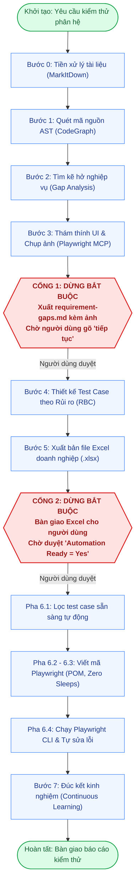

# QA Agent Testing System

<div align="center">


**Hệ thống Trợ lý Kiểm thử Phần mềm Thông minh (Smart QA Testing System)**  
*Dành cho Google Antigravity, Cursor, Claude Code, GitHub Copilot & AI Coding Agents*

*"Biến AI từ người đoán mò thành Kiến trúc sư QA thấu hiểu mã nguồn, nói ngôn ngữ nghiệp vụ và luôn phục vụ dưới sự kiểm soát của con người."*

</div>

---

## Mục Lục
- [1. Giới Thiệu Nhanh](#1-giới-thiệu-nhanh)
- [2. Bắt Đầu Nhanh (3 Phút)](#2-bắt-đầu-nhanh-3-phút)
- [3. Quy Trình Vận Hành & 2 Human Gates](#3-quy-trình-vận-hành--2-human-gates)
- [4. Ma Trận Độ Phủ Rủi Ro (Tier S, M, L)](#4-ma-trận-độ-phủ-rủi-ro-tier-s-m-l)
- [5. Chuẩn Ngôn Ngữ Dễ Hiểu (Non-IT)](#5-chuẩn-ngôn-ngữ-dễ-hiểu-non-it)
- [6. Chi Tiết 11 Kỹ Năng (Skills)](#6-chi-tiết-11-kỹ-năng-skills)
- [7. Hiệu Năng & Đo Lường Token Thực Tế](#7-hiệu-năng--đo-lường-token-thực-tế)
- [8. Cấu Trúc Dự Án](#8-cấu-trúc-dự-án)
- [9. Cài Đặt & Nhúng Dự Án](#9-cài-đặt--nhúng-dự-án)

---

## 1. Giới Thiệu Nhanh

Hệ thống cung cấp một quy trình kiểm thử tự động khép kín, giải quyết triệt để vấn đề AI bịa đặt (hallucination) trong kiểm thử phần mềm:

1. **Khám phá mã nguồn thực tế**: Dùng CodeGraph quét cây cú pháp (AST), hiểu rõ giao diện, API và cơ sở dữ liệu.
2. **Tìm kẽ hở nghiệp vụ**: Đối soát tài liệu và code, phát hiện mâu thuẫn và kiểm chứng trực tiếp trên trình duyệt qua Playwright MCP.
3. **Xuất Test Case chuẩn doanh nghiệp**: Sinh file Excel (`.xlsx`) 13 cột với màu sắc trực quan, bộ lọc và danh sách chọn.
4. **Tự động hóa Playwright**: Sinh mã kiểm thử tinh gọn (Page Object Model, Zero Arbitrary Sleeps) và tự sửa lỗi kịch bản.
5. **Hoàn toàn độc lập (Project-Agnostic)**: Tương thích với mọi dự án Web/API (React, Vue, Node.js, Python, Java, Go...).

---

## 2. Bắt Đầu Nhanh (3 Phút)

### Bước 1: Kiểm tra tính sẵn sàng
```powershell
python scripts/validate_system.py --compact
# Kết quả mong đợi: [SUCCESS] 9/9 Architectural Validations PASSED!
```

### Bước 2: Ra lệnh cho AI
> *"Hãy tiến hành quy trình QA kiểm thử cho phân hệ Đăng Nhập (Login)."*

### Bước 3: Phê duyệt tại 2 điểm dừng (Human Gates)
1. **Duyệt Cổng 1**: Xem báo cáo kẽ hở `requirement-gaps.md` (kèm ảnh minh chứng Playwright) $\rightarrow$ Gõ *"tiếp tục"*.
2. **Duyệt Cổng 2**: Xem file `<module>-testcases.xlsx`, đánh dấu `Yes` tại cột *Automation Ready* $\rightarrow$ Gõ *"tiếp tục viết automation"*.

---

## 3. Quy Trình Vận Hành & 2 Human Gates



> [!IMPORTANT]
> **2 Chốt Chặn Kiểm Soát (Human Gates):**  
> • **Cổng 1 (`WAITING_FOR_REQUIREMENT_CLARIFICATION`)**: AI dừng lại hoàn toàn sau khi xuất phiếu bất cập kèm ảnh thực chứng, chỉ tiếp tục khi người dùng gõ *"tiếp tục"*.  
> • **Cổng 2 (`WAITING_FOR_APPROVED_TESTCASES`)**: AI dừng lại sau khi xuất file Excel, tuyệt đối không tự viết code automation nếu người dùng chưa phê duyệt cột `Automation Ready`.

---

## 4. Ma Trận Độ Phủ Rủi Ro (Tier S, M, L)

Số lượng kịch bản co giãn theo độ phức tạp nghiệp vụ ([`references/risk-based-coverage-matrix.md`](references/risk-based-coverage-matrix.md)):

| Phân Cấp Quy Mô | Đặc Điểm Nghiệp Vụ | Quy Mô Test Case | Ví Dụ |
| :--- | :--- | :---: | :--- |
| **Tier S — Đơn giản** | Màn tĩnh, form 1 bước, tra cứu đơn giản | **5 – 8 cases** | Đổi avatar, xem thông tin phòng ban |
| **Tier M — Tiêu chuẩn** | Form nhiều bước, CRUD, phân quyền, gửi đơn | **10 – 18 cases** | Đăng nhập đa kênh, duyệt đơn, chấm công |
| **Tier L — Phức tạp** | Thanh toán, tính lương, quy trình đa cấp | **18 – 30+ cases** | Cổng thanh toán, chốt lương cuối tháng |

* **Severity (Chặn / Sai / Nhỏ)**: Đánh giá hậu quả kỹ thuật (mất tiền/sập web $\rightarrow$ *Chặn*; sai tính toán $\rightarrow$ *Sai*; lệch giao diện $\rightarrow$ *Nhỏ*).
* **Priority (P0 / P1 / P2)**: Xác định thứ tự thực thi bằng công thức: $\text{Điểm Rủi Ro} = \text{Mức Độ Tác Động} \times \text{Xác Suất Lỗi}$.

---

## 5. Chuẩn Ngôn Ngữ Dễ Hiểu (Non-IT)

Mọi kịch bản đều dùng ngôn ngữ tự nhiên, không dùng thuật ngữ kỹ thuật khó hiểu ([`references/business-terminology-guide.md`](references/business-terminology-guide.md)):

| Tránh Dùng (Tiếng lóng Dev) | Chuẩn Nghiệp Vụ (Ai cũng hiểu) |
| :--- | :--- |
| *Throttling / Phanh chống ngập* | **Giới hạn số lần gửi / Chặn spam liên tục** |
| *Silent drop (Chặn âm thầm)* | **Báo thành công chung để bảo mật, không tạo đơn mới** |
| *UI trả về thông báo...* | **Màn hình hiển thị thông báo...** |
| *DB không chèn dòng mới* | **Hệ thống dữ liệu không phát sinh bản ghi mới** |
| *Gọi RPC vai trò web_anon* | **Người dùng chưa đăng nhập thao tác qua đường dẫn** |

---

## 6. Chi Tiết 11 Kỹ Năng (Skills)

| Kỹ Năng (Skill) | Vai Trò & Nhiệm Vụ |
| :--- | :--- |
| [`module-intake`](skills/module-intake/SKILL.md) | Tiếp nhận spec, chuyển đổi PDF/Excel sang Markdown, thu thập thông tin Staging/Admin. |
| [`codegraph-context-discovery`](skills/codegraph-context-discovery/SKILL.md) | Quét cây AST không giới hạn chiều sâu; nạp vào LLM theo cơ chế JIT để tối ưu token. |
| [`requirement-gap-analysis`](skills/requirement-gap-analysis/SKILL.md) | Đối soát spec với code, lập phiếu làm rõ nghiệp vụ `requirement-gaps.md`. |
| [`playwright-investigation`](skills/playwright-investigation/SKILL.md) | Mở trình duyệt thật, chụp ảnh thực chứng (`screenshots/`) $\rightarrow$ **Dừng tại Cổng 1**. |
| [`testcase-design`](skills/testcase-design/SKILL.md) | Thiết kế test case 13 cột chuẩn RTM 2 chiều (100% bao phủ, 0% test ảo). |
| [`testcase-review-export`](skills/testcase-review-export/SKILL.md) | Soát lỗi nội bộ, xuất Excel font Segoe UI, badge màu pastel $\rightarrow$ **Dừng tại Cổng 2**. |
| [`automation-readiness`](skills/automation-readiness/SKILL.md) | Đọc file Excel người dùng duyệt, lọc chính xác các dòng `Automation Ready = Yes/Có`. |
| [`automation-implementation`](skills/automation-implementation/SKILL.md) | Viết mã Playwright theo mô hình POM, Zero Sleeps, định danh collision-resistant. |
| [`test-execution-debugging`](skills/test-execution-debugging/SKILL.md) | Chạy Playwright CLI, chẩn đoán lỗi, tự sửa script tối đa 2 lần. |
| [`continuous-learning`](skills/continuous-learning/SKILL.md) | Đúc kết bài học dự án (lỗi lặp lại $\ge 2$ lần), ghi nhận kiến thức sau khi người dùng duyệt. |
| [`workflow-orchestrator`](skills/workflow-orchestrator/SKILL.md) | Điều phối trung tâm cỗ máy trạng thái (`.qa-state.json`), kiểm soát checkpoint. |

---

## 7. Hiệu Năng & Đo Lường Token Thực Tế

Hệ thống áp dụng nguyên lý: **Optimize Context Consumption, NOT Discovery Coverage** (Tối ưu tiêu thụ ngữ cảnh, không thu hẹp phạm vi khám phá).

*Minh chứng đo lường định lượng từ công cụ viễn trắc [`scripts/token_benchmark.py`](scripts/token_benchmark.py) (Tokenizer `cl100k_base`):*

| Hạng Mục Đo Lường | Trước Tối Ưu (Baseline) | Sau Tối Ưu (Hiện tại) | Tỷ Lệ Tiết Kiệm |
| :--- | :---: | :---: | :---: |
| **System Prompt & Plugin Schemas** | 84,878 tokens / lượt | 21,640 tokens / lượt | **Giảm 74.5%** |
| **Khám phá mã nguồn (CodeGraph JIT)** | Đọc toàn bộ source file | Truy vấn cây gọi hàm theo nhu cầu | **Giảm >80%** |
| **Ảnh minh chứng UI (Visual Proof)** | 9,600 tokens (Base64) | 54 tokens (Disk Reference) | **Giảm 99.4%** |
| **Tổng phiên làm việc (10 lượt trao đổi)** | **858,380 tokens** | **216,454 tokens** | **Tiết kiệm 74.8% RÒNG** |

---

## 8. Cấu Trúc Dự Án

```text
qa-agent-system/
├── AGENTS.md                  # Hướng dẫn quy tắc toàn cục cho AI Agent
├── plugin.json                # Manifest đóng gói plugin Antigravity
├── skills/                    # 11 kỹ năng chuyên biệt hóa (SKILL.md)
├── scripts/
│   ├── state_manager.py       # Quản lý trạng thái (.qa-state.json) & gộp khử trùng
│   ├── export_testcases.py    # Xuất bản Excel format doanh nghiệp
│   ├── read_approved_testcases.py # Đọc file Excel người dùng duyệt (Yes/Có)
│   ├── traceability_validator.py  # Kiểm soát ma trận truy vết RTM & chống trùng lặp
│   ├── learn_manager.py       # Quản lý nạp bài học dự án an toàn (chống path traversal)
│   ├── token_benchmark.py     # Đo lường token thực tế bằng tiktoken
│   └── validate_system.py     # Bộ kiểm thử xác thực 9 bước kiến trúc
├── tests/
│   └── test_qa_skills_regression.py # Bộ 15 unit tests hồi quy (100% PASS)
├── templates/                 # File Excel mẫu chuẩn
├── telemetry/                 # Nhật ký đo lường token tự động (JSON)
└── references/                # Cẩm nang từ ngữ, ma trận rủi ro, tiêu chuẩn severity
```

---

## 9. Cài Đặt & Nhúng Dự Án

### Cài đặt công cụ phụ trợ (Chỉ cần chạy 1 lần):
```powershell
pip install openpyxl markitdown "markitdown[all]" tiktoken
npm install -g codegraph playwright
npx playwright install
```

### Cách 1: Nhúng trực tiếp vào dự án bất kỳ:
```powershell
Copy-Item -Recurse ".\qa-agent-system" "C:\du_an_cua_ban\.agent"
```

### Cách 2: Cài đặt dạng Plugin trong Google Antigravity:
```powershell
agy plugin install .\qa-agent-system
```

---

<div align="center">
  <b>QA Agent Testing System — Tự Động Hóa Kiểm Thử Chuẩn Mực Cho Mọi Dự Án</b>
</div>
