# QA Agent Testing System

<div align="center">


<br/>

**Hệ thống Kỹ năng Kiểm thử Tự động hoá Thông minh dành cho Google Antigravity, Cursor, Claude Code & AI Coding Agents**

*“Biến AI từ người đoán mò thành Kiến trúc sư QA thấu hiểu tường tận cấu trúc mã nguồn thực tế.”*

</div>

---

## Mục Lục Nhanh
- [1. Triết Lý Thiết Kế Cốt Lõi](#1-triết-lý-thiết-kế-cốt-lõi)
- [2. Cấu Trúc Thư Mục & 11 Skills Độc Lập](#2-cấu-trúc-thư-mục--11-skills-độc-lập)
- [3. Danh Sách GitHub Repositories & Lệnh Cài Đặt](#3-danh-sách-github-repositories--lệnh-cài-đặt)
- [4. Sơ Đồ Kiến Trúc & Vòng Đời Quy Trình](#4-sơ-đồ-kiến-trúc--vòng-đời-quy-trình)
- [5. Mô Tả Nghiệp Vụ Chuyên Sâu Từ Bước 0 Đến Bước 7](#5-mô-tả-nghiệp-vụ-chuyên-sâu-từ-bước-0-đến-bước-7)
- [6. Hai Điểm Dừng Phê Duyệt Bắt Buộc (Human Gates)](#6-hai-điểm-dừng-phê-duyệt-bắt-buộc-human-gates)
- [7. Tiêu Chuẩn Phân Bổ Test Case & Giao Diện Excel Mới](#7-tiêu-chuẩn-phân-bổ-test-case--giao-diện-excel-mới)
- [8. Cơ Chế Học Hỏi & Tiến Hóa Kỹ Năng (Continuous Learning)](#8-cơ-chế-học-hỏi--tiến-hóa-kỹ-năng-continuous-learning)
- [9. Hướng Dẫn Nhúng Vào Dự Án Mới & Vận Hành](#9-hướng-dẫn-nhúng-vào-dự-án-mới--vận-hành)
- [10. Bảng Tổng Hợp Thay Đổi (Changelog)](#10-bảng-tổng-hợp-thay-đổi-changelog)

---

## 1. Triết Lý Thiết Kế Cốt Lõi

```text
  ┌──────────────────┐      ┌──────────────────┐      ┌──────────────────┐
  │  GRAPHIFY AST    │ ───► │  HUMAN CONTROL   │ ───► │ PONYTAIL CODING  │
  │  Thấu hiểu code  │      │  Quyền quyết định│      │  Không sinh rác  │
  │  không đoán mò   │      │  luôn là con người│     │  chạy siêu tốc   │
  └──────────────────┘      └──────────────────┘      └──────────────────┘
```

1. **Graphify-First Discovery:** Sử dụng cây cú pháp tĩnh (AST) để bóc tách 100% các điểm vào (entry points), cây phụ thuộc (call trees) và CSDL trước khi nghĩ đến việc viết test.
2. **Microsoft MarkItDown Ingestion:** Biến đổi mọi tài liệu nhị phân phong phú (PDF, Excel, Word) thành Markdown sạch sẽ để bảo toàn bảng biểu và giảm hao phí token.
3. **Evidence-Based Reasoning:** Phân loại rạch ròi giữa `[CODE-CONFIRMED]`, `[DOC-CONFIRMED]`, `[RUNTIME-CONFIRMED]`, và `[INFERRED]`. Nghiêm cấm bịa đặt nghiệp vụ.
4. **Human-in-the-Loop:** Tuyệt đối không tự động vượt qua 2 trạm dừng bắt buộc: duyệt câu hỏi BA/PO và phê duyệt file test case Excel.
5. **Ponytail-Optimized:** Tái sử dụng tối đa Page Objects và Fixtures có sẵn, nghiêm cấm sleep cứng, cấm tạo wrapper thừa thãi.
6. **Continuous Self-Improvement:** Gặp khó khăn hay lỗi lặp lại $\ge 2$ lần $\rightarrow$ tự tổng kết kinh nghiệm $\rightarrow$ xin duyệt $\rightarrow$ tự tiêm vào file Skill để không bao giờ tái phạm.
7. **Bidirectional Requirement Traceability:** Truy vết yêu cầu 2 chiều và chống trùng lặp. Mỗi yêu cầu trọng yếu phải có ít nhất 1 test case; 100% test case phải có căn cứ từ code hoặc spec (chống test case ảo); triệt tiêu hoàn toàn các test case trùng lặp mục tiêu.

---

## 2. Cấu Trúc Thư Mục & 11 Skills Độc Lập

```text
qa-agent-system/
├── AGENTS.md                                # Quy chuẩn chỉ dẫn điều phối toàn cục
├── plugin.json                              # Manifest đóng gói plugin cho Google Antigravity
├── README.md                                # Tài liệu cẩm nang vận hành chuyên nghiệp
├── skills/                                  # 11 Kỹ năng chuyên biệt hóa (Modular Skills)
│   ├── module-intake/SKILL.md               # [BƯỚC 0] Tiếp nhận, tiền xử lý MarkItDown & init state
│   ├── graphify-context-discovery/SKILL.md  # [BƯỚC 1] Quét AST & dựng Knowledge Graph bằng Graphify
│   ├── requirement-gap-analysis/SKILL.md    # [BƯỚC 2] Phát hiện kẽ hở & lập bảng hỏi BA/PO ───► ĐIỂM DỪNG 1
│   ├── playwright-investigation/SKILL.md    # [BƯỚC 3] Thám thính runtime DOM bằng Playwright MCP
│   ├── testcase-design/SKILL.md             # [BƯỚC 4] Thiết kế test suite (7-10 Chặn, 5-7 Sai)
│   ├── testcase-review-export/SKILL.md      # [BƯỚC 5] Tự soát checklist & xuất file Excel ────► ĐIỂM DỪNG 2
│   ├── automation-readiness/SKILL.md        # [PHA 6.1] Bóc tách các ca Automation Ready = Yes
│   ├── automation-implementation/SKILL.md   # [PHA 6.2-6.3] Tái sử dụng POM, viết test Ponytail
│   ├── test-execution-debugging/SKILL.md    # [PHA 6.4] Chạy Playwright CLI, auto-repair & rerun
│   ├── continuous-learning/SKILL.md         # [BƯỚC 7] Đúc kết kinh nghiệm & nạp tự động vào Skill
│   └── workflow-orchestrator/SKILL.md       # Cỗ máy trạng thái điều phối trung tâm
├── templates/
│   └── testcase-template.xlsx               # File mẫu Excel giao diện doanh nghiệp cao cấp
├── scripts/
│   ├── state_manager.py                     # Quản trị vòng đời state (.qa-state.json)
│   ├── learn_manager.py                     # Quản lý đề xuất và tự động tiêm tri thức vào Skill
│   ├── generate_template.py                 # Tạo/cập nhật file Excel mẫu với badge pastel
│   ├── export_testcases.py                  # Xuất bộ test case ra file .xlsx hoàn chỉnh
│   ├── traceability_validator.py            # Kiểm soát truy vết yêu cầu 2 chiều & chống trùng lặp
│   ├── read_approved_testcases.py           # Phân tích file Excel người dùng duyệt
│   └── validate_system.py                   # Bộ kiểm thử xác thực toàn diện (9 bài test)
└── references/
    ├── severity-guidelines.md               # Tiêu chuẩn mức độ nghiêm trọng: Chặn / Sai / Nhỏ
    ├── testcase-quality-checklist.md        # 9 Trụ cột đánh giá chất lượng test case nội bộ
    ├── project-learnings.json               # Kho lưu trữ các bài học kinh nghiệm đã được duyệt
    └── workflow-state-schema.json           # JSON Schema kiểm soát tính toàn vẹn của state
```

---

## 3. Danh Sách GitHub Repositories & Vai Trò, Lợi Ích Chi Tiết

Hệ thống kết hợp sức mạnh của 6 công cụ mã nguồn mở hàng đầu nhằm tạo nên một giải pháp kiểm thử toàn diện, chặt chẽ từ mã nguồn đến giao diện:

| Công cụ / Repository | Vai trò cốt lõi trong hệ thống | Lợi ích vượt trội cho QA & Dự án |
| :--- | :--- | :--- |
| **[Graphify](https://github.com/Graphify-Labs/graphify)** | Động cơ phân tích AST & Lập Đồ thị tri thức mã nguồn | Xoá bỏ điểm mù (Blind spots), phân tích tác động (Impact Analysis) chuẩn xác, tiết kiệm 80-90% token ngữ cảnh. |
| **[Ponytail](https://github.com/DietrichGebert/ponytail)** | Định hình tư duy viết mã tối giản YAGNI | Ngăn chặn AI sinh mã rác (anti-overengineering), ép tái sử dụng POM/Fixture có sẵn, code test ngắn gọn và chạy nhanh. |
| **[Microsoft Playwright](https://github.com/microsoft/playwright)** | Framework thực thi tự động hoá E2E Test qua CLI | Auto-waiting thông minh triệt tiêu lỗi chập chờn (flaky), web-first assertions, hỗ trợ Trace Viewer bắt lỗi chính xác. |
| **[Playwright MCP](https://github.com/microsoft/playwright)** | Cầu nối điều khiển browser thám thính runtime | Cung cấp bằng chứng thực nghiệm khách quan khi spec bị thiếu, tự động chụp ảnh màn hình DOM lưu vết từng bước. |
| **[Microsoft MarkItDown](https://github.com/microsoft/markitdown)** | Bộ chuyển đổi tài liệu đa định dạng (PDF, Excel, Word -> .md) | Giữ nguyên cấu trúc bảng biểu của spec, giảm token so với file nhị phân, hỗ trợ đối soát kẽ hở theo từng dòng. |
| **[OpenPyXL](https://github.com/openpyxl/openpyxl)** | Thư viện xử lý và định dạng bảng tính Excel `.xlsx` | Xuất bản file Excel thực thụ chuẩn doanh nghiệp, đóng băng dòng, autofilter, dropdown validation, pill badges pastel. |

---

### 3.1. Graphify (`Graphify-Labs/graphify`)
* **Repository GitHub:** [https://github.com/Graphify-Labs/graphify](https://github.com/Graphify-Labs/graphify)
* **Vai trò trong hệ thống:**  
  Là "con mắt X-quang" của hệ thống ở **Bước 1**. Graphify sử dụng các bộ parser Tree-sitter cục bộ để bóc tách cây cú pháp trừu tượng (AST) của hơn 40 ngôn ngữ lập trình, sau đó áp dụng thuật toán phân cụm Leiden để dựng thành Đồ thị tri thức (Knowledge Graph) hoàn chỉnh mà không cần đến Vector Database đắt đỏ.
* **Lợi ích khi sử dụng:**
  - **Xóa sổ "Điểm Mù" (Zero Blind Spots):** Lần theo toàn bộ luồng gọi chéo (UI Component $\rightarrow$ Service $\rightarrow$ Repository $\rightarrow$ SQL Schema). QA thấy được cả những đoạn code ngầm mà Dev cài cắm nhưng không ghi trong spec (như bẫy khoá tài khoản, két mã PIN PBKDF2, cảnh báo thiết bị lạ).
  - **Định vị "Tử Huyệt" (God Nodes & Hotspots):** Tự động phát hiện các class/hàm có hàng trăm kết nối phụ thuộc. Bất kỳ thay đổi nào đụng vào đây đều được QA ưu tiên dựng test suite bao vây rủi ro.
  - **Impact Analysis & Regression Scope chuẩn xác:** Khi Dev sửa 1 hàm, bạn chạy `graphify explain "tenHam"` là biết chính xác 5 chỗ khác đang gọi đến nó. Khoanh vùng kiểm thử hồi quy chuẩn 100%, không cần đoán mò.
  - **Tiết kiệm Token & Chống ảo giác (Anti-Hallucination):** Thay vì quăng cả repo 1,600 files vào prompt khiến AI bị tràn bộ nhớ và trả lời ngáo, Graphify chỉ trích xuất đúng các node liên quan, tiết kiệm đến 85% chi phí token.
* **Lệnh cài đặt chi tiết:**
  ```powershell
  # Cài đặt công cụ toàn cục qua uv tool (Khuyên dùng):
  uv tool install graphifyy

  # Cài đặt kèm tính năng trích xuất PDF hoặc Office:
  uv tool install "graphifyy[pdf]"
  uv tool install "graphifyy[office]"

  # Hoặc clone mã nguồn từ GitHub để tự cài đặt:
  git clone https://github.com/Graphify-Labs/graphify.git
  cd graphify
  pip install -e .
  ```

---

### 3.2. Ponytail (`DietrichGebert/ponytail`)
* **Repository GitHub:** [https://github.com/DietrichGebert/ponytail](https://github.com/DietrichGebert/ponytail)
* **Vai trò trong hệ thống:**  
  Là "chiếc kéo cắt tỉa rác" ở **Pha 6.2 - 6.3**. Ponytail cài cắm vào AI tư duy của một "Kỹ sư Senior lười biếng" (*The Laziest Senior Developer*) với châm ngôn: *"Dòng code tốt nhất là dòng code bạn không bao giờ phải viết."*
* **Lợi ích khi sử dụng:**
  - **Triệt tiêu căn bệnh "Over-engineering" của AI:** Mặc định AI rất hay tự chế thêm class wrapper, tự viết hàm retry/sleep lung tung, biến 1 file test đơn giản thành một đống code rác 300 dòng khó bảo trì. Ponytail dẹp bỏ hoàn toàn thói quen xấu này.
  - **Ép buộc tái sử dụng triệt để (YAGNI & Reuse):** Trước khi viết 1 dòng code mới, Ponytail ép AI phải kiểm tra xem trong repo đã có sẵn Page Object (`LoginPage.mjs`), Fixture hay Helper nào chưa. Nếu có rồi, gọi dùng ngay lập tức.
  - **Code test ngắn, sạch, chạy ổn định:** Test script sinh ra chỉ từ 35–50 dòng, dùng native assertions của Playwright, diff ngắn nhất, phản hồi nhanh và giảm 50-70% token đầu ra.
* **Lệnh cài đặt chi tiết:**
  ```powershell
  # Cài đặt plugin vào Google Antigravity:
  agy plugin install https://github.com/DietrichGebert/ponytail

  # Cài đặt cho Gemini CLI:
  gemini extensions install https://github.com/DietrichGebert/ponytail

  # Cài đặt cho Claude Code:
  /plugin marketplace add DietrichGebert/ponytail
  /plugin install ponytail@ponytail

  # Cài đặt cho Codex / GitHub Copilot CLI:
  codex plugin marketplace add DietrichGebert/ponytail
  codex plugin install ponytail@ponytail
  ```

---

### 3.3. Microsoft Playwright (`microsoft/playwright`)
* **Repository GitHub:** [https://github.com/microsoft/playwright](https://github.com/microsoft/playwright)
* **Vai trò trong hệ thống:**  
  Là "cỗ xe tăng bọc thép" thực thi toàn bộ kịch bản kiểm thử tự động E2E ở **Pha 6.4**. Điều khiển các trình duyệt hiện đại (Chromium, Firefox, WebKit) thông qua giao thức DevTools tốc độ cao.
* **Lợi ích khi sử dụng:**
  - **Cơ chế Auto-waiting thông minh:** Tự động chờ element sẵn sàng (visible, enabled, stable) trước khi thực hiện click hoặc gõ phím. Chấm dứt hoàn toàn tình trạng test chập chờn (flaky tests) và nói KHÔNG với `sleep()` cứng.
  - **Web-First Assertions:** Các lệnh kiểm chứng như `await expect(locator).toBeVisible()` tự động retry ngầm cho đến khi điều kiện thoả mãn hoặc hết timeout, giúp kịch bản test ổn định ngay cả khi mạng chậm.
  - **Trace Viewer & Debugging chuyên sâu:** Khi một ca test bị fail, Playwright tự động ghi lại toàn bộ video, timeline, ảnh chụp DOM snapshot và network log tại đúng khoảnh khắc xảy ra lỗi, giúp QA tìm ra nguyên nhân chỉ trong vài giây.
* **Lệnh cài đặt & thực thi chi tiết:**
  ```powershell
  # Cài đặt các dependencies trong package.json:
  npm install

  # Tải toàn bộ binary trình duyệt headless (Chromium, Firefox, WebKit):
  npx playwright install

  # Chạy kiểm thử tự động với Playwright CLI:
  npm test
  # Hoặc chạy có giao diện UI trực quan:
  npm run test:ui
  ```

---

### 3.4. Playwright MCP Server (`@playwright/mcp`)
* **Nguồn chính thức:** Model Context Protocol Server for Playwright
* **Vai trò trong hệ thống:**  
  Là "giác quan thực nghiệm" của AI ở **Bước 3 (Runtime Investigation)**. Cho phép AI trực tiếp điều khiển trình duyệt headless để khám phá ứng dụng trước khi thiết kế test case.
* **Lợi ích khi sử dụng:**
  - **Bằng chứng khách quan (Empirical Verification):** Khi tài liệu BA viết chưa rõ ràng hoặc mâu thuẫn với code, AI không cần đoán mò. Nó tự mở app, đăng nhập thử, thao tác qua luồng nghi vấn và xem thực tế ứng dụng phản hồi ra sao.
  - **Tự động chụp ảnh màn hình lưu vết:** Chụp lại các bằng chứng trực quan theo mã chuẩn `<IssueID>-step-<NN>-<description>.png` để kẹp vào báo cáo, giúp QA và Dev có ngay bằng chứng tái lập lỗi không thể chối cãi.
  - **Phân định rạch ròi:** AI quan sát để biết *code đang chạy thế nào*, nhưng vẫn giữ nguyên tắc không coi hành vi đó là *nghiệp vụ đúng* nếu chưa có xác nhận của BA.
* **Cấu hình kích hoạt trong file `~/.gemini/config/mcp_config.json`:**
  ```json
  {
    "mcpServers": {
      "playwright": {
        "command": "npx",
        "args": ["-y", "@playwright/mcp@latest"]
      }
    }
  }
  ```

---

### 3.5. Microsoft MarkItDown (`microsoft/markitdown`)
* **Repository GitHub:** [https://github.com/microsoft/markitdown](https://github.com/microsoft/markitdown)
* **Vai trò trong hệ thống:**  
  Là "bộ lọc tiêu chuẩn hoá tài liệu" ở **Bước 0 (Module Intake)**. Chuyển đổi mọi định dạng tài liệu đặc tả nhị phân hoặc phong phú của người dùng (`.pdf`, `.xlsx`, `.xls`, `.docx`, `.pptx`) thành định dạng Markdown (`.md`) tinh khiết.
* **Lợi ích khi sử dụng:**
  - **Bảo toàn hoàn hảo Bảng biểu & Tiêu đề:** Các bảng nghiệp vụ phức tạp trong file Excel/Word khi chuyển sang Markdown table vẫn giữ nguyên hàng và cột, giúp AI và Graphify đọc hiểu luồng logic nghiệp vụ mà không bị xô lệch dữ liệu.
  - **Tiết kiệm Token & Chi phí tối đa:** Nén dung lượng từ các file nhị phân nặng hàng chục Megabytes xuống chỉ còn vài Kilobytes văn bản thuần, giúp AI đọc hiểu nhanh hơn gấp 10 lần.
  - **Kiểm soát tính toàn vẹn (Integrity & Traceability):** Đưa mọi tài liệu về chuẩn `.md` duy nhất giúp hệ thống dễ dàng băm mã SHA-256 để phát hiện ngay khi tài liệu bị sửa đổi ngầm.
* **Lệnh cài đặt chi tiết:**
  ```powershell
  # Cài đặt qua pip:
  pip install markitdown

  # Cài đặt đầy đủ các plugin mở rộng (cho file Excel, PDF, Audio):
  pip install "markitdown[all]"
  ```

---

### 3.6. OpenPyXL (`openpyxl/openpyxl`)
* **Repository GitHub:** [https://github.com/openpyxl/openpyxl](https://github.com/openpyxl/openpyxl)
* **Vai trò trong hệ thống:**  
  Là "xưởng in ấn cao cấp" ở **Bước 5** và **Pha 6.1**. Phụ trách tạo mới, định dạng và phân tích cú pháp các file bảng tính Excel `.xlsx`.
* **Lợi ích khi sử dụng:**
  - **Tạo file Excel thực thụ (Native `.xlsx`):** Không phải dạng file CSV đổi đuôi giả mạo. File xuất ra có cấu trúc nhiều sheets (*Test Cases*, *Requirement Gaps*, *Coverage Summary*).
  - **Giao diện chuẩn Doanh nghiệp (Executive Design):** Hỗ trợ đóng băng dòng tiêu đề (*Freeze Panes*), gắn bộ lọc tự động (*AutoFilter*), thiết lập danh sách chọn Dropdown validation cho cột `Severity` và `Automation Ready`.
  - **Tô màu Pill Badges & Kẻ sọc Zebra:** Giúp ban lãnh đạo, Product Owner và QA dễ dàng phân biệt ngay các ca kiểm thử mức `Chặn` (màu hồng đỏ), `Sai` (màu hổ phách) hay `Automation Ready` (màu xanh mint).
* **Lệnh cài đặt chi tiết:**
  ```powershell
  pip install openpyxl
  ```

---

## 4. Sơ Đồ Kiến Trúc & Vòng Đời Quy Trình

```mermaid
flowchart TD
    Start(["Bắt đầu Yêu cầu"]) --> Step0["Bước 0: module-intake\n(MarkItDown: PDF/Excel -> .md)"]
    Step0 --> Step1["Bước 1: graphify-context-discovery\n(Quét AST -> module-context.md)"]
    Step1 --> Step2["Bước 2: requirement-gap-analysis\n(Xuất <module>-gaps.md & bảng hỏi BA/PO)"]
    
    Step2 --> Gate1{"ĐIỂM DỪNG 1\nWAITING_FOR_REQUIREMENT_CLARIFICATION\n(Hiển thị link file .md & chờ người dùng chọn)"}
    
    Gate1 -- "Path A: Đưa câu trả lời" --> Step3A["Bước 3: Nạp câu trả lời BA/PO\n(Đối soát không xung đột code)"]
    Gate1 -- "Path B: Bỏ qua câu hỏi" --> Step3B["Bước 3: playwright-investigation\n(Duyệt DOM, xuất runtime-investigation.md)"]
    
    Step3A --> Step4["Bước 4: testcase-design\n(7-10 ca Chặn/Nặng · 5-7 ca Sai)"]
    Step3B --> Step4
    
    Step4 --> Step5["Bước 5: testcase-review-export\n(Tự soát checklist & xuất Excel đẹp)"]
    
    Step5 --> Gate2{"ĐIỂM DỪNG 2\nWAITING_FOR_APPROVED_TESTCASES\n(Chờ người dùng duyệt file Excel)"}
    
    Gate2 -- "Người dùng xác nhận đã duyệt" --> Step61["Pha 6.1: automation-readiness\n(Lọc Automation Ready = Yes)"]
    Step61 --> Step62["Pha 6.2 - 6.3: automation-implementation\n(Tái sử dụng POM, viết test Ponytail)"]
    Step62 --> Step64["Pha 6.4: test-execution-debugging\n(Chạy Playwright CLI & auto-repair)"]
    
    Step64 --> Step7["Bước 7: continuous-learning\n(Lỗi lặp lại? Đúc kết kinh nghiệm)"]
    Step7 --> Gate3{"DUYỆT BÀI HỌC?\n(Người dùng đồng ý?)"}
    Gate3 -- "Đồng ý" --> Ingest["Tự động tiêm kiến thức\nvào SKILL.md"]
    Gate3 -- "Từ chối" --> EndNode(["Hoàn tất Quy trình"])
    Ingest --> EndNode

    classDef stopGate fill:#FEE2E2,stroke:#DC2626,stroke-width:2px,color:#991B1B,font-weight:bold;
    classDef stepBox fill:#EFF6FF,stroke:#3B82F6,stroke-width:1.5px,color:#1E3A8A;
    classDef successBox fill:#DCFCE7,stroke:#16A34A,stroke-width:1.5px,color:#166534;

    class Gate1,Gate2 stopGate;
    class Step0,Step1,Step2,Step3A,Step3B,Step4,Step5,Step61,Step62,Step64,Step7 stepBox;
    class Ingest,EndNode successBox;
```



---

## 5. Mô Tả Nghiệp Vụ Chuyên Sâu Từ Bước 0 Đến Bước 7

### BƯỚC 0 — Tiếp Nhận Yêu Cầu & Tiền Xử Lý Tài Liệu (`module-intake`)
* **Mục tiêu:** Định vị phân hệ, chuyển đổi toàn bộ tài liệu đầu vào sang định dạng Markdown sạch sẽ và thiết lập cơ chế giám sát state.
* **Quy tắc bắt buộc:** Nếu người dùng cung cấp tài liệu dạng nhị phân (`.pdf`, `.xlsx`, `.docx`, `.pptx`), hệ thống tự động chạy **Microsoft MarkItDown**:
  ```bash
  markitdown "specs/tai_lieu.pdf" -o "specs/tai_lieu.md"
  ```
* **Khởi tạo state:** Khởi tạo `.qa-state.json` và lưu trữ mã băm SHA-256 của các tài liệu để chống thay đổi ngầm.

### BƯỚC 1 — Bóc Tách AST Bằng Graphify (`graphify-context-discovery`)
* **Mục tiêu:** Thấu hiểu bản đồ kiến trúc thực tế thông qua phân tích tĩnh, không đoán mò.
* **Quy trình:**
  - Chạy `graphify update .` để quét mã nguồn.
  - Phân tích luồng gọi chéo (UI Component $\rightarrow$ Service $\rightarrow$ Repository $\rightarrow$ Database).
  - Phân tích phụ thuộc liên đới: Ví dụ với `Login`, phải rà soát cả Đăng ký, Quên mật khẩu, Mở khoá PIN, Throttling và Cảnh báo máy lạ.
  - Phân loại bằng chứng: `[CODE-CONFIRMED]`, `[DOC-CONFIRMED]`, `[INFERRED]`.

### BƯỚC 2 — Phân Tích Kẽ Hở & Lập Bảng Hỏi BA/PO (`requirement-gap-analysis`)
* **Mục tiêu:** Soát lỗi logic giữa tài liệu và code thực tế, xuất báo cáo điểm bất cập rõ ràng.
* **Quy trình:** Phát hiện 5 dạng kẽ hở (mơ hồ, lỗi tiềm ẩn, thiếu tài liệu, giới hạn môi trường, lỗi xác định). Lập bảng câu hỏi BA/PO chuyên sâu với các giả thuyết đề xuất A/B/C. Xuất file báo cáo độc lập `<module-name>-gaps.md` theo chuẩn `references/requirement-gaps-template.md` và lưu link vào `.qa-state.json`. Trình bày link có thể nhấp cùng bảng tóm tắt trực tiếp trong chat.
* **ĐIỂM DỪNG 1:** Dừng toàn bộ tiến trình, chuyển state sang `WAITING_FOR_REQUIREMENT_CLARIFICATION` và chờ người dùng chọn hướng xử lý (Path A hoặc Path B).

### BƯỚC 3 — Làm Rõ Hoặc Thám Thính Runtime (`playwright-investigation`)
* **Path A (Người dùng trả lời):** Nạp câu trả lời vào `module-context.md`, phát hiện mâu thuẫn nếu câu trả lời trái ngược code.
* **Path B (Thám thính Runtime qua Playwright MCP):** Mở browser thật, tương tác qua các luồng nghi vấn, chụp ảnh màn hình lưu vết (`<IssueID>-step-<NN>-<description>.png`), và xuất file báo cáo độc lập `<module-name>-runtime-investigation.md` kèm link ảnh trực quan.
* *Nguyên tắc nhận thức:* Hành vi quan sát được ở runtime chỉ chứng minh *code đang chạy thế nào*, không tự động biến nó thành *nghiệp vụ đúng*.

### BƯỚC 4 — Thiết Kế Bộ Test Case Theo Rủi Ro (`testcase-design`)
* **Mục tiêu:** Thiết kế bộ test suite phân tầng rủi ro sâu sắc, đạt chuẩn **13 cột thông tin**.
* **Chỉ tiêu phân bổ nghiêm ngặt:**
  - **7 – 10 Test Cases cho mức Nặng / Chặn (`Chặn`):** Happy Path sống còn, crash 500, kẹt luồng bắt buộc, thủng bảo mật, rò rỉ dữ liệu, mất session, throttling.
  - **5 – 7 Test Cases cho mức Sai (`Sai`):** Sai công thức tính toán, sai trạng thái CSDL, điều hướng nhầm URL, vi phạm quy tắc validation dữ liệu.
  - **Mức Nhỏ (`Nhỏ`):** Lỗi chính tả, lệch pixel, thông báo chưa mượt.
* **Quy tắc Automation Ready:** Đánh `Yes` khi hành vi assert được khách quan; đánh `No` bắt buộc phải ghi rõ lý do vào `Automation Blocker`.
* **Cột trạng thái thực thi (`Status` - Cột M ngoài cùng):** Tự động gán mặc định là `Pending`. Dropdown gồm: `Pass`, `Fail`, `Pending`, `Skip`.

### BƯỚC 5 — Kiểm Định Chất Lượng & Xuất Excel Doanh Nghiệp (`testcase-review-export`)
* **Mục tiêu:** Kiểm tra 8 trụ cột chất lượng và xuất bản file Excel `<module>-testcases.xlsx`.
* **Giao diện bảng tính:** Áp dụng font Segoe UI, bảng màu Corporate Navy, kẻ sọc Zebra striping, pill badges màu pastel cho Severity/Readiness/Status, đầy đủ 13 cột chuẩn mực.
* **ĐIỂM DỪNG 2:** Dừng tiến trình, chuyển state sang `WAITING_FOR_APPROVED_TESTCASES` và bàn giao file Excel cho người dùng duyệt.

### BƯỚC 6 — Hiện Thực Hoá & Thực Thi Automation (`automation-implementation` & `debugging`)
* **Pha 6.1:** Đọc file Excel người dùng vừa tải lên, chỉ bóc tách các ca có `Automation Ready = Yes`.
* **Pha 6.2 - 6.3:** Khảo sát POM có sẵn của dự án, viết script Playwright chuẩn Ponytail (tối giản, không sleep cứng, sinh dữ liệu test chống đụng độ, map chuẩn ID test case).
* **Pha 6.4:** Chạy test thật qua CLI (`npx playwright test`), tự sửa lỗi selector/setup tối đa 2 lần rerun, xuất báo cáo `automation-summary.md`.

### BƯỚC 7 — Tự Động Học Hỏi & Tiến Hóa Kỹ Năng (`continuous-learning`)
* **Mục tiêu:** Biến các bài học xương máu thành tài sản tri thức vĩnh viễn của dự án.
* **Quy trình:** Khi phát hiện lỗi lặp lại $\ge 2$ lần, AI tự động đúc kết kinh nghiệm qua `scripts/learn_manager.py propose`. Khi người dùng xác nhận duyệt, AI tự động tiêm kinh nghiệm vào file `SKILL.md` tương ứng để không bao giờ tái phạm.

---

## 6. Hai Điểm Dừng Phê Duyệt Bắt Buộc (Human Gates)

> [!IMPORTANT]
> Đây là 2 "chốt chặn thép" bảo đảm AI luôn phục vụ dưới sự kiểm soát của con người:

```text
┌────────────────────────────────────────────────────────────────────────┐
│ ĐIỂM DỪNG 1: WAITING_FOR_REQUIREMENT_CLARIFICATION                     │
│ AI xuất file <module>-gaps.md, gửi link xem trực tiếp và DỪNG LẠI.     │
│ Người dùng chọn:                                                        │
│   • Lựa chọn 1: Cung cấp câu trả lời từ BA/PO                          │
│   • Lựa chọn 2: Bỏ qua và dùng Playwright MCP thám thính runtime       │
└────────────────────────────────────────────────────────────────────────┘

┌────────────────────────────────────────────────────────────────────────┐
│ ĐIỂM DỪNG 2: WAITING_FOR_APPROVED_TESTCASES                            │
│ AI xuất file Excel và DỪNG LẠI, bàn giao file cho người dùng.          │
│ Người dùng mở file, chỉnh sửa, đánh dấu Automation Ready = Yes.         │
│ AI CẤM viết code automation trước khi người dùng xác nhận duyệt file!   │
└────────────────────────────────────────────────────────────────────────┘
```

---

## 7. Tiêu Chuẩn Phân Bổ Test Case & Giao Diện Excel Mới

Giao diện bảng tính trong [`templates/testcase-template.xlsx`](templates/testcase-template.xlsx) được thiết kế theo chuẩn **Executive Spreadsheet Design System** gồm 3 Sheets chuyên nghiệp:

### 7.1. Cấu Trúc 13 Cột Chuẩn Mực (Sheet 1 — Test Cases)
1. **`Test Case ID` (Cột A):** Mã định danh duy nhất, font đậm căn giữa (`TC-AUTH-001`).
2. **`Module` (Cột B):** Phân hệ kiểm thử (`Authentication`).
3. **`Test Case Name` (Cột C):** Tên ca kiểm thử rõ ràng, súc tích.
4. **`Preconditions` (Cột D):** Tiền điều kiện môi trường, dữ liệu, auth session.
5. **`Test Data` (Cột E):** Dữ liệu kiểm thử cụ thể, giá trị biên.
6. **`Test Steps` (Cột F):** Các bước thực hiện đánh số `1., 2., 3.` tách biệt.
7. **`Expected Result` (Cột G):** Kết quả kỳ vọng đo lường được, rõ ràng.
8. **`Severity` (Cột H):** Mức độ nghiêm trọng (`Chặn`, `Sai`, `Nhỏ`) kèm dropdown validation.
9. **`Automation Ready` (Cột I):** Đánh dấu sẵn sàng tự động hoá (`Yes`, `No`) kèm dropdown.
10. **`Automation Blocker` (Cột J):** Rào cản kỹ thuật nếu `Automation Ready = No`.
11. **`Requirement Reference` (Cột K):** Mã ký hiệu code/tài liệu tham chiếu (`SPEC-AU-01`).
12. **`Notes` (Cột L):** Ghi chú bổ sung, font nghiêng màu Slate.
13. **`Status` (Cột M — Ngoài Cùng):** Trạng thái thực thi (`Pass`, `Fail`, `Pending`, `Skip`), **mặc định là `Pending`** kèm dropdown validation.

### 7.2. Bảng Phối Màu Pill Badges (Severity, Readiness & Status)

| Phân Loại & Giá Trị | Chỉ Tiêu / Vị Trí | Phối Màu Pill Badge Pastel trong Excel | Ý Nghĩa Nghiệp Vụ |
| :--- | :---: | :---: | :--- |
| **`Chặn` (Blocking)** | **7 – 10 Test Cases** | Nền hồng pastel (`#FEE2E2`)<br>Chữ đỏ thẫm (`#991B1B`, Bold) | Bế tắc luồng chính, crash hệ thống, lỗi 500, thủng bảo mật, mất mát dữ liệu, throttling. |
| **`Sai` (Incorrect)** | **5 – 7 Test Cases** | Nền hổ phách pastel (`#FEF3C7`)<br>Chữ nâu sẫm (`#92400E`, Bold) | Sai lệch công thức tính tiền/ngày công, sai trạng thái CSDL, điều hướng nhầm URL, lỗi validation. |
| **`Nhỏ` (Minor)** | *(Linh hoạt bổ sung)* | Nền xanh trời pastel (`#E0F2FE`)<br>Chữ xanh biển (`#075985`, Bold) | Lệch pixel UI, lỗi chính tả, câu dịch i18n chưa mượt. |
| **`Automation Ready = Yes`** | — | Nền xanh mint pastel (`#DCFCE7`)<br>Chữ xanh lá đậm (`#166534`, Bold) | Sẵn sàng tự động hoá hoàn toàn, assert được khách quan. |
| **`Status: Pending` (Mặc định)** | Cột M (Ngoài cùng) | Nền hổ phách pastel (`#FEF3C7`)<br>Chữ nâu sẫm (`#92400E`, Bold) | Trạng thái khởi tạo mặc định, đang chờ kiểm thử thủ công hoặc chạy script Playwright. |
| **`Status: Pass`** | Cột M (Ngoài cùng) | Nền xanh mint pastel (`#DCFCE7`)<br>Chữ xanh lá đậm (`#166534`, Bold) | Ca kiểm thử đã chạy thực tế và vượt qua toàn bộ assertions thành công. |
| **`Status: Fail`** | Cột M (Ngoài cùng) | Nền hồng pastel (`#FEE2E2`)<br>Chữ đỏ thẫm (`#991B1B`, Bold) | Ca kiểm thử phát hiện lỗi thật (Defect) hoặc assert không đạt. |
| **`Status: Skip`** | Cột M (Ngoài cùng) | Nền xám slate pastel (`#F1F5F9`)<br>Chữ xám trung tính (`#475569`) | Ca kiểm thử tạm thời bỏ qua do rào cản môi trường hoặc yêu cầu huỷ. |

---

## 8. Cơ Chế Học Hỏi & Tiến Hóa Kỹ Năng (Continuous Learning)

Khi bạn gặp một lỗi đặc thù trong dự án (ví dụ nút bấm bị chặn bởi hook `useSubmitOnce` hoặc độ trễ mã hoá PBKDF2), AI sẽ xuất hiện đề xuất:

```text
AI PHÁT HIỆN BÀI HỌC KINH NGHIỆM DỰ ÁN CẦN NẠP VÀO SKILL:
- Mã đề xuất: LRN-001
- Vấn đề: Nút Đăng nhập bị click liên tục khi mạng lag làm tài khoản bị khoá
- Nguyên nhân: Dự án có hook useSubmitOnce xử lý bất đồng bộ
- Giải pháp: Playwright test phải assert trạng thái disabled trước khi thao tác tiếp
- Skill tiếp nhận: automation-implementation

Bạn có đồng ý duyệt để AI tự động nạp kinh nghiệm này vào Skill không? (Đồng ý / Từ chối)
```

Khi bạn gõ **"Đồng ý"**, AI sẽ chạy:
```powershell
python scripts/learn_manager.py approve LRN-001
```
Nội dung này được ghi thẳng vào mục `## Project-Specific Learnings & Best Practices` của file `skills/automation-implementation/SKILL.md`. Trong tất cả các lần kiểm thử sau, AI sẽ **tự động áp dụng kinh nghiệm này mà bạn không cần phải dặn lại!**

---

## 9. Hướng Dẫn Nhúng Vào Dự Án Mới & Vận Hành

### Nhúng vào repository bất kỳ
Hệ thống được thiết kế hoàn toàn **độc lập, không fix cứng bất kỳ đường dẫn nào** (zero hardcoded paths). Để tích hợp vào dự án của bạn:

```powershell
# Cách 1: Copy toàn bộ thư mục hệ thống kỹ năng vào thư mục dự án cần kiểm thử
Copy-Item -Recurse ".\qa-agent-system\*" ".\your-project\"

# Hoặc nếu bạn đang đứng trực tiếp tại thư mục qa-agent-system:
Copy-Item -Recurse ".\*" "..\your-project\"
```

Hoặc cài đặt như một Plugin cục bộ trong Antigravity:
```powershell
# Cài đặt từ thư mục hiện tại:
agy plugin install .

# Hoặc cài đặt qua đường dẫn tương đối:
agy plugin install ".\qa-agent-system"
```

### Các câu lệnh khởi động mẫu:
* **Bắt đầu kiểm thử:**
  > *"Hãy áp dụng quy trình QA testing kiểm thử phân hệ Đăng nhập (`Login`)."*
* **Khi AI dừng ở Điểm dừng 1:**
  > *"Trả lời GAP-001: Khóa 15 phút sau 5 lần nhập sai."* hoặc  
  > *"Bỏ qua câu hỏi, hãy bật Playwright MCP thám thính runtime thực tế."*
* **Khi AI dừng ở Điểm dừng 2:**
  > *"Tôi đã duyệt file `Login-testcases.xlsx`, hãy tiến hành viết code automation cho các ca đã đánh dấu."*
* **Khôi phục phiên khi bị gián đoạn:**
  > *"Kiểm tra trạng thái trong `.qa-state.json` và tiếp tục quy trình."*

---

## 10. Bảng Tổng Hợp Thay Đổi (Changelog)

| Phiên bản | Hạng mục thay đổi | Mô tả chi tiết |
| :---: | :--- | :--- |
| **v1.0.0** | **Khởi tạo hệ thống** | 10 kỹ năng cốt lõi, tích hợp Graphify, Playwright MCP/CLI, Ponytail coding style. |
| **v1.1.0** | **Tiền xử lý Microsoft MarkItDown** | Tự động biến đổi PDF, Excel, Word sang Markdown để nạp vào Graphify. |
| **v1.2.0** | **Tái cấu trúc Severity Quotas** | Phân tầng bắt buộc: 7–10 ca Chặn (Nặng) và 5–7 ca Sai. |
| **v1.3.0** | **Continuous Learning Engine** | Thêm skill `continuous-learning` và `scripts/learn_manager.py` tự tiến hóa kỹ năng khi người dùng duyệt. |
| **v1.4.0** | **Đại tu giao diện Excel** | Nâng cấp Segoe UI, corporate navy palette, kẻ sọc zebra, pastel pill badges cho Severity/Readiness. |

---

<div align="center">
  <b>QA Agent Testing System — Được xây dựng cho các Kỹ sư QA & SDET chuyên nghiệp</b>
</div>
