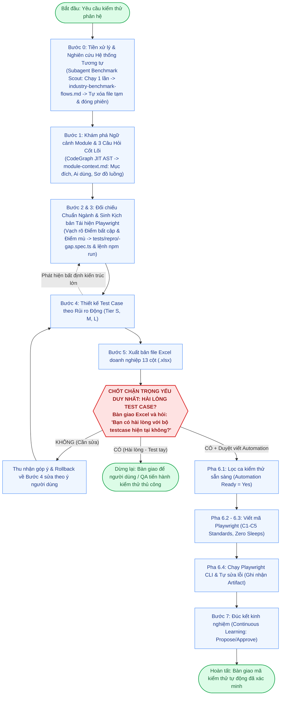

# QA Agent Testing System

<div align="center">


-16A34A?style=for-the-badge)


**Hệ Thống Trợ Lý Kiểm Thử Phần Mềm Thông Minh Đẳng Cấp Doanh Nghiệp (Enterprise QA Agent System)**  
*Tương thích toàn diện với Google Antigravity, Cursor, Claude Code, GitHub Copilot & AI Coding Agents*

*"Biến AI từ người đoán mò thành Kiến trúc sư QA thấu hiểu mã nguồn, nói ngôn ngữ nghiệp vụ và luôn vận hành dưới sự kiểm soát an toàn tuyệt đối của con người."*

</div>

---

## 📌 Mục Lục
- [1. Giới Thiệu Tổng Quan](#1-giới-thiệu-tổng-quan)
- [2. Bắt Đầu Nhanh (3 Phút)](#2-bắt-đầu-nhanh-3-phút)
- [3. Quy Trình Vận Hành & Chốt Chặn Kiểm Soát Hài Lòng](#3-quy-trình-vận-hành--chốt-chặn-kiểm-soát-hài-lòng-core-human-gate)
- [4. Đối Chiếu Luồng Song Song & Điểm Gây Ức Chế Người Dùng (User Friction Audit)](#4-đối-chiếu-luồng-song-song--điểm-gây-ức-chế-người-dùng-user-friction-audit)
- [5. Ma Trận Độ Phủ Rủi Ro Động (Tier S, M, L)](#5-ma-trận-độ-phủ-rủi-ro-động-tier-s-m-l)
- [6. Chuẩn Ngôn Ngữ Dễ Hiểu (Non-IT Business Phrasing)](#6-chuẩn-ngôn-ngữ-dễ-hiểu-non-it-business-phrasing)
- [7. Chi Tiết 13 Kỹ Năng Chuyên Biệt (Skills)](#7-chi-tiết-13-kỹ-năng-chuyên-biệt-skills)
- [8. Hiệu Năng & Đo Lường Token Thực Tế (Ground Truth)](#8-hiệu-năng--đo-lường-token-thực-tế-ground-truth)
- [9. Cấu Trúc Dự Án & Bộ Kịch Bản (Scripts)](#9-cấu-trúc-dự-án--bộ-kịch-bản-scripts)
- [10. Cài Đặt & Nhúng Dự Án](#10-cài-đặt--nhúng-dự-án)

---

## 1. Giới Thiệu Tổng Quan

Hệ thống cung cấp một quy trình kiểm thử tự động khép kín, hướng chứng cứ, giải quyết triệt để hiện tượng AI tự suy đoán (hallucination) và cắt xén quy trình trong kiểm thử phần mềm doanh nghiệp thông qua 5 trụ cột kỹ thuật:

1. **Nghiên cứu Hệ thống Tương tự & Phân tích AST (Industry Benchmark & CodeGraph JIT):** Khám phá các hệ thống dẫn đầu trong ngành có phân hệ tương tự ở Bước 0 (chạy 1 lần duy nhất, lưu độc lập vào `industry-benchmark-flows.md` chống góc nhìn cục bộ; Subagent tự dọn file tạm và đóng phiên ngay); kết hợp duyệt cây đồ thị BFS an toàn chu trình và tự động phác thảo **Sơ đồ luồng hoạt động chuẩn mực (Mermaid Flowchart)** với hình thoi `{}` và hình chữ nhật `[]` vào `module-context.md` giúp đối chiếu vạch trần mọi điểm bất cập và điểm mù.
2. **Đối chiếu Kẽ hở & Kịch bản tái hiện lỗi Playwright (Mô hình Lai CLI & MCP):** Đối chiếu mã nguồn thực tế với chuẩn mực ngành để vạch rõ **Điểm bất cập** và **Điểm mù**; đánh giá 2 trục tác động: **Trải nghiệm người dùng (UX)** và **Rủi ro kỹ thuật tương lai**; thay thế hoàn toàn ảnh chụp tĩnh bằng việc **tự động sinh kịch bản Playwright tái hiện lỗi (`tests/repro/`)** qua kiến trúc Lai (ưu tiên Playwright CLI cho dự án có mã nguồn giúp chạy nhanh 1.5s và tiết kiệm token; dùng Playwright MCP dự phòng khi kiểm thử hộp đen), kèm câu lệnh chạy 1-click ở Terminal (`npm run <module>:gap:<id>`), kết hợp thu thập chẩn đoán DevTools (Console errors & Network $\ge 400$) giúp kiểm chứng lỗi thực tế tức thì.
3. **Xuất bản Test Case chuẩn doanh nghiệp:** Sinh file Excel (`.xlsx`) 13 cột với phong cách thiết kế Pastel Pill Badges, bộ lọc tự động, căn chỉnh độ co giãn dòng và Data Validation dropdown list.
4. **Kiểm soát Truy vết Hai chiều & Khử trùng lặp $O(N)$:** Cơ chế Bidirectional Traceability đảm bảo 100% yêu cầu trọng yếu có test case bao phủ (Forward Coverage), 100% test case có căn cứ mã nguồn/spec thực tế (Backward Grounding - không có test case ảo) và thuật toán bảng băm khử trùng lặp nội dung đơn lượt.
5. **Cỗ máy trạng thái FSM Tự phục hồi (Atomic & Self-Healing):** Ghi file nguyên tử (`.tmp` + `.bak` + `os.replace`), chống sập hỏng JSON, tự động giải phóng deadlock với cơ chế kiểm tra tính sống của tiến trình theo PID (TTL 60 giây) và tích hợp bộ quét bảo mật ngăn chặn rò rỉ Plaintext Secret.

---

## 2. Bắt Đầu Nhanh (3 Phút)

### Bước 1: Kiểm tra tính sẵn sàng của kiến trúc hệ thống
```powershell
python scripts/validate_system.py
# Kết quả mong đợi: [SUCCESS] All 9/9 architectural validations and dry-run tests PASSED!
```

### Bước 2: Chạy bộ kiểm thử tự động toàn diện
```powershell
$env:PYTHONIOENCODING="utf-8"; python -m pytest -s tests/
# Kết quả mong đợi: 100 passed (100% PASS)
```

### Bước 3: Ra lệnh cho AI Agent
> *"Hãy tiến hành quy trình kiểm thử QA toàn diện cho phân hệ Xác Thực & Phân Quyền (Authentication & Access Control)."*

### Bước 4: Kiểm duyệt tại Chốt Chặn Hài Lòng Test Case (Core Human Gate)
Sau khi thiết kế và xuất bản file Excel `<module>-testcases.xlsx`, AI sẽ bàn giao và trực tiếp hỏi bạn:
> **"Bạn có hài lòng với bộ testcase hiện tại không?"**
* **Nếu CÓ (Hài lòng):** AI dừng lại để bạn hoặc đội ngũ kiểm thử thủ công tiến hành test (hoặc nếu muốn AI tự động hoá thì đánh dấu `Automation Ready = Yes` để viết mã).
* **Nếu KHÔNG (Chưa hài lòng / cần sửa):** Bạn chỉ cần đưa ra yêu cầu góp ý, AI sẽ quay lại sửa đổi, bổ sung test case đúng theo ý bạn cho đến khi hoàn toàn hài lòng.

---

## 3. Quy Trình Vận Hành & Chốt Chặn Kiểm Soát Hài Lòng (Core Human Gate)



> [!IMPORTANT]
> **Quy Tắc Vận Hành Tại Chốt Chặn Hài Lòng:**  
> • **Quyền quyết định tối cao của người dùng:** AI không bao giờ tự ý chốt kịch bản. Sau khi xuất Excel, AI bắt buộc hỏi bạn có hài lòng không.  
> • **Vòng lặp sửa đổi tức thì (Instant Feedback Loop):** Nếu bạn chưa hài lòng, AI lập tức tiếp thu phản hồi, quay ngược về bước thiết kế để sửa đổi kịch bản mà không bắt bạn phải thao tác phức tạp.  
> • **An toàn tuyệt đối cho Automation:** AI tuyệt đối cấm tự ý viết mã Playwright nếu chưa có sự xác nhận của người dùng.

---

## 4. Đối Chiếu Luồng Song Song & Điểm Gây Ức Chế Người Dùng (User Friction Audit)

Mục đích tối thượng của việc nghiên cứu các hệ thống tương tự trong ngành ở Bước 0 (lưu độc lập vào `industry-benchmark-flows.md`) là làm **tấm gương soi chiếu trực diện** vào phân hệ dự án công ty mình ở Bước 2 nhằm vạch trần:
1. **Điểm Bất Cập Kỹ Thuật (Inadequacies):** Luồng gãy vụn, thiếu chốt an toàn, thiếu cơ chế hoàn tác/rollback, xử lý bất đồng bộ hớ hênh.
2. **Điểm Gây Khó Chịu / Ức Chế Cho Người Dùng (User Friction & Frustration Points):** Thao tác rườm rà, bẫy bấm nhầm, mất công sức nhập liệu, giao diện đơ hoặc thông báo gây hoang mang.

Hệ thống bắt buộc đối chiếu song song qua **5 giai đoạn thao tác cốt lõi**:

| Giai Đoạn Thao Tác (Operational Phase) | Chuẩn Mực Hệ Thống Dẫn Đầu (Benchmark Flow) | Luồng Thực Tế Dự Án Công Ty Mình | Điểm Bất Cập Kỹ Thuật (Inadequacy) | Điểm Gây Khó Chịu / Ức Chế Cho User (User Friction Point) |
| :--- | :--- | :--- | :--- | :--- |
| **1. Nhập liệu & Khởi tạo (Data Entry)** | Inline validation, tự động lưu nháp (auto-save draft), giữ nguyên form khi có lỗi. | [Khởi tạo & nhập form trong dự án] | Không validate phía client, reload trang toàn phần khi bấm Lưu. | ❌ **Ức chế 1: Mất dữ liệu vừa điền.** Báo lỗi 1 ô là xóa sạch cả form, bắt người dùng nhập lại từ đầu. |
| **2. Gửi yêu cầu & Chuyển trạng thái (Submission)** | Disable nút submit ngay khi click, kèm Idempotency Key, loading mượt tại nút. | [Nút gửi & xử lý submit] | Nút bấm không disable, không debounce, không chặn double click. | ❌ **Ức chế 2: Bẫy bấm đúp (Double-Click Trap).** Người dùng tưởng chưa ăn nên bấm 2-3 lần, sinh đơn trùng hoặc trừ tiền 2 lần. |
| **3. Chờ xử lý bất đồng bộ (Async Processing)** | Có tiến trình rõ ràng, timeout tối đa (ví dụ 10s), có nút Hủy/Thử lại. | [Xử lý API khi mạng chậm/lag] | Không bắt lỗi Promise reject, không đặt timeout trần. | ❌ **Ức chế 3: Treo màn hình / Spinner vô tận.** Màn hình đơ, spinner quay mãi không dừng, không dám F5 vì sợ mất dữ liệu. |
| **4. Thông báo lỗi & Khắc phục (Error Feedback)** | Giải thích rõ lý do lỗi và chỉ đích danh thao tác cần sửa để tiếp tục. | [Thông báo lỗi hiển thị trên UI] | Banner chung chung *"Có lỗi xảy ra"* hoặc văng mã lỗi kỹ thuật 500. | ❌ **Ức chế 4: Thông báo mơ hồ hoặc im lặng.** Người dùng không biết tại sao lỗi (do thẻ, do mạng hay máy chủ) và không biết làm gì tiếp theo. |
| **5. Kết thúc & Hoàn tất (Completion & Control)** | Hiển thị mã biên nhận rõ ràng, có thời gian ân hạn cho phép Hủy / Sửa (Undo). | [Màn hình hoàn tất sau thao tác] | Điều hướng thẳng về trang chủ không có mã xác nhận, không có nút Undo. | ❌ **Ức chế 5: Mất dấu vết & Thiếu quyền kiểm soát.** Không biết đơn đã lưu ở đâu, lỡ bấm nhầm không có cách nào hủy hoặc sửa. |

> [!IMPORTANT]
> **Cam Kết Tái Hiện Thực Tế:**  
> Mọi Điểm Bất Cập và Điểm Khó Chịu được phát hiện đều tự động được AI chuyển hóa thành **Phiếu GAP chuẩn hóa** trong `<module>-gaps.md` và **Mã kiểm thử Playwright tự động** trong `tests/repro/<module>-gap-<id>.spec.ts` kèm lệnh chạy 1-click tại terminal (`npm run <module>:gap:<id>`), bảo đảm 100% bằng chứng thực tế, không lý thuyết suông.

---

## 5. Ma Trận Độ Phủ Rủi Ro Động (Tier S, M, L)

Số lượng và cấu trúc test case tự động co giãn theo mức độ phức tạp kiến trúc và rủi ro vận hành ([`references/risk-based-coverage-matrix.md`](references/risk-based-coverage-matrix.md)):

| Phân Cấp Quy Mô | Đặc Điểm Nghiệp Vụ & Kiến Trúc | Quy Mô Đề Xuất | Ví Dụ Điển Hình Phổ Quát |
| :--- | :--- | :---: | :--- |
| **Tier S — Đơn giản** | Màn tĩnh, form 1 bước, tra cứu danh mục, đổi avatar | **5 – 8 cases** | Xem hồ sơ cá nhân, đổi mật khẩu cơ bản, tra cứu FAQ |
| **Tier M — Tiêu chuẩn** | Form nhiều bước, CRUD hoàn chỉnh, phân quyền RBAC, bộ lọc | **10 – 18 cases** | Đặt đơn hàng, giỏ hàng nhiều bước, quản trị tài khoản |
| **Tier L — Phức tạp** | Cổng thanh toán, cỗ máy tính cước/thuế, đồng bộ phân tán | **18 – 30+ cases** | Xử lý giao dịch tài chính, phê duyệt đa cấp, xử lý concurrency |

* **Mức độ Nghiêm trọng (`Critical/Blocker`, `Major`, `Minor`):** Đánh giá mức độ thiệt hại vốn có nếu lỗi xảy ra (*Critical* = sập luồng, thất thoát dữ liệu/doanh thu, hở bảo mật; *Major* = sai lệch trạng thái, vi phạm validation; *Minor* = lệch giao diện, lỗi chính tả).
* **Thứ tự Ưu tiên Chạy (`P0`, `P1`, `P2`):** Tính toán động dựa trên công thức: $\text{Điểm Rủi Ro} = \text{Mức Độ Thiệt Hại} \times \text{Xác Suất Xuất Hiện}$.

---

## 6. Chuẩn Ngôn Ngữ Dễ Hiểu (Non-IT Business Phrasing)

Mọi kịch bản, bước thực hiện và kết quả mong đợi đều tuân thủ ngôn ngữ nghiệp vụ rõ ràng, không dùng tiếng lóng nội bộ nhà phát triển, giúp BA, Tester thủ công và Product Owner đều đọc hiểu ngay ([`references/business-terminology-guide.md`](references/business-terminology-guide.md)):

| Tránh Dùng (Tiếng lóng Dev) | Chuẩn Ngôn Ngữ Nghiệp Vụ (Ai cũng hiểu được) |
| :--- | :--- |
| *Throttling / Circuit breaker tripped* | **Giới hạn số lần gửi: Chặn thao tác liên tục khi vượt quá ngưỡng an toàn** |
| *Silent drop / Unhandled rejection* | **Hiển thị thông báo an toàn chung, hệ thống không tạo thêm bản ghi mới** |
| *UI trả về mã lỗi 500* | **Giao diện hiển thị biểu ngữ thông báo lỗi thao tác cho người dùng** |
| *DB không chèn dòng mới vào bảng* | **Hệ thống dữ liệu không ghi nhận thêm yêu cầu mới phát sinh** |
| *Gọi RPC với quyền web_anon* | **Người dùng chưa đăng nhập thao tác thông qua đường liên kết trực tiếp** |

---

## 7. Chi Tiết 13 Kỹ Năng Chuyên Biệt (Skills)

| Kỹ Năng (Skill) | Vai Trò & Nhiệm Vụ Cốt Lõi Trong Hệ Thống |
| :--- | :--- |
| [`module-intake`](skills/module-intake/SKILL.md) | Tiếp nhận tài liệu, khám phá hệ thống tương tự trong ngành (Step 0) qua Subagent gọn nhẹ (chạy 1 lần, tự hủy), khởi tạo FSM. |
| [`codegraph-context-discovery`](skills/codegraph-context-discovery/SKILL.md) | Quét cây AST mã nguồn qua CodeGraph SQLite; nạp chữ ký theo cơ chế 5-Level Progressive Context. |
| [`requirement-gap-analysis`](skills/requirement-gap-analysis/SKILL.md) | Đối chiếu spec x code x chuẩn ngành để vạch rõ Điểm bất cập & Điểm gây ức chế người dùng (User Friction); sinh kịch bản Playwright tái hiện lỗi; lập phiếu `<module>-gaps.md`. |
| [`playwright-investigation`](skills/playwright-investigation/SKILL.md) | Kiểm chứng giao diện qua kiến trúc Lai (Playwright CLI chính + Playwright MCP dự phòng), tác giả kịch bản UI repro (`tests/repro/*-gap-*.spec.ts`). |
| [`gap-reproduction`](skills/gap-reproduction/SKILL.md) | Chuyển hóa kẽ hở thành kịch bản Playwright tái hiện lỗi độc lập (`tests/repro/`), tích hợp lệnh chạy 1-click tại terminal, kiểm tra pre-delivery --debug. |
| [`api-investigation`](skills/api-investigation/SKILL.md) | Kiểm chứng trực tiếp tại tầng API/RPC/REST (bỏ qua UI), tác giả kịch bản Playwright API (`tests/repro/*-api-gap-*.spec.ts`), bắt lỗi UI Bypass và Silent API Failures. |
| [`testcase-design`](skills/testcase-design/SKILL.md) | Thiết kế test case 13 cột và kiểm soát truy vết hai chiều trên tập yêu cầu đã nạp. |
| [`testcase-review-export`](skills/testcase-review-export/SKILL.md) | Tự soát lỗi nội bộ, xuất Excel phong cách Pastel Pill Badges $\rightarrow$ **Dừng tại Cổng 2**. |
| [`automation-readiness`](skills/automation-readiness/SKILL.md) | Đọc file Excel người dùng duyệt, lọc chính xác các ca `Automation Ready = Yes`, chống giả mạo kết quả. |
| [`automation-implementation`](skills/automation-implementation/SKILL.md) | Viết mã Playwright theo chuẩn C1–C5 (POM, Zero arbitrary sleeps, định danh chống xung đột song song). |
| [`test-execution-debugging`](skills/test-execution-debugging/SKILL.md) | Chạy Playwright CLI, chẩn đoán lỗi, tự sửa script tối đa 2 lần, đăng ký báo cáo nghiệm thu. |
| [`continuous-learning`](skills/continuous-learning/SKILL.md) | Đúc kết bài học tự động (`propose`, `approve`, `reject`), cập nhật tri thức vào các Skill liên quan. |
| [`workflow-orchestrator`](skills/workflow-orchestrator/SKILL.md) | Cỗ máy FSM trung tâm điều phối trạng thái, kiểm soát chuyển pha an toàn và hỗ trợ khôi phục tiến trình. |

---

## 8. Hiệu Năng & Đo Lường Token Thực Tế (Ground Truth)

Hệ thống hoạt động theo nguyên lý kỹ thuật: **Tối ưu hóa tiêu thụ ngữ cảnh, KHÔNG thu hẹp phạm vi khám phá** (*Optimize Context Consumption, NOT Discovery Coverage*).

### 1. Mô Hình Đo Lường Ground Truth
Khác với các benchmark lý thuyết nhân khống token system prompt qua các lượt trò chuyện, [`scripts/token_benchmark.py`](scripts/token_benchmark.py) tính toán **dựa 100% trên sự cắt giảm dữ liệu vật lý** (đo đếm ký tự và token mã nguồn thực tế nạp vào LLM):

```
┌────────────────────────────────────────────────────────────────────────┐
│                   BẢN CHẤT TIẾT KIỆM TOKEN VẬT LÝ                      │
├───────────────────────────────────┬────────────────────────────────────┤
│         CÁI ẢO (ĐÃ LOẠI BỎ)       │          CÁI THẬT (GROUND TRUTH)   │
├───────────────────────────────────┼────────────────────────────────────┤
│ ❌ Đọc nguyên file mã nguồn thô    │ ✔️ CodeGraph JIT trích xuất AST    │
│    làm tràn ngập context window.  │    giảm 79% – 93% lượng token đọc. │
│ ❌ Nhồi ảnh Base64 kích thước lớn │ ✔️ Lưu ảnh ra ổ đĩa và dùng link   │
│    vào lịch sử hội thoại LLM.     │    tiết kiệm hơn 1.600 token/ảnh.  │
└───────────────────────────────────┴────────────────────────────────────┘
```

---

### 2. Dữ Liệu Kiểm Chứng Thực Nghiệm Trên Các Mã Nguồn Doanh Nghiệp
Đo lường trực tiếp bằng lệnh `python scripts/token_benchmark.py <repo_path> <module>`:

#### 📊 Bảng Đối Soát Hiệu Năng Cắt Giảm Token

| Dự Án Đo Lường Mẫu | Phân Hệ Phân Tích | Quy Mô Mã Nguồn | Đọc File Thô (Baseline) | CodeGraph JIT (Optimized) | Số Token Tiết Kiệm | Tỷ Lệ Tiết Kiệm Context | Hiệu Quả Toàn Phiên (Net Rate) |
| :--- | :--- | :---: | :---: | :---: | :---: | :---: | :---: |
| **Nền Tảng Doanh Nghiệp SaaS** (`src/time-tracking`) | **Chấm công & Định vị GPS** | 54 files (4.088 dòng) | 74.093 tokens | 13.087 tokens | **61.006 tokens** | **82.3%** | **84.3% SAVED** |
| **Nền Tảng Doanh Nghiệp SaaS** (`src/identity`) | **Xác thực & Quản lý Phiên** | 12 files (792 dòng) | 10.748 tokens | 1.629 tokens | **9.119 tokens** | **84.8%** | **91.7% SAVED** |
| **Cổng Thông Tin Đăng Ký** (`src/submissions`) | **Quy trình Nộp Hồ sơ Trực tuyến** | 52 files (3.033 dòng) | 38.955 tokens | 8.100 tokens | **30.855 tokens** | **79.2%** | **83.2% SAVED** |
| **Cổng Thông Tin Đăng Ký** (`src/auth`) | **Tài khoản & Phân quyền Người dùng** | 12 files (732 dòng) | 7.898 tokens | 1.525 tokens | **6.373 tokens** | **80.7%** | **91.0% SAVED** |
| **QA Agent System** (`qa-agent-system`) | **Cỗ máy Trạng thái FSM Engine** | 1 file (441 dòng) | 3.981 tokens | 261 tokens | **3.720 tokens** | **93.4%** | **97.7% SAVED** |

> [!TIP]
> **Giá Trị Kỹ Thuật Thực Tế:** Trên các phân hệ doanh nghiệp phức tạp, việc giảm từ **74.093 tokens xuống 13.087 tokens** (tiết kiệm hơn 61.000 tokens) giúp AI Agent hoàn toàn tránh được hiện tượng loãng sự chú ý (*Lost in the Middle*), tăng vượt trội độ nhạy bén khi phát hiện kẽ hở logic nghiệp vụ và bảo vệ trần giới hạn Context Window.

---

### 3. Theo Dõi Viễn Trắc API Gemini Thật (Production Telemetry)
Thu thập chỉ số `usage_metadata` chuẩn xác từ các lệnh gọi API thực tế:

* **Lệnh ghi nhận một API call thật:**
  ```powershell
  python scripts/token_benchmark.py record-telemetry --session-id "SESS-ENTERPRISE-01" --step "Attendance_Discovery" --prompt-tokens 74093 --output-tokens 13087 --model "gemini-1.5-pro"
  ```
* **Lệnh xem bảng thống kê Telemetry sản xuất:**
  ```powershell
  python scripts/token_benchmark.py show-telemetry
  ```

---

## 9. Cấu Trúc Dự Án & Bộ Kịch Bản (Scripts)

```text
qa-agent-system/
├── AGENTS.md                      # Hướng dẫn quy tắc toàn cục và chuẩn mực bắt buộc cho AI Agent
├── plugin.json                    # Manifest đóng gói plugin Google Antigravity
├── skills/                        # 13 kỹ năng kiểm thử chuyên biệt hóa (SKILL.md)
├── scripts/
│   ├── state_manager.py           # Quản lý FSM nguyên tử (.tmp + .bak) với cơ chế PID lock recovery
│   ├── codegraph_discovery.py     # Quét cây AST, 5-level context và trích xuất chữ ký phương thức
│   ├── codegraph_preflight.py     # Tiền kiểm tra môi trường CodeGraph, loại trừ thư mục binary
│   ├── export_testcases.py        # Xuất Excel format doanh nghiệp với Data Validation và Pastel styling
│   ├── read_approved_testcases.py # Đọc file Excel người dùng duyệt, bảo vệ Primary Key (chống trùng lặp)
│   ├── traceability_validator.py  # Ma trận RTM 2 chiều và thuật toán băm O(N) Hash Map Deduplication
│   ├── learn_manager.py           # Quản lý bài học dự án (propose, approve, reject, query)
│   ├── token_benchmark.py         # Đo lường token ground-truth & production telemetry logger
│   ├── verify_and_embed_images.py # Kiểm tra tính toàn vẹn của ảnh Playwright & nhúng link an toàn
│   ├── generate_template.py       # Tự động sinh file Excel mẫu chuẩn (testcase-template.xlsx)
│   ├── lint_test_code.py          # Linter tĩnh kiểm soát chuẩn C1-C5 trước khi hoàn tất automation
│   └── validate_system.py         # Bộ kiểm thử xác thực 9 bước kiến trúc toàn hệ thống
├── tests/
│   ├── test_qa_skills_regression.py # 56 bài test hồi quy FSM, bảo mật, RTM, Excel & Learning
│   ├── test_codegraph_upgrades.py   # 30 bài test AST discovery, classification & token benchmark
│   ├── test_adaptive_level4.py      # 11 bài test cô lập trạng thái đa phân hệ và JIT AST Level 4
│   └── test_golden_e2e_pipeline.py  # 2 bài test mô phỏng khép kín quy trình E2E trên dự án mẫu
├── templates/                     # File Excel mẫu chuẩn (testcase-template.xlsx)
└── references/                    # Cẩm nang từ ngữ nghiệp vụ, ma trận rủi ro RBC, tiêu chuẩn severity
```

---

## 10. Cài Đặt & Nhúng Dự Án

### Cài đặt công cụ phụ trợ (Chỉ cần chạy 1 lần):
```powershell
pip install -r requirements-dev.txt
npm install -g @colbymchenry/codegraph playwright
npx playwright install chromium
```

### Cách 1: Nhúng trực tiếp vào dự án bất kỳ:
```powershell
Copy-Item -Recurse ".\qa-agent-system" "C:\du_an_cua_ban\.agent"
```

### Cách 2: Cài đặt dạng Plugin trong Google Antigravity:
```powershell
agy plugin install .\qa-agent-system
```

---

<div align="center">
  <b>QA Agent Testing System — Tự Động Hóa Kiểm Thử Chuẩn Mực, Hướng Chứng Cứ Cho Mọi Dự Án</b>
</div>
