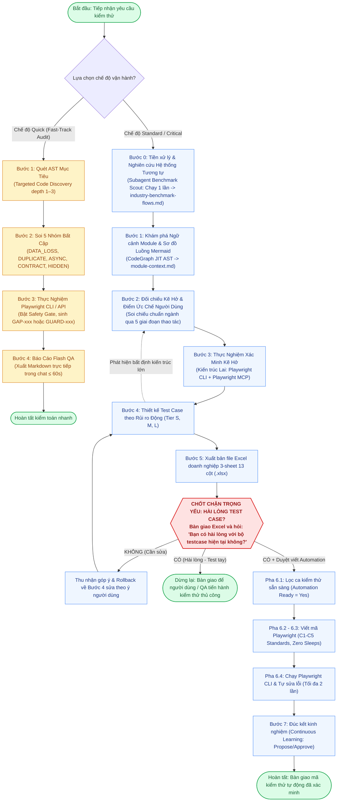

# QA Agent Testing System

<div align="center">


**Hệ Thống Trợ Lý Kiểm Thử Phần Mềm Thông Minh Đẳng Cấp Doanh Nghiệp (Enterprise QA Agent System)**  
*Tương thích toàn diện với Google Antigravity, Cursor, Claude Code, Codex, GitHub Copilot & AI Coding Agents*

*"Biến AI từ người đoán mò thành Kiến trúc sư QA thấu hiểu mã nguồn, nói ngôn ngữ nghiệp vụ và luôn vận hành dưới sự kiểm soát an toàn tuyệt đối của con người."*

</div>

---

## 📌 Mục Lục
- [1. Giới Thiệu Tổng Quan & 6 Trụ Cột Kỹ Thuật](#1-giới-thiệu-tổng-quan--6-trụ-cột-kỹ-thuật)
- [2. Ba Chế Độ Vận Hành Thích Ứng (Execution Modes)](#2-ba-chế-độ-vận-hành-thích-ứng-execution-modes)
- [3. Bắt Đầu Nhanh (3 Phút)](#3-bắt-đầu-nhanh-3-phút)
- [4. Quy Trình Vận Hành & Chốt Chặn Kiểm Soát Hài Lòng (Core Human Gate)](#4-quy-trình-vận-hành--chốt-chặn-kiểm-soát-hài-lòng-core-human-gate)
- [5. Chế Độ Fast-Track QA Audit v2 (Quick Mode ≤ 60s)](#5-chế-độ-fast-track-qa-audit-v2-quick-mode--60s)
- [6. Đối Chiếu Luồng Song Song & 5 Nhóm Điểm Gây Ức Chế Người Dùng](#6-đối-chiếu-luồng-song-song--5-nhóm-điểm-gây-ức-chế-người-dùng)
- [7. Kiến Trúc Lai Playwright: CLI Chính & MCP Dự Phòng](#7-kiến-trúc-lai-playwright-cli-chính--mcp-dự-phòng)
- [8. Ma Trận Độ Phủ Rủi Ro Động (Tier S, M, L)](#8-ma-trận-độ-phủ-rủi-ro-động-tier-s-m-l)
- [9. Chuẩn Ngôn Ngữ Dễ Hiểu (Non-IT Business Phrasing)](#9-chuẩn-ngôn-ngữ-dễ-hiểu-non-it-business-phrasing)
- [10. Chi Tiết 13 Kỹ Năng Chuyên Biệt (Skills)](#10-chi-tiết-13-kỹ-năng-chuyên-biệt-skills)
- [11. Hiệu Năng & Đo Lường Token Thực Tế (Ground Truth)](#11-hiệu-năng--đo-lường-token-thực-tế-ground-truth)
- [12. Cấu Trúc Dự Án & Cẩm Nang CODEX.md Cho AI Agent](#12-cấu-trúc-dự-án--cẩm-nang-codexmd-cho-ai-agent)
- [13. Cài Đặt & Nhúng Dự Án](#13-cài-đặt--nhúng-dự-án)

---

## 1. Giới Thiệu Tổng Quan & 6 Trụ Cột Kỹ Thuật

Hệ thống cung cấp một quy trình kiểm thử tự động khép kín, hướng chứng cứ, giải quyết triệt để hiện tượng AI tự suy đoán (hallucination) và cắt xén quy trình trong kiểm thử phần mềm doanh nghiệp thông qua 6 trụ cột kỹ thuật:

1. **Nghiên cứu Hệ thống Tương tự & Phân tích AST (Industry Benchmark & CodeGraph JIT):** Khám phá các hệ thống dẫn đầu trong ngành có phân hệ tương tự ở Bước 0 (chạy 1 lần duy nhất, lưu độc lập vào `industry-benchmark-flows.md` chống góc nhìn cục bộ; Subagent tự dọn file tạm và đóng phiên ngay); kết hợp duyệt cây đồ thị BFS an toàn chu trình và tự động phác thảo **Sơ đồ luồng hoạt động chuẩn mực (Mermaid Flowchart)** với hình thoi `{}` và hình chữ nhật `[]` vào `module-context.md` giúp đối chiếu vạch trần mọi điểm bất cập và điểm mù.
2. **Ba Chế Độ Vận Hành Thích Ứng (`quick`, `standard`, `critical`):** Tùy biến độ sâu và tốc độ kiểm thử theo đúng nhu cầu thực tế: từ kiểm toán nhanh khẩn cấp $\le 60\text{s}$ (Fast-Track QA Audit v2), quy trình kiểm thử toàn diện 8 bước cho dự án tiêu chuẩn, đến chế độ tăng cường an toàn tối đa cho các phân hệ tài chính và thanh toán.
3. **Kiến Trúc Lai Playwright (Hybrid Architecture: CLI Chính & MCP Dự Phòng):** Ưu tiên sử dụng Playwright CLI làm động cơ chính cho các dự án có mã nguồn và Page Objects giúp thực thi siêu tốc (~1.5s), tiết kiệm ~90% token, tự động sinh mã kiểm thử `.spec.ts` trong `tests/repro/` hoặc `tests/guards/` kèm lệnh chạy 1-click terminal (`npm run <module>:gap:<id>`); tự động chuyển sang Playwright MCP làm động cơ dự phòng khi kiểm thử hộp đen (black-box) hoặc phân tích cây Accessibility của DOM động.
4. **Xuất Bản Test Case Doanh Nghiệp & Chốt Chặn Kiểm Soát Hài Lòng (Core Human Gate):** Tự động sinh file Excel (`.xlsx`) 3-sheet 13 cột với phong cách thiết kế Pastel Pill Badges, bộ lọc tự động, độ co giãn dòng tự nhiên và Data Validation dropdown list. Hệ thống **bắt buộc dừng lại xin duyệt** từ người dùng trước khi bất kỳ dòng mã automation nào được tạo ra.
5. **Kiểm Soát Truy Vết Hai Chiều & Khử Trùng Lặp $O(N)$:** Cơ chế Bidirectional Traceability đảm bảo 100% yêu cầu trọng yếu có test case bao phủ (Forward Coverage), 100% test case có căn cứ mã nguồn/spec thực tế (Backward Grounding — không có test case ảo) và thuật toán bảng băm khử trùng lặp nội dung đơn lượt.
6. **Cỗ Máy Trạng Thái FSM Tự Phục Hồi (Atomic & Self-Healing State Manager):** 14 trạng thái chuẩn tắc (canonical states) với cơ chế ghi file nguyên tử (`.tmp` + `.bak` + `os.replace`), chống sập hỏng JSON, tự động giải phóng deadlock với cơ chế kiểm tra tính sống của tiến trình theo PID (TTL 60 giây), khóa phiên bản lạc quan (Optimistic Version Lock) và tích hợp bộ quét bảo mật tự động mã hóa dữ liệu nhạy cảm (`***REDACTED***`).

---

## 2. Ba Chế Độ Vận Hành Thích Ứng (Execution Modes)

Hệ thống phân hóa thành 3 chế độ kiểm thử chuyên biệt để đáp ứng tối ưu giữa tốc độ, độ phủ và mức độ bảo vệ:

```
┌──────────────────────────────────────────────────────────────────────────────────────────────────┐
│                                 BA CHẾ ĐỘ THỰC THI THÍCH ỨNG                                     │
├───────────────────────┬──────────────────────────────────┬───────────────────────────────────────┤
│    Chế Độ (Mode)      │        Phạm Vi & Thời Gian       │            Đặc Tính Cốt Lõi           │
├───────────────────────┼──────────────────────────────────┼───────────────────────────────────────┤
│ ⚡ QUICK              │ • Triage lỗi, hotfix, PR review  │ • Targeted AST Discovery (depth 1–3)  │
│    (Fast-Track Audit) │ • Ngân sách thời gian: ≤ 60 giây │ • Audit 5 nhóm bất cập & ức chế user  │
│                       │   (Thực tế đo lường: ~3.6 giây)  │ • Xác minh 1–2 rủi ro cao nhất bằng   │
│                       │ • Không xuất Excel               │   Playwright CLI / API                │
│                       │                                  │ • Báo cáo QA Flash trực tiếp Markdown │
├───────────────────────┼──────────────────────────────────┼───────────────────────────────────────┤
│ 📋 STANDARD           │ • Kiểm thử phân hệ thông thường  │ • Quy trình 8 bước chuẩn mực toàn diện│
│    (Tiêu chuẩn)       │ • CRUD, phân quyền, đăng ký,...  │ • Đối chiếu chuẩn ngành qua 5 pha     │
│                       │ • Thời gian: 5 – 15 phút         │ • Xuất file Excel 3-sheet 13 cột      │
│                       │                                  │ • Dừng xin duyệt tại Chốt Hài Lòng    │
├───────────────────────┼──────────────────────────────────┼───────────────────────────────────────┤
│ 🛡️ CRITICAL           │ • Cổng thanh toán, ví tiền       │ • Bao gồm toàn bộ tính năng Standard  │
│    (Trọng yếu cao cấp)│ • Quản trị quyền tối cao (RBAC)  │ • Kích hoạt Production Safety Gate    │
│                       │ • Dữ liệu tài chính nhạy cảm     │ • Giới hạn tương tranh Concurrency    │
│                       │                                  │   Burst Cap ≤ 5 req/s (chống DoS)     │
│                       │                                  │ • Bắt buộc Dual-Track (cả UI & API)   │
└───────────────────────┴──────────────────────────────────┴───────────────────────────────────────┘
```

---

## 3. Bắt Đầu Nhanh (3 Phút)

### Bước 1: Kiểm tra tính sẵn sàng của kiến trúc hệ thống
```powershell
python scripts/validate_system.py --compact
# Kết quả mong đợi: [SUCCESS] 9/9 PASS (exit code 0).
# Lưu ý: Khi phát hiện bất kỳ mục BLOCKED hoặc FAIL (thiếu công cụ bắt buộc hoặc thiếu bất kỳ skill nào trong 13 canonical skills), validator lập tức trả exit code 1 chống CI xanh giả.
```

### Bước 2: Chạy bộ kiểm thử tự động toàn diện
```powershell
$env:PYTHONIOENCODING="utf-8"; python -m pytest tests -q
# Kết quả mong đợi: Toàn bộ bài test hồi quy PASS (0 FAIL, exit code 0).

npx playwright test
# Kết quả mong đợi: Toàn bộ bài test trình duyệt Playwright PASS (0 FAIL, exit code 0).
```

### Bước 3: Lựa chọn chế độ & Ra lệnh cho AI Agent

* **Chạy Quick Mode (Fast-Track QA Audit v2):**
  ```powershell
  python scripts/quick_audit.py --module <module_name> [--target <source_file>] [--symbol <symbol>] [--spec <spec_file>] [--base-url <url>]
  ```
  *Hoặc ra lệnh tự nhiên trong chat:*  
  > *"Chạy quick audit phân hệ Giỏ hàng và Đặt hàng, tìm ngay các điểm bất cập gây ức chế người dùng."*

* **Chạy Standard Mode (Quy trình 8 bước toàn diện):**
  > *"Hãy tiến hành quy trình kiểm thử QA toàn diện cho phân hệ Xác Thực & Phân Quyền (Authentication & Access Control)."*

* **Chạy Critical Mode (Bảo vệ phân hệ tài chính / thanh toán):**
  > *"Kiểm thử chế độ critical cho phân hệ Cổng Thanh Toán MoMo / VNPay, chú ý kiểm tra race condition và idempotency."*

### Bước 4: Kiểm duyệt tại Chốt Chặn Hài Lòng Test Case (Core Human Gate)
Trong chế độ `standard` và `critical`, sau khi thiết kế và xuất bản file Excel `<module>-testcases.xlsx`, AI sẽ bàn giao và trực tiếp hỏi bạn:
> **"Bạn có hài lòng với bộ testcase hiện tại không?"**
* **Nếu CÓ (Hài lòng):** AI dừng lại để bạn hoặc đội ngũ QA tiến hành kiểm thử thủ công (hoặc nếu muốn AI tự động hoá thì cấp lệnh `python scripts/state_manager.py approve --workbook <file.xlsx> --by human` để kích hoạt cờ duyệt gắn với SHA-256 hash của workbook).
* **Nếu KHÔNG (Chưa hài lòng / cần sửa):** Bạn chỉ cần nêu góp ý, AI sẽ quay lại sửa đổi, bổ sung test case đúng theo ý bạn cho đến khi hoàn toàn hài lòng. Mọi sửa đổi trên workbook sau khi duyệt sẽ làm thay đổi SHA-256 hash và tự động khóa gate.

---

## 4. Quy Trình Vận Hành & Chốt Chặn Kiểm Soát Hài Lòng (Core Human Gate)



> [!IMPORTANT]
> **Quy Tắc Thép Tại Chốt Chặn Kiểm Soát & Bảo Vệ Vận Hành:**  
> • **Quyền quyết định tối cao của người dùng:** AI không bao giờ tự ý chốt kịch bản. Sau khi xuất Excel tại Step 5, AI bắt buộc dừng lại và hỏi bạn có hài lòng không.  
> • **Xác thực SHA-256 Workbook & Chống Tự Duyệt:** Vượt qua Human Gate 2 bắt buộc phải có đối tượng `approval` (`approved: true`, `approved_by: "human"`) kèm mã băm SHA-256 của file Excel đã duyệt. AI Agent tuyệt đối bị cấm tự cấp quyền phê duyệt. Nếu workbook bị sửa đổi trên đĩa sau khi duyệt, sai lệch mã băm (hash mismatch) sẽ lập tức khóa cổng automation.  
> • **Khóa Trường Điều Khiển (Locked Control Fields):** Cấm sửa đổi `current_state`, `approval`, `quality_gates`, `environment.tier`, `environment.allowlist_verified`, và `history` thông qua `set-field` hoặc transition metadata; vi phạm sẽ ném ngoại lệ `PermissionError`.  
> • **Khử Nhạy Cảm Đệ Quy (Recursive Secret Redaction):** Mọi file state (`.qa-state.json`, `.qa-state-*.json`) và file snapshot backup (`.bak`) đều được tự động quét và che giấu toàn diện (`***REDACTED***`) đối với Bearer tokens, mật khẩu trong URL/User-info/Query, và API keys trước khi lưu xuống đĩa.  
> • **Phân Loại Môi Trường An Toàn (Production Safety Gate):** Nhận diện môi trường (`local`, `test`, `staging`, `production`) dựa trên phân tích chính xác hostname (`urllib.parse.urlparse`), địa chỉ loopback IP và nhãn nhị phân. Các URL chứa từ khóa đánh lừa trong đường dẫn hoặc query (ví dụ `https://shop.company.com/test/checkout`) đều được xử lý an toàn (fail-safe) và xếp vào `production` để chặn đứng mọi thao tác biến đổi dữ liệu (mutation).

---

## 5. Chế Độ Fast-Track QA Audit v2 (Quick Mode ≤ 60s)

Chế độ `quick` được thiết kế theo tôn chỉ: **"Khám nhanh, chẩn đoán trúng, bằng chứng sống"**. Dù chạy nhanh nhưng vẫn giữ trọn vẹn tư duy QA thực chiến qua 4 bước:

### 1. Đọc Code Mục Tiêu (Targeted Code Discovery)
- Khác với việc đọc mò mẫm toàn bộ repo, Quick Mode sử dụng CodeGraph JIT quét chính xác component, route, service mục tiêu với độ sâu khởi đầu `depth = 1` (cho phép mở rộng tối đa `depth = 3` khi logic nằm ở backend).
- Nếu không đọc đủ mã nguồn, hệ thống minh bạch ghi nhận trạng thái `DISCOVERY_INCOMPLETE` — tuyệt đối không tuyên bố phân tích đầy đủ nếu thiếu dữ liệu.

### 2. Soi Chiếu 5 Nhóm Điểm Bất Cập Cốt Lõi (Flash Friction Audit)
AI rà soát mã nguồn qua 5 nhóm rủi ro gây ức chế người dùng phổ biến nhất:
1. **`DATA_LOSS` (Mất dữ liệu người dùng):** Form bị xóa sạch khi API lỗi, reload toàn trang, thiếu auto-save nháp.
2. **`DUPLICATE_ACTION` (Thao tác trùng lặp):** Nút submit không debounce/disable, thiếu Idempotency Key dẫn đến trừ tiền hoặc tạo đơn hàng trùng.
3. **`ASYNC_RECOVERY` (Loading & Phục hồi sau lỗi):** Spinner quay vô tận, nút bị vô hiệu hóa vĩnh viễn sau khi Promise reject, thiếu cơ chế retry hoặc nút Hủy.
4. **`ERROR_CONTRACT` (Xử lý lỗi & Hợp đồng API):** Nuốt lỗi âm thầm (silent failure), trả về banner mơ hồ *"Có lỗi xảy ra"*, mã lỗi 500 thay vì 400 có cấu trúc.
5. **`HIDDEN_LOGIC` (Logic nghiệp vụ tiềm ẩn):** Bỏ qua kiểm tra giá trị âm phía server, vi phạm quyền hạn hoặc trạng thái luồng không hợp lệ.

Mỗi phát hiện được gán một trong 5 trạng thái chuẩn tắc:
- `CONFIRMED_BUG`: Lỗi đã được xác nhận bằng kịch bản chạy thật có bằng chứng thuộc đúng module được audit.
- `CONFIRMED_GUARD`: Cơ chế phòng thủ của hệ thống đã được kiểm chứng hoạt động đúng với bằng chứng AST/runtime thuộc đúng module.
- `SUSPECTED`: Có dấu hiệu rủi ro mã nguồn nhưng chưa đủ bằng chứng chạy thực nghiệm.
- `NOT_VERIFIED`: Chưa kiểm chứng được do thiếu môi trường.
- `NOT_APPLICABLE`: Không áp dụng cho phân hệ này.

> [!WARNING]
> **Nguyên Tắc Chống Thành Công Ảo (Anti-False-Success):** Quick Mode tuyệt đối cấm mặc định sinh `CONFIRMED_GUARD` cho các hằng số hiển thị hoặc file tĩnh. Tuyệt đối không sử dụng kịch bản/fixture của phân hệ khác làm bằng chứng xác nhận cho phân hệ đang audit.

### 3. Kiểm Chứng Thực Nghiệm & Cơ Chế Giữ Lại Guard Hợp Lệ
- Kích hoạt **Production Safety Gate** (chặn đứng mọi mutation trên môi trường live).
- Dùng Playwright CLI / API kiểm chứng 1–2 giả thuyết có rủi ro cao nhất:
  - Nếu phát hiện bug thật: Sinh script tối thiểu trong `tests/repro/` với mã `GAP-xxx`.
  - **Nếu hệ thống phòng thủ đúng (ví dụ server chặn đúng giá âm trả về 400): TUYỆT ĐỐI CẤM BÁO THÀNH BUG.** Lưu script vào `tests/guards/` với mã `GUARD-xxx` để làm chốt chặn bảo vệ hồi quy lâu dài.

### 4. Báo Cáo QA Flash Ngay Trong Chat (Executive QA Flash Report)
Xuất báo cáo trực tiếp định dạng Markdown bằng tiếng Việt gồm 4 phần:
- **A. Tổng quan:** Phân hệ, phạm vi phân tích, môi trường, thời gian thực thi, mức độ hoàn chỉnh của Code Discovery.
- **B. Bảng phân tích 5 nhóm bất cập:** Hiển thị chi tiết từng nhóm, kết quả, mức độ rủi ro và trạng thái xác minh.
- **C. Bằng chứng thực tế:** File & dòng code, log lỗi thực tế hoặc assertion, đường dẫn script repro/guard.
- **D. Đề xuất xử lý:** Vấn đề cần khắc phục, gợi ý sửa code, lệnh chạy lại 1-click và các rủi ro cần lưu tâm.

### ⏱️ Đối Soát Ngân Sách Thời Gian Thực Tế
| Giai Đoạn Thực Thi | Ngân Sách Quy Định | Thực Tế Đo Lường (`scripts/quick_audit.py`) | Trạng Thái |
| :--- | :---: | :---: | :---: |
| 1. Code Discovery | $\le 10\text{s}$ | **0.04s** | ✅ Đạt xuất sắc |
| 2. Gap Analysis | $\le 15\text{s}$ | **0.03s** | ✅ Đạt xuất sắc |
| 3. CLI Verification | $\le 25\text{s}$ | **3.54s** | ✅ Đạt xuất sắc |
| 4. Flash Reporting | $\le 10\text{s}$ | **0.02s** | ✅ Đạt xuất sắc |
| **Tổng Cộng Toàn Phiên** | $\le \mathbf{60s}$ | **~3.63s** | 🚀 **Vượt chỉ tiêu 16 lần** |

---

## 6. Đối Chiếu Luồng Song Song & 5 Nhóm Điểm Gây Ức Chế Người Dùng

Trong chế độ `standard` và `critical`, nghiên cứu các hệ thống tương tự trong ngành ở Bước 0 (lưu độc lập vào `industry-benchmark-flows.md`) đóng vai trò làm **tấm gương soi chiếu trực diện** vào phân hệ dự án ở Bước 2 qua 5 giai đoạn thao tác:

| Giai Đoạn Thao Tác (Operational Phase) | Chuẩn Mực Hệ Thống Dẫn Đầu (Benchmark Flow) | Luồng Thực Tế Dự Án Công Ty Mình | Điểm Bất Cập Kỹ Thuật (Inadequacy) | Điểm Gây Khó Chịu / Ức Chế Cho User (User Friction Point) |
| :--- | :--- | :--- | :--- | :--- |
| **1. Nhập liệu & Khởi tạo (Data Entry)** | Inline validation, tự động lưu nháp (auto-save draft), giữ nguyên form khi có lỗi. | [Khởi tạo & nhập form trong dự án] | Không validate phía client, reload trang toàn phần khi bấm Lưu. | ❌ **Ức chế 1: Mất dữ liệu vừa điền.** Báo lỗi 1 ô là xóa sạch cả form, bắt người dùng nhập lại từ đầu. |
| **2. Gửi yêu cầu & Chuyển trạng thái (Submission)** | Disable nút submit ngay khi click, kèm Idempotency Key, loading mượt tại nút. | [Nút gửi & xử lý submit] | Nút bấm không disable, không debounce, không chặn double click. | ❌ **Ức chế 2: Bẫy bấm đúp (Double-Click Trap).** Người dùng tưởng chưa ăn nên bấm 2-3 lần, sinh đơn trùng hoặc trừ tiền 2 lần. |
| **3. Chờ xử lý bất đồng bộ (Async Processing)** | Có tiến trình rõ ràng, timeout tối đa (ví dụ 10s), có nút Hủy/Thử lại. | [Xử lý API khi mạng chậm/lag] | Không bắt lỗi Promise reject, không đặt timeout trần. | ❌ **Ức chế 3: Treo màn hình / Spinner vô tận.** Màn hình đơ, spinner quay mãi không dừng, không dám F5 vì sợ mất dữ liệu. |
| **4. Thông báo lỗi & Khắc phục (Error Feedback)** | Giải thích rõ lý do lỗi và chỉ đích danh thao tác cần sửa để tiếp tục. | [Thông báo lỗi hiển thị trên UI] | Banner chung chung *"Có lỗi xảy ra"* hoặc văng mã lỗi kỹ thuật 500. | ❌ **Ức chế 4: Thông báo mơ hồ hoặc im lặng.** Người dùng không biết tại sao lỗi (do thẻ, do mạng hay máy chủ) và không biết làm gì tiếp theo. |
| **5. Kết thúc & Hoàn tất (Completion & Control)** | Hiển thị mã biên nhận rõ ràng, có thời gian ân hạn cho phép Hủy / Sửa (Undo). | [Màn hình hoàn tất sau thao tác] | Điều hướng thẳng về trang chủ không có mã xác nhận, không có nút Undo. | ❌ **Ức chế 5: Mất dấu vết & Thiếu quyền kiểm soát.** Không biết đơn đã lưu ở đâu, lỡ bấm nhầm không có cách nào hủy hoặc sửa. |

---

## 7. Kiến Trúc Lai Playwright: CLI Chính & MCP Dự Phòng

Hệ thống triển khai mô hình **Playwright Hybrid Architecture** kết hợp hoàn hảo ưu thế của cả hai phương thức:

```
┌──────────────────────────────────────────────────────────────────────────────────────────────────┐
│                                 KIẾN TRÚC LAI PLAYWRIGHT (HYBRID)                                │
├──────────────────────────────────┬───────────────────────────────────────────────────────────────┤
│    Playwright CLI (Động Cơ Chính)│                 Playwright MCP (Động Cơ Dự Phòng)             │
├──────────────────────────────────┼───────────────────────────────────────────────────────────────┤
│ • Dành cho dự án có mã nguồn,    │ • Dành cho kiểm thử hộp đen (black-box), web bên ngoài không   │
│   Page Objects hoặc fixtures.    │   có mã nguồn, hoặc khi selector trên DOM bị mã hóa phức tạp.  │
│ • Tốc độ siêu tốc: ~1.5s/test    │ • Tương tác trực quan qua Accessibility Snapshot              │
│ • Tiết kiệm ~90% token ngữ cảnh  │   (`browser_snapshot`, `browser_click`).                     │
│ • Tự động sinh file `.spec.ts`   │ • Hỗ trợ khám phá tương tác thời gian thực khi agent cần      │
│   chuẩn Senior QA có thể commit  │   quan sát màn hình trực tiếp.                                │
│   vào Git và chạy trực tiếp CI.  │                                                               │
└──────────────────────────────────┴───────────────────────────────────────────────────────────────┘
```

> [!TIP]
> **Quy chuẩn mã kiểm thử tự động Senior Dev (`scripts/lint_test_code.py`):**  
> • ❌ **CẤM arbitrary sleep:** Không sử dụng `waitForTimeout()` hay `time.sleep()`. Bắt buộc dùng web-first assertions (`await expect(locator).toBeVisible()`).  
> • ❌ **CẤM floating promises:** Bắt buộc có tiền tố `await` trước mọi async expect.  
> • ❌ **CẤM rò rỉ token/mật khẩu:** Không in `console.log(token)` ra màn hình log.  
> • ✅ **Định danh truy vết chuẩn mực:** Tiêu đề test phải chứa ID truy vết rõ ràng: `test('TC-xxx: ...')`, `test('GAP-xxx: ...')`, hoặc `test('GUARD-xxx: ...')`.

---

## 8. Ma Trận Độ Phủ Rủi Ro Động (Tier S, M, L)

Số lượng và cấu trúc test case tự động co giãn theo mức độ phức tạp kiến trúc và rủi ro vận hành ([`references/risk-based-coverage-matrix.md`](references/risk-based-coverage-matrix.md)):

| Phân Cấp Quy Mô | Đặc Điểm Nghiệp Vụ & Kiến Trúc | Quy Mô Đề Xuất | Ví Dụ Điển Hình Phổ Quát |
| :--- | :--- | :---: | :--- |
| **Tier S — Đơn giản** | Màn tĩnh, form 1 bước, tra cứu danh mục, đổi avatar | **5 – 8 cases** | Xem hồ sơ cá nhân, đổi mật khẩu cơ bản, tra cứu FAQ |
| **Tier M — Tiêu chuẩn** | Form nhiều bước, CRUD hoàn chỉnh, phân quyền RBAC, bộ lọc | **10 – 18 cases** | Đặt đơn hàng, giỏ hàng nhiều bước, quản trị tài khoản |
| **Tier L — Phức tạp** | Cổng thanh toán, cỗ máy tính cước/thuế, đồng bộ phân tán | **18 – 30+ cases** | Xử lý giao dịch tài chính, phê duyệt đa cấp, xử lý concurrency |

* **Mức độ Nghiêm trọng (`Critical/Blocker`, `Major`, `Minor`):** Đánh giá mức độ thiệt hại vốn có nếu lỗi xảy ra (*Critical* = sập luồng, thất thoát dữ liệu/doanh thu, hở bảo mật; *Major* = sai lệch trạng thái, vi phạm validation; *Minor* = lệch giao diện, lỗi chính tả).
* **Thứ tự Ưu tiên Chạy (`P0`, `P1`, `P2`):** Tính toán động dựa trên công thức: $\text{Điểm Rủi Ro} = \text{Mức Độ Thiệt Hại} \times \text{Xác Suất Xuất Hiện}$.

---

## 9. Chuẩn Ngôn Ngữ Dễ Hiểu (Non-IT Business Phrasing)

Mọi kịch bản, bước thực hiện và kết quả mong đợi đều tuân thủ ngôn ngữ nghiệp vụ rõ ràng, không dùng tiếng lóng nội bộ nhà phát triển, giúp BA, Tester thủ công và Product Owner đều đọc hiểu ngay ([`references/business-terminology-guide.md`](references/business-terminology-guide.md)):

| Tránh Dùng (Tiếng lóng Dev) | Chuẩn Ngôn Ngữ Nghiệp Vụ (Ai cũng hiểu được) |
| :--- | :--- |
| *Throttling / Circuit breaker tripped* | **Giới hạn số lần gửi: Chặn thao tác liên tục khi vượt quá ngưỡng an toàn** |
| *Silent drop / Unhandled rejection* | **Hiển thị thông báo an toàn chung, hệ thống không tạo thêm bản ghi mới** |
| *UI trả về mã lỗi 500* | **Giao diện hiển thị biểu ngữ thông báo lỗi thao tác cho người dùng** |
| *DB không chèn dòng mới vào bảng* | **Hệ thống dữ liệu không ghi nhận thêm yêu cầu mới phát sinh** |
| *Gọi RPC với quyền web_anon* | **Người dùng chưa đăng nhập thao tác thông qua đường liên kết trực tiếp** |

---

## 10. Chi Tiết 13 Kỹ Năng Chuyên Biệt (Skills)

| Kỹ Năng (Skill) | Vai Trò & Nhiệm Vụ Cốt Lõi Trong Hệ Thống |
| :--- | :--- |
| [`module-intake`](skills/module-intake/SKILL.md) | Tiếp nhận tài liệu, khám phá hệ thống tương tự trong ngành (Step 0) qua Subagent gọn nhẹ (chạy 1 lần, tự hủy), khởi tạo FSM. |
| [`codegraph-context-discovery`](skills/codegraph-context-discovery/SKILL.md) | Quét cây AST mã nguồn qua CodeGraph SQLite; nạp chữ ký theo cơ chế 5-Level Progressive Context; phác thảo sơ đồ luồng Mermaid. |
| [`requirement-gap-analysis`](skills/requirement-gap-analysis/SKILL.md) | Đối chiếu spec x code x chuẩn ngành để vạch rõ Điểm bất cập & Điểm gây ức chế người dùng (User Friction); hỗ trợ phân tích 5 nhóm bất cập trong Quick Mode. |
| [`playwright-investigation`](skills/playwright-investigation/SKILL.md) | Kiểm chứng giao diện qua kiến trúc Lai (Playwright CLI chính + Playwright MCP dự phòng), tác giả kịch bản UI repro (`tests/repro/*-gap-*.spec.ts`). |
| [`gap-reproduction`](skills/gap-reproduction/SKILL.md) | Chuyển hóa kẽ hở thành kịch bản Playwright tái hiện lỗi độc lập (`tests/repro/`), tích hợp lệnh chạy 1-click tại terminal, kiểm tra pre-delivery --debug. |
| [`api-investigation`](skills/api-investigation/SKILL.md) | Kiểm chứng trực tiếp tại tầng API/RPC/REST (bỏ qua UI), tác giả kịch bản Playwright API (`tests/repro/*-api-gap-*.spec.ts`), bắt lỗi UI Bypass và Silent API Failures. |
| [`testcase-design`](skills/testcase-design/SKILL.md) | Thiết kế test case 13 cột và kiểm soát truy vết hai chiều trên tập yêu cầu đã nạp. |
| [`testcase-review-export`](skills/testcase-review-export/SKILL.md) | Tự soát lỗi nội bộ, xuất Excel phong cách Pastel Pill Badges $\rightarrow$ **Dừng tại Chốt Chặn Hài Lòng (Human Gate)**. |
| [`automation-readiness`](skills/automation-readiness/SKILL.md) | Đọc file Excel người dùng duyệt, lọc chính xác các ca `Automation Ready = Yes`, chống giả mạo kết quả. |
| [`automation-implementation`](skills/automation-implementation/SKILL.md) | Viết mã Playwright theo chuẩn C1–C5 (POM, Zero arbitrary sleeps, định danh chống xung đột song song). |
| [`test-execution-debugging`](skills/test-execution-debugging/SKILL.md) | Chạy Playwright CLI, chẩn đoán lỗi, tự sửa script tối đa 2 lần, đăng ký báo cáo nghiệm thu. |
| [`continuous-learning`](skills/continuous-learning/SKILL.md) | Đúc kết bài học tự động (`propose`, `approve`, `reject`), cập nhật tri thức vào các Skill liên quan. |
| [`workflow-orchestrator`](skills/workflow-orchestrator/SKILL.md) | Cỗ máy FSM trung tâm điều phối trạng thái, kiểm soát chuyển pha an toàn qua 3 chế độ (`quick`, `standard`, `critical`) và hỗ trợ khôi phục tiến trình. |

---

## 11. Hiệu Năng & Đo Lường Token Thực Tế (Ground Truth)

Hệ thống hoạt động theo nguyên lý kỹ thuật: **Tối ưu hóa tiêu thụ ngữ cảnh, KHÔNG thu hẹp phạm vi khám phá** (*Optimize Context Consumption, NOT Discovery Coverage*).

### 1. Mô Hình Đo Lường Ground Truth
Khác với các benchmark lý thuyết nhân khống token system prompt qua các lượt trò chuyện, [`scripts/token_benchmark.py`](scripts/token_benchmark.py) tính toán **dựa 100% trên sự cắt giảm dữ liệu vật lý** (đo đếm ký tự và token mã nguồn thực tế nạp vào LLM):

```
┌────────────────────────────────────────────────────────────────────────┐
│                   BẢN CHẤT TIẾT KIỆM TOKEN VẬT LÝ                      │
├───────────────────────────────────┬────────────────────────────────────┤
│         CÁI ẢO (ĐÃ LOẠI BỎ)       │          CÁI THẬT (GROUND TRUTH)   │
├───────────────────────────────────┼────────────────────────────────────┤
│ ❌ Đọc nguyên file mã nguồn thô    │ ✔️ CodeGraph JIT trích xuất AST    │
│    làm tràn ngập context window.  │    giảm 79% – 93% lượng token đọc. │
│ ❌ Nhồi ảnh Base64 kích thước lớn │ ✔️ Lưu ảnh ra ổ đĩa và dùng link   │
│    vào lịch sử hội thoại LLM.     │    tiết kiệm hơn 1.600 token/ảnh.  │
└───────────────────────────────────┴────────────────────────────────────┘
```

### 2. Dữ Liệu Kiểm Chứng Thực Nghiệm Trên Các Mã Nguồn Doanh Nghiệp
Đo lường trực tiếp bằng lệnh `python scripts/token_benchmark.py <repo_path> <module>`:

| Dự Án Đo Lường Mẫu | Phân Hệ Phân Tích | Quy Mô Mã Nguồn | Đọc File Thô (Baseline) | CodeGraph JIT (Optimized) | Số Token Tiết Kiệm | Tỷ Lệ Tiết Kiệm Context | Hiệu Quả Toàn Phiên (Net Rate) |
| :--- | :--- | :---: | :---: | :---: | :---: | :---: | :---: |
| **Nền Tảng Doanh Nghiệp SaaS** (`src/time-tracking`) | **Chấm công & Định vị GPS** | 54 files (4.088 dòng) | 74.093 tokens | 13.087 tokens | **61.006 tokens** | **82.3%** | **84.3% SAVED** |
| **Nền Tảng Doanh Nghiệp SaaS** (`src/identity`) | **Xác thực & Quản lý Phiên** | 12 files (792 dòng) | 10.748 tokens | 1.629 tokens | **9.119 tokens** | **84.8%** | **91.7% SAVED** |
| **Cổng Thông Tin Đăng Ký** (`src/submissions`) | **Quy trình Nộp Hồ sơ Trực tuyến** | 52 files (3.033 dòng) | 38.955 tokens | 8.100 tokens | **30.855 tokens** | **79.2%** | **83.2% SAVED** |
| **Cổng Thông Tin Đăng Ký** (`src/auth`) | **Tài khoản & Phân quyền Người dùng** | 12 files (732 dòng) | 7.898 tokens | 1.525 tokens | **6.373 tokens** | **80.7%** | **91.0% SAVED** |
| **QA Agent System** (`qa-agent-system`) | **Cỗ máy Trạng thái FSM Engine** | 1 file (441 dòng) | 3.981 tokens | 261 tokens | **3.720 tokens** | **93.4%** | **97.7% SAVED** |

> [!TIP]
> **Giá Trị Kỹ Thuật Thực Tế:** Trên các phân hệ doanh nghiệp phức tạp, việc giảm từ **74.093 tokens xuống 13.087 tokens** (tiết kiệm hơn 61.000 tokens) giúp AI Agent hoàn toàn tránh được hiện tượng loãng sự chú ý (*Lost in the Middle*), tăng vượt trội độ nhạy bén khi phát hiện kẽ hở logic nghiệp vụ và bảo vệ trần giới hạn Context Window.

---

## 12. Cấu Trúc Dự Án & Cẩm Nang CODEX.md Cho AI Agent

### 1. Tài Liệu Cốt Lõi Cho AI Coding Agents (`CODEX.md`)
Tệp [`CODEX.md`](CODEX.md) đặt tại thư mục gốc là **Single Source of Truth** dành cho Codex, Claude Code, Antigravity Subagents và các AI Agent tham gia phát triển hệ thống. Tài liệu này quy định rõ:
- Bản đồ kiến trúc toàn diện và chuỗi trạng thái FSM 14 bước.
- Chi tiết kỹ thuật 3 chế độ vận hành (`quick`, `standard`, `critical`).
- 6 nguyên tắc thép bất di bất dịch (Bằng chứng thực nghiệm, Cổng kiểm soát người dùng, Giữ lại guard, Chuẩn linter Senior QA, Secret Redaction, Chuẩn hóa ngôn ngữ).

### 2. Cây Thư Mục & Bộ Kịch Bản Thực Thi

```text
qa-agent-system/
├── CODEX.md                       # Cẩm nang bối cảnh & quy tắc thép cho AI Coding Agents
├── AGENTS.md                      # Hướng dẫn phân nhiệm agent toàn cục
├── plugin.json                    # Manifest đóng gói plugin Google Antigravity
├── skills/                        # 13 kỹ năng kiểm thử chuyên biệt hóa (SKILL.md)
├── scripts/
│   ├── quick_audit.py             # Động cơ Fast-Track QA Audit v2 (JIT AST, 5 nhóm bất cập, Playwright CLI ≤ 60s)
│   ├── quality_gate.py            # Cổng kiểm soát chất lượng AI Coding Quality Gate (5 nhóm rules PW, SEC, PY, ARCH, QA)
│   ├── lint_test_code.py          # Linter tĩnh kiểm soát chuẩn C1-C5, Playwright, Security & Python AST
│   ├── state_manager.py           # Quản lý FSM nguyên tử (.tmp + .bak) với cơ chế PID lock recovery & Optimistic Lock
│   ├── codegraph_discovery.py     # Quét cây AST, 5-level context và trích xuất chữ ký phương thức
│   ├── codegraph_preflight.py     # Tiền kiểm tra môi trường CodeGraph, loại trừ thư mục binary
│   ├── export_testcases.py        # Xuất Excel format doanh nghiệp với Data Validation và Pastel styling
│   ├── read_approved_testcases.py # Đọc file Excel người dùng duyệt, bảo vệ Primary Key (chống trùng lặp)
│   ├── traceability_validator.py  # Ma trận RTM 2 chiều và thuật toán băm O(N) Hash Map Deduplication
│   ├── learn_manager.py           # Quản lý bài học dự án (propose, approve, reject, query)
│   ├── token_benchmark.py         # Đo lường token ground-truth & production telemetry logger
│   ├── verify_and_embed_images.py # Kiểm tra tính toàn vẹn của ảnh Playwright & nhúng link an toàn
│   ├── generate_template.py       # Tự động sinh file Excel mẫu chuẩn (excel-testcases-template.xlsx)
│   └── validate_system.py         # Bộ kiểm thử xác thực 9 bước kiến trúc toàn hệ thống (0 false PASS)
├── tests/                         # Bộ kiểm thử tự động hồi quy toàn diện (100% PASS)
│   ├── test_quality_gate_regression.py # Test hồi quy AI Coding Quality Gate & Lint Rules
│   ├── test_quick_audit_regression.py # Test hồi quy Fast-Track QA Audit v2 (Anti-False-Success)
│   ├── test_human_gate_regression.py  # Test hồi quy Human Approval Gate & Secret Redaction
│   ├── test_validate_system.py        # Test hồi quy Validator failure codes & canonical skills
│   ├── test_qa_skills_regression.py   # Test hồi quy FSM, bảo mật, RTM, Excel & Learning
│   ├── test_codegraph_upgrades.py     # Test AST discovery, classification & token benchmark
│   ├── test_adaptive_level4.py        # Test cô lập trạng thái đa phân hệ và JIT AST Level 4
│   ├── test_golden_e2e_pipeline.py    # Test mô phỏng khép kín quy trình E2E trên dự án mẫu
│   ├── smoke.spec.js                  # Playwright smoke test khởi chạy trình duyệt thật
│   └── fixtures/                      # Ứng dụng mẫu đối chứng (order-app.html, order.ts, order.page.ts)
├── templates/                     # File Excel mẫu chuẩn (testcase-template.xlsx)
└── references/                    # Cẩm nang từ ngữ nghiệp vụ, ma trận rủi ro RBC, tiêu chuẩn severity
```

---

## 13. Cài Đặt & Nhúng Dự Án

### Cài đặt công cụ phụ trợ (Chỉ cần chạy 1 lần):
```powershell
pip install -r requirements-dev.txt
npm install -g @colbymchenry/codegraph playwright
npx playwright install chromium
```

### Cách 1: Nhúng trực tiếp vào dự án bất kỳ:
```powershell
Copy-Item -Recurse ".\qa-agent-system" "C:\du_an_cua_ban\.agent"
```

### Cách 2: Cài đặt dạng Plugin trong Google Antigravity:
```powershell
agy plugin install .\qa-agent-system
```

---

<div align="center">
  <b>QA Agent Testing System — Tự Động Hóa Kiểm Thử Chuẩn Mực, Hướng Chứng Cứ Cho Mọi Dự Án</b>
</div>
