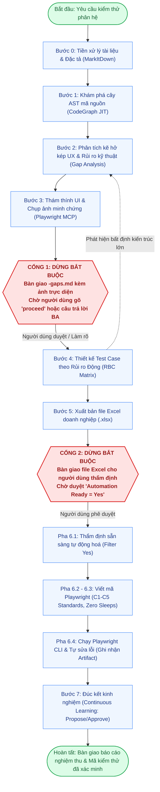

# QA Agent Testing System

<div align="center">


-16A34A?style=for-the-badge)


**Hệ Thống Trợ Lý Kiểm Thử Phần Mềm Thông Minh Đẳng Cấp Doanh Nghiệp (Enterprise QA Agent System)**  
*Tương thích toàn diện với Google Antigravity, Cursor, Claude Code, GitHub Copilot & AI Coding Agents*

*"Biến AI từ người đoán mò thành Kiến trúc sư QA thấu hiểu mã nguồn, nói ngôn ngữ nghiệp vụ và luôn vận hành dưới sự kiểm soát an toàn tuyệt đối của con người."*

</div>

---

## 📌 Mục Lục
- [1. Giới Thiệu Tổng Quan](#1-giới-thiệu-tổng-quan)
- [2. Bắt Đầu Nhanh (3 Phút)](#2-bắt-đầu-nhanh-3-phút)
- [3. Quy Trình Vận Hành & 2 Chốt Chặn Kiểm Soát (Human Gates)](#3-quy-trình-vận-hành--2-chốt-chặn-kiểm-soát-human-gates)
- [4. Ma Trận Độ Phủ Rủi Ro Động (Tier S, M, L)](#4-ma-trận-độ-phủ-rủi-ro-động-tier-s-m-l)
- [5. Chuẩn Ngôn Ngữ Dễ Hiểu (Non-IT Business Phrasing)](#5-chuẩn-ngôn-ngữ-dễ-hiểu-non-it-business-phrasing)
- [6. Chi Tiết 11 Kỹ Năng Chuyên Biệt (Skills)](#6-chi-tiết-11-kỹ-năng-chuyên-biệt-skills)
- [7. Hiệu Năng & Đo Lường Token Thực Tế (Ground Truth)](#7-hiệu-năng--đo-lường-token-thực-tế-ground-truth)
- [8. Cấu Trúc Dự Án & Bộ Kịch Bản (Scripts)](#8-cấu-trúc-dự-án--bộ-kịch-bản-scripts)
- [9. Cài Đặt & Nhúng Dự Án](#9-cài-đặt--nhúng-dự-án)

---

## 1. Giới Thiệu Tổng Quan

Hệ thống cung cấp một quy trình kiểm thử tự động khép kín, hướng chứng cứ, giải quyết triệt để hiện tượng AI tự suy đoán (hallucination) và cắt xén quy trình trong kiểm thử phần mềm doanh nghiệp thông qua 5 trụ cột kỹ thuật:

1. **Khám phá mã nguồn AST tất định (CodeGraph JIT AST):** Duyệt cây đồ thị BFS an toàn chu trình với ngưỡng độ sâu và số node cấu hình được; báo cáo minh bạch khi bị cắt ngắn (`TRUNCATED`). Trích xuất interfaces, types, schemas và chữ ký phương thức để nạp vào LLM với lượng token tối thiểu.
2. **Phân tích kẽ hở 2 chiều & Thám thính UI (Playwright MCP):** Đối soát đặc tả kỹ thuật với mã nguồn thực tế; bắt buộc đánh giá theo **2 trục tác động: Trải nghiệm người dùng (UX Degradation)** và **Dự báo rủi ro lỗi kỹ thuật trong tương lai (Future Technical Liabilities)**; tự động điều khiển trình duyệt thật chụp ảnh thực chứng giao diện (`screenshots/`) để chứng minh vấn đề.
3. **Xuất bản Test Case chuẩn doanh nghiệp:** Sinh file Excel (`.xlsx`) 13 cột với phong cách thiết kế Pastel Pill Badges, bộ lọc tự động, căn chỉnh độ co giãn dòng và Data Validation dropdown list.
4. **Kiểm soát Truy vết Hai chiều & Khử trùng lặp $O(N)$:** Cơ chế Bidirectional Traceability đảm bảo 100% yêu cầu trọng yếu có test case bao phủ (Forward Coverage), 100% test case có căn cứ mã nguồn/spec thực tế (Backward Grounding - không có test case ảo) và thuật toán bảng băm khử trùng lặp nội dung đơn lượt.
5. **Cỗ máy trạng thái FSM Tự phục hồi (Atomic & Self-Healing):** Ghi file nguyên tử (`.tmp` + `.bak` + `os.replace`), chống sập hỏng JSON, tự động giải phóng deadlock với cơ chế kiểm tra tính sống của tiến trình theo PID (TTL 60 giây) và tích hợp bộ quét bảo mật ngăn chặn rò rỉ Plaintext Secret.

---

## 2. Bắt Đầu Nhanh (3 Phút)

### Bước 1: Kiểm tra tính sẵn sàng của kiến trúc hệ thống
```powershell
python scripts/validate_system.py
# Kết quả mong đợi: [SUCCESS] All 9/9 architectural validations and dry-run tests PASSED!
```

### Bước 2: Chạy bộ kiểm thử tự động toàn diện
```powershell
$env:PYTHONIOENCODING="utf-8"; pytest -s tests/
# Kết quả mong đợi: 94 passed (100% PASS)
```

### Bước 3: Ra lệnh cho AI Agent
> *"Hãy tiến hành quy trình kiểm thử QA toàn diện cho phân hệ Xác Thực & Phân Quyền (Authentication & Access Control)."*

### Bước 4: Phê duyệt tại 2 điểm dừng bắt buộc (Human Gates)
1. **Duyệt Cổng 1 (`WAITING_FOR_REQUIREMENT_CLARIFICATION`):** Xem báo cáo điểm bất cập `<module>-gaps.md` (kèm phân tích tác động kép UX / Future Risk và ảnh thực chứng Playwright) $\rightarrow$ Gõ lệnh *"proceed"* (hoặc gửi câu trả lời làm rõ của BA).
2. **Duyệt Cổng 2 (`WAITING_FOR_APPROVED_TESTCASES`):** Mở file `<module>-testcases.xlsx`, kiểm tra nghiệp vụ và đánh dấu `Yes` tại cột *Automation Ready* $\rightarrow$ Gõ lệnh *"proceed with automation"*.

---

## 3. Quy Trình Vận Hành & 2 Chốt Chặn Kiểm Soát (Human Gates)



> [!IMPORTANT]
> **2 Chốt Chặn Bắt Buộc Do Con Người Kiểm Soát (Human Gates):**  
> • **Cổng 1 (`WAITING_FOR_REQUIREMENT_CLARIFICATION`):** AI agent bắt buộc dừng lại hoàn toàn sau khi xuất phiếu bất cập kèm ảnh thực chứng, tuyệt đối không được tự ý thiết kế test case khi người dùng chưa xác nhận lệnh *"proceed"*.  
> • **Cổng 2 (`WAITING_FOR_APPROVED_TESTCASES`):** AI agent bắt buộc dừng lại sau khi xuất file Excel, tuyệt đối cấm tự ý viết mã tự động hoá nếu người dùng chưa rà soát và đánh dấu phê duyệt tại cột `Automation Ready`.  
> • **Cơ chế Hồi lui Hợp lệ (Rollback):** Cỗ máy trạng thái FSM cho phép chuyển trạng thái ngược từ `TESTCASE_GENERATION` quay về `GAP_ANALYSIS` nếu phát hiện tài liệu phát sinh mâu thuẫn lớn trong quá trình thiết kế kịch bản.

---

## 4. Ma Trận Độ Phủ Rủi Ro Động (Tier S, M, L)

Số lượng và cấu trúc test case tự động co giãn theo mức độ phức tạp kiến trúc và rủi ro vận hành ([`references/risk-based-coverage-matrix.md`](references/risk-based-coverage-matrix.md)):

| Phân Cấp Quy Mô | Đặc Điểm Nghiệp Vụ & Kiến Trúc | Quy Mô Đề Xuất | Ví Dụ Điển Hình Phổ Quát |
| :--- | :--- | :---: | :--- |
| **Tier S — Đơn giản** | Màn tĩnh, form 1 bước, tra cứu danh mục, đổi avatar | **5 – 8 cases** | Xem hồ sơ cá nhân, đổi mật khẩu cơ bản, tra cứu FAQ |
| **Tier M — Tiêu chuẩn** | Form nhiều bước, CRUD hoàn chỉnh, phân quyền RBAC, bộ lọc | **10 – 18 cases** | Đặt đơn hàng, giỏ hàng nhiều bước, quản trị tài khoản |
| **Tier L — Phức tạp** | Cổng thanh toán, cỗ máy tính cước/thuế, đồng bộ phân tán | **18 – 30+ cases** | Xử lý giao dịch tài chính, phê duyệt đa cấp, xử lý concurrency |

* **Mức độ Nghiêm trọng (`Critical/Blocker`, `Major`, `Minor`):** Đánh giá mức độ thiệt hại vốn có nếu lỗi xảy ra (*Critical* = sập luồng, thất thoát dữ liệu/doanh thu, hở bảo mật; *Major* = sai lệch trạng thái, vi phạm validation; *Minor* = lệch giao diện, lỗi chính tả).
* **Thứ tự Ưu tiên Chạy (`P0`, `P1`, `P2`):** Tính toán động dựa trên công thức: $\text{Điểm Rủi Ro} = \text{Mức Độ Thiệt Hại} \times \text{Xác Suất Xuất Hiện}$.

---

## 5. Chuẩn Ngôn Ngữ Dễ Hiểu (Non-IT Business Phrasing)

Mọi kịch bản, bước thực hiện và kết quả mong đợi đều tuân thủ ngôn ngữ nghiệp vụ rõ ràng, không dùng tiếng lóng nội bộ nhà phát triển, giúp BA, Tester thủ công và Product Owner đều đọc hiểu ngay ([`references/business-terminology-guide.md`](references/business-terminology-guide.md)):

| Tránh Dùng (Tiếng lóng Dev) | Chuẩn Ngôn Ngữ Nghiệp Vụ (Ai cũng hiểu được) |
| :--- | :--- |
| *Throttling / Circuit breaker tripped* | **Giới hạn số lần gửi: Chặn thao tác liên tục khi vượt quá ngưỡng an toàn** |
| *Silent drop / Unhandled rejection* | **Hiển thị thông báo an toàn chung, hệ thống không tạo thêm bản ghi mới** |
| *UI trả về mã lỗi 500* | **Giao diện hiển thị biểu ngữ thông báo lỗi thao tác cho người dùng** |
| *DB không chèn dòng mới vào bảng* | **Hệ thống dữ liệu không ghi nhận thêm yêu cầu mới phát sinh** |
| *Gọi RPC với quyền web_anon* | **Người dùng chưa đăng nhập thao tác thông qua đường liên kết trực tiếp** |

---

## 6. Chi Tiết 11 Kỹ Năng Chuyên Biệt (Skills)

| Kỹ Năng (Skill) | Vai Trò & Nhiệm Vụ Cốt Lõi Trong Hệ Thống |
| :--- | :--- |
| [`module-intake`](skills/module-intake/SKILL.md) | Tiếp nhận tài liệu đặc tả, chuyển đổi PDF/Office sang Markdown qua MarkItDown, khởi tạo FSM. |
| [`codegraph-context-discovery`](skills/codegraph-context-discovery/SKILL.md) | Quét cây AST mã nguồn qua CodeGraph SQLite; nạp chữ ký theo cơ chế 5-Level Progressive Context. |
| [`requirement-gap-analysis`](skills/requirement-gap-analysis/SKILL.md) | Đối soát spec với code; phân tích tác động kép UX và rủi ro kỹ thuật tương lai; lập phiếu `<module>-gaps.md`. |
| [`playwright-investigation`](skills/playwright-investigation/SKILL.md) | Mở trình duyệt Chromium qua Playwright MCP, chụp ảnh minh chứng thực tế $\rightarrow$ **Dừng tại Cổng 1**. |
| [`testcase-design`](skills/testcase-design/SKILL.md) | Thiết kế test case 13 cột và kiểm soát truy vết hai chiều trên tập yêu cầu đã nạp. |
| [`testcase-review-export`](skills/testcase-review-export/SKILL.md) | Tự soát lỗi nội bộ, xuất Excel phong cách Pastel Pill Badges $\rightarrow$ **Dừng tại Cổng 2**. |
| [`automation-readiness`](skills/automation-readiness/SKILL.md) | Đọc file Excel người dùng duyệt, lọc chính xác các ca `Automation Ready = Yes`, chống giả mạo kết quả. |
| [`automation-implementation`](skills/automation-implementation/SKILL.md) | Viết mã Playwright theo chuẩn C1–C5 (POM, Zero arbitrary sleeps, định danh chống xung đột song song). |
| [`test-execution-debugging`](skills/test-execution-debugging/SKILL.md) | Chạy Playwright CLI, chẩn đoán lỗi, tự sửa script tối đa 2 lần, đăng ký báo cáo nghiệm thu. |
| [`continuous-learning`](skills/continuous-learning/SKILL.md) | Đúc kết bài học tự động (`propose`, `approve`, `reject`), cập nhật tri thức vào các Skill liên quan. |
| [`workflow-orchestrator`](skills/workflow-orchestrator/SKILL.md) | Cỗ máy FSM trung tâm điều phối trạng thái, kiểm soát chuyển pha an toàn và hỗ trợ khôi phục tiến trình. |

---

## 7. Hiệu Năng & Đo Lường Token Thực Tế (Ground Truth)

Hệ thống hoạt động theo nguyên lý kỹ thuật: **Tối ưu hóa tiêu thụ ngữ cảnh, KHÔNG thu hẹp phạm vi khám phá** (*Optimize Context Consumption, NOT Discovery Coverage*).

### 1. Mô Hình Đo Lường Ground Truth
Khác với các benchmark lý thuyết nhân khống token system prompt qua các lượt trò chuyện, [`scripts/token_benchmark.py`](scripts/token_benchmark.py) tính toán **dựa 100% trên sự cắt giảm dữ liệu vật lý** (đo đếm ký tự và token mã nguồn thực tế nạp vào LLM):

```
┌────────────────────────────────────────────────────────────────────────┐
│                   BẢN CHẤT TIẾT KIỆM TOKEN VẬT LÝ                      │
├───────────────────────────────────┬────────────────────────────────────┤
│         CÁI ẢO (ĐÃ LOẠI BỎ)       │          CÁI THẬT (GROUND TRUTH)   │
├───────────────────────────────────┼────────────────────────────────────┤
│ ❌ Đọc nguyên file mã nguồn thô    │ ✔️ CodeGraph JIT trích xuất AST    │
│    làm tràn ngập context window.  │    giảm 79% – 93% lượng token đọc. │
│ ❌ Nhồi ảnh Base64 kích thước lớn │ ✔️ Lưu ảnh ra ổ đĩa và dùng link   │
│    vào lịch sử hội thoại LLM.     │    tiết kiệm hơn 1.600 token/ảnh.  │
└───────────────────────────────────┴────────────────────────────────────┘
```

---

### 2. Dữ Liệu Kiểm Chứng Thực Nghiệm Trên Các Mã Nguồn Doanh Nghiệp
Đo lường trực tiếp bằng lệnh `python scripts/token_benchmark.py <repo_path> <module>`:

#### 📊 Bảng Đối Soát Hiệu Năng Cắt Giảm Token

| Dự Án Đo Lường Mẫu | Phân Hệ Phân Tích | Quy Mô Mã Nguồn | Đọc File Thô (Baseline) | CodeGraph JIT (Optimized) | Số Token Tiết Kiệm | Tỷ Lệ Tiết Kiệm Context | Hiệu Quả Toàn Phiên (Net Rate) |
| :--- | :--- | :---: | :---: | :---: | :---: | :---: | :---: |
| **Nền Tảng Doanh Nghiệp SaaS** (`src/time-tracking`) | **Chấm công & Định vị GPS** | 54 files (4.088 dòng) | 74.093 tokens | 13.087 tokens | **61.006 tokens** | **82.3%** | **84.3% SAVED** |
| **Nền Tảng Doanh Nghiệp SaaS** (`src/identity`) | **Xác thực & Quản lý Phiên** | 12 files (792 dòng) | 10.748 tokens | 1.629 tokens | **9.119 tokens** | **84.8%** | **91.7% SAVED** |
| **Cổng Thông Tin Đăng Ký** (`src/submissions`) | **Quy trình Nộp Hồ sơ Trực tuyến** | 52 files (3.033 dòng) | 38.955 tokens | 8.100 tokens | **30.855 tokens** | **79.2%** | **83.2% SAVED** |
| **Cổng Thông Tin Đăng Ký** (`src/auth`) | **Tài khoản & Phân quyền Người dùng** | 12 files (732 dòng) | 7.898 tokens | 1.525 tokens | **6.373 tokens** | **80.7%** | **91.0% SAVED** |
| **QA Agent System** (`qa-agent-system`) | **Cỗ máy Trạng thái FSM Engine** | 1 file (441 dòng) | 3.981 tokens | 261 tokens | **3.720 tokens** | **93.4%** | **97.7% SAVED** |

> [!TIP]
> **Giá Trị Kỹ Thuật Thực Tế:** Trên các phân hệ doanh nghiệp phức tạp, việc giảm từ **74.093 tokens xuống 13.087 tokens** (tiết kiệm hơn 61.000 tokens) giúp AI Agent hoàn toàn tránh được hiện tượng loãng sự chú ý (*Lost in the Middle*), tăng vượt trội độ nhạy bén khi phát hiện kẽ hở logic nghiệp vụ và bảo vệ trần giới hạn Context Window.

---

### 3. Theo Dõi Viễn Trắc API Gemini Thật (Production Telemetry)
Thu thập chỉ số `usage_metadata` chuẩn xác từ các lệnh gọi API thực tế:

* **Lệnh ghi nhận một API call thật:**
  ```powershell
  python scripts/token_benchmark.py record-telemetry --session-id "SESS-ENTERPRISE-01" --step "Attendance_Discovery" --prompt-tokens 74093 --output-tokens 13087 --model "gemini-1.5-pro"
  ```
* **Lệnh xem bảng thống kê Telemetry sản xuất:**
  ```powershell
  python scripts/token_benchmark.py show-telemetry
  ```

---

## 8. Cấu Trúc Dự Án & Bộ Kịch Bản (Scripts)

```text
qa-agent-system/
├── AGENTS.md                      # Hướng dẫn quy tắc toàn cục và chuẩn mực bắt buộc cho AI Agent
├── plugin.json                    # Manifest đóng gói plugin Google Antigravity
├── skills/                        # 11 kỹ năng kiểm thử chuyên biệt hóa (SKILL.md)
├── scripts/
│   ├── state_manager.py           # Quản lý FSM nguyên tử (.tmp + .bak) với cơ chế PID lock recovery
│   ├── codegraph_discovery.py     # Quét cây AST, 5-level context và trích xuất chữ ký phương thức
│   ├── codegraph_preflight.py     # Tiền kiểm tra môi trường CodeGraph, loại trừ thư mục binary
│   ├── export_testcases.py        # Xuất Excel format doanh nghiệp với Data Validation và Pastel styling
│   ├── read_approved_testcases.py # Đọc file Excel người dùng duyệt, bảo vệ Primary Key (chống trùng lặp)
│   ├── traceability_validator.py  # Ma trận RTM 2 chiều và thuật toán băm O(N) Hash Map Deduplication
│   ├── learn_manager.py           # Quản lý bài học dự án (propose, approve, reject, query)
│   ├── token_benchmark.py         # Đo lường token ground-truth & production telemetry logger
│   ├── verify_and_embed_images.py # Kiểm tra tính toàn vẹn của ảnh Playwright & nhúng link an toàn
│   ├── generate_template.py       # Tự động sinh file Excel mẫu chuẩn (testcase-template.xlsx)
│   ├── lint_test_code.py          # Linter tĩnh kiểm soát chuẩn C1-C5 trước khi hoàn tất automation
│   └── validate_system.py         # Bộ kiểm thử xác thực 9 bước kiến trúc toàn hệ thống
├── tests/
│   ├── test_qa_skills_regression.py # 53 bài test hồi quy FSM, bảo mật, RTM, Excel & Learning
│   ├── test_codegraph_upgrades.py   # 28 bài test AST discovery, classification & token benchmark
│   ├── test_adaptive_level4.py      # 11 bài test cô lập trạng thái đa phân hệ và JIT AST Level 4
│   └── test_golden_e2e_pipeline.py  # 2 bài test mô phỏng khép kín quy trình E2E trên dự án mẫu
├── templates/                     # File Excel mẫu chuẩn (testcase-template.xlsx)
└── references/                    # Cẩm nang từ ngữ nghiệp vụ, ma trận rủi ro RBC, tiêu chuẩn severity
```

---

## 9. Cài Đặt & Nhúng Dự Án

### Cài đặt công cụ phụ trợ (Chỉ cần chạy 1 lần):
```powershell
pip install -r requirements-dev.txt
npm install -g codegraph playwright
npx playwright install chromium
```

### Cách 1: Nhúng trực tiếp vào dự án bất kỳ:
```powershell
Copy-Item -Recurse ".\qa-agent-system" "C:\du_an_cua_ban\.agent"
```

### Cách 2: Cài đặt dạng Plugin trong Google Antigravity:
```powershell
agy plugin install .\qa-agent-system
```

---

<div align="center">
  <b>QA Agent Testing System — Tự Động Hóa Kiểm Thử Chuẩn Mực, Hướng Chứng Cứ Cho Mọi Dự Án</b>
</div>
