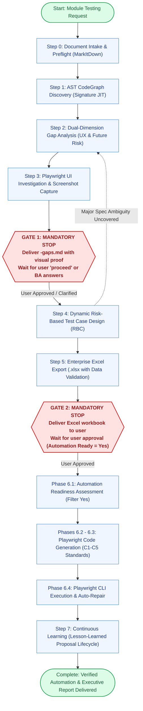

# QA Agent Testing System

<div align="center">


-16A34A?style=for-the-badge)


**Enterprise-Grade Autonomous QA Testing System**  
*Fully compatible with Google Antigravity, Cursor, Claude Code, GitHub Copilot & AI Coding Agents*

*"Transforming AI from an unpredictable guesser into a code-grounded QA Architect that speaks clear business language and operates under strict human control."*

</div>

---

## 📌 Table of Contents
- [1. Executive Overview](#1-executive-overview)
- [2. Quick Start (3 Minutes)](#2-quick-start-3-minutes)
- [3. Operational Lifecycle & Dual Human Gates](#3-operational-lifecycle--dual-human-gates)
- [4. Dynamic Risk-Based Coverage Matrix (Tier S, M, L)](#4-dynamic-risk-based-coverage-matrix-tier-s-m-l)
- [5. Business-Accessible Language Standards (Non-IT)](#5-business-accessible-language-standards-non-it)
- [6. Deep Dive: 11 Specialized Skills](#6-deep-dive-11-specialized-skills)
- [7. Performance & Ground-Truth Token Benchmarks](#7-performance--ground-truth-token-benchmarks)
- [8. Repository Structure & Core Scripts](#8-repository-structure--core-scripts)
- [9. Installation & Deployment](#9-installation--deployment)

---

## 1. Executive Overview

The QA Agent Testing System delivers an end-to-end, evidence-grounded software verification workflow designed to eliminate AI hallucination and corner-cutting across web test automation. It is anchored by five technical pillars:

1. **Deterministic AST Code Discovery (CodeGraph JIT AST):** Cycle-safe BFS graph traversal with configurable depth/node thresholds and transparent truncation reporting. Extracts interfaces, types, schemas, and method signatures to maximize code comprehension while minimizing context window load.
2. **Dual-Dimension Requirement Gap Analysis & UI Investigation (Playwright MCP):** Rigorously compares specifications against real implementation logic. Analyzes **UX degradation** and predicts **future technical liabilities** before driving live browser sessions to capture cryptographic visual proof (`screenshots/`).
3. **Enterprise Excel Test Suite Export:** Produces professional 13-column workbooks (`.xlsx`) styled with soft Pastel Pill badges, auto-filters, zebra striping, and data-validation dropdown lists.
4. **Bidirectional Requirement Traceability & $O(N)$ Deduplication:** Enforces 100% forward coverage on active requirements, 100% backward grounding against verified code symbols (zero ungrounded/hallucinated tests), and single-pass hash map deduplication.
5. **Self-Healing Atomic State Machine (FSM):** Zero-corruption atomic persistence (`.tmp` + `.bak` + `os.replace`), stale lock recovery with PID liveness verification (60s TTL), and automated secret scanning to prevent plaintext credential leaks.

---

## 2. Quick Start (3 Minutes)

### Step 1: Verify System Architecture & Environment
```powershell
python scripts/validate_system.py
# Expected output: [SUCCESS] All 9/9 architectural validations and dry-run tests PASSED!
```

### Step 2: Run Full Automated Regression Test Suite
```powershell
$env:PYTHONIOENCODING="utf-8"; pytest -s tests/
# Expected output: 94 passed in ~3.5s (100% PASS)
```

### Step 3: Trigger QA Workflow via AI Agent Prompt
> *"Please initiate the QA testing workflow for the Authentication & Access Control module."*

### Step 4: Review & Approve at the 2 Mandatory Human Gates
1. **Gate 1 (`WAITING_FOR_REQUIREMENT_CLARIFICATION`):** Review `<module>-gaps.md` (containing dual UX/Future Risk impact analysis and Playwright UI screenshot evidence) $\rightarrow$ Instruct the agent to *"proceed"* or provide clarification answers.
2. **Gate 2 (`WAITING_FOR_APPROVED_TESTCASES`):** Review `<module>-testcases.xlsx`, verify business coverage, and set `Automation Ready = Yes` for target cases $\rightarrow$ Instruct the agent to *"proceed with automation"*.

---

## 3. Operational Lifecycle & Dual Human Gates



> [!IMPORTANT]
> **Enforced Human-in-the-Loop Safeguards:**  
> • **Gate 1 (`WAITING_FOR_REQUIREMENT_CLARIFICATION`):** The AI agent is strictly prohibited from designing test cases until the user explicitly commands *"proceed"* or provides clarification answers.  
> • **Gate 2 (`WAITING_FOR_APPROVED_TESTCASES`):** The AI agent is strictly prohibited from generating automation test code until the user audits the exported Excel workbook and explicitly approves the target cases.  
> • **Legal State Rollback:** The state machine allows transitioning backward from `TESTCASE_GENERATION` to `GAP_ANALYSIS` if deep inconsistencies are discovered during scenario authoring.

---

## 4. Dynamic Risk-Based Coverage Matrix (Tier S, M, L)

Test suite volume dynamically scales based on architectural complexity and systemic risk ([`references/risk-based-coverage-matrix.md`](references/risk-based-coverage-matrix.md)):

| Module Complexity Tier | Functional Characteristics | Target Suite Size | Representative Module Types |
| :--- | :--- | :---: | :--- |
| **Tier S — Simple** | Static screens, single-step inputs, directory lookups | **5 – 8 cases** | Avatar upload, personal profile views, static FAQs |
| **Tier M — Standard** | Multi-step wizards, CRUD, RBAC access, form submissions | **10 – 18 cases** | Multi-step checkout, profile security, search & filter |
| **Tier L — Complex / Core** | Payment gateways, billing engines, hierarchical approvals | **18 – 30+ cases** | Payment processors, subscription billing, high-concurrency sync |

* **Severity (`Critical/Blocker`, `Major`, `Minor`):** Inherent damage if a defect occurs in production (*Critical* = crash, revenue loss, data corruption, auth bypass; *Major* = state miscalculation, broken validation; *Minor* = cosmetic shift, typo).
* **Execution Priority (`P0`, `P1`, `P2`):** Determined dynamically via $\text{Risk Score} = \text{Severity} \times \text{Likelihood}$.

---

## 5. Business-Accessible Language Standards (Non-IT)

All test cases, steps, and expected results must be instantly understandable by non-technical stakeholders (BAs, Manual QA, Product Owners, Business Users) without raw dev jargon ([`references/business-terminology-guide.md`](references/business-terminology-guide.md)):

| Avoid (Raw Dev Jargon) | Recommended Business Phrasing |
| :--- | :--- |
| *Throttling / Circuit breaker tripped* | **Rate-limit enforced: Repeated rapid submissions blocked** |
| *Silent drop / Unhandled rejection* | **Generic secure confirmation displayed without mutating state** |
| *UI returns 200 with error payload* | **Screen displays informative validation error banner** |
| *DB does not insert record into users* | **System records show no new account created** |
| *Direct RPC call via web_anon role* | **Unauthenticated guest accessing resource via direct link** |

---

## 6. Deep Dive: 11 Specialized Skills

| Skill | Core Operational Responsibility |
| :--- | :--- |
| [`module-intake`](skills/module-intake/SKILL.md) | Ingests specifications, converts documents (PDF/Office) via MarkItDown, and initializes state machine. |
| [`codegraph-context-discovery`](skills/codegraph-context-discovery/SKILL.md) | Reverse-engineers codebase AST via CodeGraph SQLite using 5-level progressive signature disclosure. |
| [`requirement-gap-analysis`](skills/requirement-gap-analysis/SKILL.md) | Audits code against specifications with dual UX/Future Risk impact analysis; compiles `<module>-gaps.md`. |
| [`playwright-investigation`](skills/playwright-investigation/SKILL.md) | Drives live Chromium sessions via Playwright MCP, captures visual screenshots $\rightarrow$ **Halts at Gate 1**. |
| [`testcase-design`](skills/testcase-design/SKILL.md) | Authors dynamic risk-based test cases with 100% bidirectional requirement traceability. |
| [`testcase-review-export`](skills/testcase-review-export/SKILL.md) | Executes internal QA review and exports formatted Excel workbook (`.xlsx`) $\rightarrow$ **Halts at Gate 2**. |
| [`automation-readiness`](skills/automation-readiness/SKILL.md) | Ingests user-approved Excel file, filters `Automation Ready = Yes`, enforces zero-tampering guard. |
| [`automation-implementation`](skills/automation-implementation/SKILL.md) | Generates robust Playwright scripts adhering to C1–C5 standards (POM, no arbitrary sleeps, dynamic data). |
| [`test-execution-debugging`](skills/test-execution-debugging/SKILL.md) | Executes Playwright CLI, diagnoses failures, executes up to 2 auto-repairs, publishes execution summary. |
| [`continuous-learning`](skills/continuous-learning/SKILL.md) | Extracts actionable lessons-learned proposals (`propose`, `approve`, `reject`) and evolves target skills. |
| [`workflow-orchestrator`](skills/workflow-orchestrator/SKILL.md) | Central FSM orchestrator coordinating state transitions, checkpoint safety, and resume commands. |

---

## 7. Performance & Ground-Truth Token Benchmarks

The system adheres to a core engineering tenet: **Optimize Context Consumption, NOT Discovery Coverage** (traversing entire codebases safely while streaming only relevant AST signatures into the LLM context).

### 1. Ground-Truth Token Telemetry Model
Unlike speculative theoretical calculations that inflate prompt token savings, [`scripts/token_benchmark.py`](scripts/token_benchmark.py) measures **physical data reduction** (actual characters and tokens loaded into LLM prompts):

```
┌────────────────────────────────────────────────────────────────────────┐
│                   PHYSICAL TOKEN REDUCTION ARCHITECTURE                │
├───────────────────────────────────┬────────────────────────────────────┤
│         ELIMINATED OVERHEAD       │          GROUND TRUTH REALITY      │
├───────────────────────────────────┼────────────────────────────────────┤
│ ❌ Monolithic whole-file reads    │ ✔️ CodeGraph JIT AST signatures    │
│    bloating context window.       │    deliver 79% – 93% token savings.│
│ ❌ Embedding raw Base64 images    │ ✔️ Local disk persistence saves    │
│    into multi-turn conversation.  │    1,600+ tokens per screenshot.   │
└───────────────────────────────────┴────────────────────────────────────┘
```

---

### 2. Empirical Benchmark Across Real-World Enterprise Codebases
Direct measurements executed via `python scripts/token_benchmark.py <repo_path> <module>`:

#### 📊 Token Reduction & Context Optimization Matrix

| Target Application | Module Analyzed | Source Size | Raw Full Files (Baseline) | CodeGraph JIT (Optimized) | Tokens Saved | Context Saving Rate | Net Multi-Turn Efficiency |
| :--- | :--- | :---: | :---: | :---: | :---: | :---: | :---: |
| **Enterprise SaaS Platform** (`src/time-tracking`) | **Attendance & Geofencing** | 54 files (4,088 LOC) | 74,093 tokens | 13,087 tokens | **61,006 tokens** | **82.3%** | **84.3% SAVED** |
| **Enterprise SaaS Platform** (`src/identity`) | **Authentication & MFA** | 12 files (792 LOC) | 10,748 tokens | 1,629 tokens | **9,119 tokens** | **84.8%** | **91.7% SAVED** |
| **Academic Portal System** (`src/submissions`) | **Paper Submission Flow** | 52 files (3,033 LOC) | 38,955 tokens | 8,100 tokens | **30,855 tokens** | **79.2%** | **83.2% SAVED** |
| **Academic Portal System** (`src/auth`) | **Account & Access Control** | 12 files (732 LOC) | 7,898 tokens | 1,525 tokens | **6,373 tokens** | **80.7%** | **91.0% SAVED** |
| **QA Agent System** (`qa-agent-system`) | **FSM State Engine** | 1 file (441 LOC) | 3,981 tokens | 261 tokens | **3,720 tokens** | **93.4%** | **97.7% SAVED** |

> [!TIP]
> **Engineering Value:** On complex enterprise modules, reducing token ingestion from **74,093 tokens down to 13,087 tokens** (>61,000 tokens saved) prevents *Lost in the Middle* attention degradation, eliminates context window limits, and sharply increases gap discovery precision.

---

### 3. Production Telemetry & Cost Tracking
Real-time tracking of Gemini `usage_metadata` via the benchmark utility:

* **Log a production API call:**
  ```powershell
  python scripts/token_benchmark.py record-telemetry --session-id "SESS-ENTERPRISE-01" --step "Attendance_Discovery" --prompt-tokens 74093 --output-tokens 13087 --model "gemini-1.5-pro"
  ```
* **Display telemetry report:**
  ```powershell
  python scripts/token_benchmark.py show-telemetry
  ```

---

## 8. Repository Structure & Core Scripts

```text
qa-agent-system/
├── AGENTS.md                      # Global orchestration guidelines and non-negotiable rules
├── plugin.json                    # Antigravity plugin manifest
├── skills/                        # 11 specialized agent skills (SKILL.md)
├── scripts/
│   ├── state_manager.py           # Atomic FSM (.tmp + .bak) with stale PID lock recovery
│   ├── codegraph_discovery.py     # AST discovery, 5-level progressive disclosure & bracket parsing
│   ├── codegraph_preflight.py     # Preflight environment check and binary directory exclusion
│   ├── export_testcases.py        # Enterprise Excel export with pastel styling & data validation
│   ├── read_approved_testcases.py # Parser for user-approved test cases with unique ID validation
│   ├── traceability_validator.py  # Bidirectional RTM validator and O(N) deduplication hash map
│   ├── learn_manager.py           # Continuous learning manager (propose, approve, reject, query)
│   ├── token_benchmark.py         # Ground-truth physical token benchmark & telemetry recorder
│   ├── verify_and_embed_images.py # Image integrity validator and markdown link embedder
│   ├── generate_template.py       # Standard blank Excel template generator
│   ├── lint_test_code.py          # Static AST linter enforcing C1-C5 automation standards
│   └── validate_system.py         # 9-phase architectural validation and dry-run test suite
├── tests/
│   ├── test_qa_skills_regression.py # Comprehensive regression tests for FSM, RTM, Excel, & rules
│   ├── test_codegraph_upgrades.py   # CodeGraph AST discovery and token benchmark tests
│   ├── test_adaptive_level4.py      # Multi-module state isolation and JIT body retrieval tests
│   └── test_golden_e2e_pipeline.py  # End-to-end pipeline simulation on golden fixture projects
├── templates/                     # Blank Excel workbook template (testcase-template.xlsx)
└── references/                    # Terminology guides, RBC matrices, severity guidelines
```

---

## 9. Installation & Deployment

### Prerequisites Installation (One-time setup):
```powershell
pip install -r requirements-dev.txt
npm install -g codegraph playwright
npx playwright install chromium
```

### Option 1: Direct Repository Embedding (Any Codebase):
```powershell
Copy-Item -Recurse ".\qa-agent-system" "C:\path_to_your_project\.agent"
```

### Option 2: Install as a Plugin in Google Antigravity:
```powershell
agy plugin install .\qa-agent-system
```

---

<div align="center">
  <b>QA Agent Testing System — Universal, Grounded Test Automation for Any Project</b>
</div>
