# QA Agent Testing System

<div align="center">


<br/>

**Hệ thống Trợ lý Kiểm thử Phần mềm Thông minh (Smart QA Testing System)**  
*Dành cho Google Antigravity, Cursor, Claude Code, GitHub Copilot & AI Coding Agents*

*"Biến AI từ người đoán mò thành Kiến trúc sư QA thấu hiểu mã nguồn, nói ngôn ngữ nghiệp vụ và luôn phục vụ dưới sự kiểm soát của con người."*

</div>

---

## Mục Lục
- [1. Giới Thiệu Dành Cho Người Mới Bắt Đầu](#1-giới-thiệu-dành-cho-người-mới-bắt-đầu)
- [2. Hướng Dẫn Bắt Đầu Nhanh Trong 3 Phút](#2-hướng-dẫn-bắt-đầu-nhanh-trong-3-phút)
- [3. Sơ Đồ Quy Trình Hoạt Động](#3-sơ-đồ-quy-trình-hoạt-động)
- [4. Hai Điểm Dừng Phê Duyệt Bắt Buộc (Human Gates)](#4-hai-điểm-dừng-phê-duyệt-bắt-buộc-human-gates)
- [5. Ma Trận Độ Phủ Rủi Ro Động (Tier S, M, L)](#5-ma-trận-độ-phủ-rủi-ro-động-tier-s-m-l)
- [6. Tiêu Chuẩn Ngôn Ngữ Dễ Hiểu Cho Người Non-IT](#6-tiêu-chuẩn-ngôn-ngữ-dễ-hiểu-cho-người-non-it)
- [7. Giải Thích 7 Bước Chi Tiết](#7-giải-thích-7-bước-chi-tiết)
- [8. Cơ Chế Quản Trị & Tiết Kiệm Token](#8-cơ-chế-quản-trị--tiết-kiệm-token)
- [9. Cấu Trúc Thư Mục & 11 Kỹ Năng Độc Lập](#9-cấu-trúc-thư-mục--11-kỹ-năng-độc-lập)
- [10. Bảng Giải Thích Thuật Ngữ Cho Người Mới](#10-bảng-giải-thích-thuật-ngữ-cho-người-mới)
- [11. Hướng Dẫn Cài Đặt Công Cụ & Nhúng Vào Dự Án](#11-hướng-dẫn-cài-đặt-công-cụ--nhúng-vào-dự-án)

---

## 1. Giới Thiệu Dành Cho Người Mới Bắt Đầu

### Hệ thống này là gì?
Nếu bạn là sinh viên thực tập, Tester mới vào nghề (Fresher/Junior), BA, hay Product Owner, bạn có thể hiểu đơn giản:  
**Đây là một Trợ lý QA AI thông minh hỗ trợ bạn từ A đến Z trong công việc kiểm thử phần mềm.**

Thay vì bạn phải ngồi hàng ngày để đọc code, nghĩ kịch bản test case, gõ từng dòng vào file Excel rồi tự viết code tự động hóa Playwright, hệ thống này giúp bạn:
1. **Đọc hiểu cấu trúc mã nguồn thực tế:** Tự động quét code dự án để biết màn hình có những nút nào, API nào và cơ sở dữ liệu lưu ra sao (không đoán mò).
2. **Tìm kẽ hở nghiệp vụ:** Chỉ ra những điểm tài liệu viết chưa rõ hoặc code chạy khác với tài liệu, xuất ra file báo cáo `.md` rõ ràng cho bạn xem.
3. **Thiết kế bảng Test Case bằng Excel cực đẹp:** Xuất ra file `.xlsx` chuyên nghiệp với đầy đủ màu sắc, bộ lọc, danh sách chọn (dropdown) và các bước làm theo rất dễ hiểu.
4. **Viết code kiểm thử tự động (Automation Test):** Tự động viết kịch bản Playwright và chạy thử trên trình duyệt thật, tự sửa lỗi nếu script bị trục trặc.

### Sự khác biệt so với việc chat thông thường với ChatGPT / Claude:
* **Không đoán mò (No Hallucination):** Chat AI thông thường không thấy được toàn bộ code nên hay tự bịa ra kịch bản test không có thật. Hệ thống này quét trực tiếp từ cây cú pháp mã nguồn (AST) nên 100% test case đều có căn cứ từ code thật.
* **Con người luôn nắm quyền kiểm soát (Human-in-the-Loop):** AI không bao giờ tự ý làm bừa. Nó bắt buộc phải dừng lại ở 2 trạm kiểm soát để xin phép bạn duyệt trước khi đi tiếp.
* **Ngôn ngữ dễ hiểu:** Không dùng từ ngữ kỹ thuật đánh đố người dùng. Bất kỳ ai đọc vào cũng có thể tự thao tác làm theo được trên màn hình.

---

## 2. Hướng Dẫn Bắt Đầu Nhanh Trong 3 Phút

### Bước 1: Kiểm tra tính sẵn sàng của hệ thống
Mở cửa sổ dòng lệnh (Terminal / PowerShell) tại thư mục dự án và chạy:
```powershell
python scripts/validate_system.py --compact
```
Khi thấy dòng chữ `[SUCCESS] 9/9 Architectural Validations PASSED!` xuất hiện, hệ thống đã sẵn sàng 100%.

### Bước 2: Ra lệnh cho AI bắt đầu làm việc
Trong khung chat với AI (Antigravity, Cursor, hoặc Claude Code), bạn chỉ cần gõ một câu lệnh tự nhiên:
> *"Hãy tiến hành quy trình QA kiểm thử cho phân hệ Đăng Nhập (Login)."*

### Bước 3: Xem kết quả và duyệt 2 lần
* **Lần duyệt 1 (Tại Điểm dừng 1):** AI sẽ gửi cho bạn một file báo cáo kẽ hở nghiệp vụ `requirement-gaps.md`. Bạn chỉ cần đọc lướt qua và trả lời câu hỏi nghiệp vụ, hoặc bảo AI tự mở trình duyệt lên kiểm tra thực tế.
* **Lần duyệt 2 (Tại Điểm dừng 2):** AI tạo ra file Excel `<module>-testcases.xlsx`. Bạn mở file lên xem, thấy kịch bản nào cần chạy tự động hoá thì đánh dấu `Yes`. Sau đó bảo AI: *"Tôi đã duyệt file, hãy viết code automation"*.
* **Hoàn tất:** AI tự viết code và chạy test tự động trên trình duyệt thật cho bạn.

---

## 3. Sơ Đồ Quy Trình Hoạt Động

Dưới đây là bức tranh toàn cảnh về cách AI phối hợp cùng bạn qua từng giai đoạn:

```mermaid
flowchart TD
    Start(["Bắt đầu: Bạn yêu cầu kiểm thử 1 phân hệ"]) --> Step0["Bước 0: Tiền xử lý tài liệu\n(Chuyển PDF / Excel / Word thành Markdown)"]
    Step0 --> Step1["Bước 1: Khám phá mã nguồn\n(Quét cây cú pháp AST để vẽ bản đồ luồng chạy)"]
    Step1 --> Step2["Bước 2: Tìm kẽ hở nghiệp vụ\n(Soát lỗi logic giữa tài liệu và code thực tế)"]
    Step2 --> Step3["Bước 3: Xác minh giao diện bằng Playwright MCP\n(Thao tác tái hiện & Chụp ảnh màn hình minh chứng)"]
    
    Step3 --> Gate1{"ĐIỂM DỪNG 1 (BẮT BUỘC)\nAI xuất phiếu BA kèm ảnh minh chứng\nvà DỪNG LẠI chờ bạn bảo 'tiếp tục'"}
    
    Gate1 -- "Bạn bảo 'tiếp tục' hoặc đưa lời giải BA" --> Step4["Bước 4: Thiết kế Test Case theo rủi ro (RBC Matrix)\n(Ngôn ngữ dễ hiểu, ai cũng làm theo được)"]
    
    Step4 --> Step5["Bước 5: Xuất bản file Excel doanh nghiệp\n(<module>-testcases.xlsx chuẩn 13 cột)"]
    
    Step5 --> Gate2{"ĐIỂM DỪNG 2 (BẮT BUỘC)\nAI trao file Excel cho bạn\nvà dừng lại chờ bạn xem & duyệt"}
    
    Gate2 -- "Bạn xác nhận đã duyệt file" --> Step61["Pha 6.1: Lọc các ca Automation Ready = Yes"]
    Step61 --> Step62["Pha 6.2: Viết mã Playwright tự động hoá tối giản"]
    Step62 --> Step64["Pha 6.4: Chạy test thật trên CLI & tự sửa lỗi nếu có"]
    
    Step64 --> Step7["Bước 7: Đúc kết kinh nghiệm dự án\n(Tự học hỏi để không tái phạm lỗi cũ)"]
    Step7 --> EndNode(["Hoàn tất: Bàn giao báo cáo kiểm thử hoàn chỉnh"])

    classDef humanStop fill:#FEE2E2,stroke:#DC2626,stroke-width:2px,color:#991B1B,font-weight:bold;
    classDef aiStep fill:#EFF6FF,stroke:#3B82F6,stroke-width:1.5px,color:#1E3A8A;
    classDef successNode fill:#DCFCE7,stroke:#16A34A,stroke-width:1.5px,color:#166534;

    class Gate1,Gate2 humanStop;
    class Step0,Step1,Step2,Step3,Step4,Step5,Step61,Step62,Step64,Step7 aiStep;
    class Start,EndNode successNode;
```



---

## 4. Hai Điểm Dừng Phê Duyệt Bắt Buộc (Human Gates)

> [!IMPORTANT]
> Đây là 2 "chốt chặn thép" bảo đảm AI luôn là người trợ lý phục vụ bạn, không bao giờ tự ý đưa ra quyết định thay con người.

```text
┌────────────────────────────────────────────────────────────────────────┐
│ ĐIỂM DỪNG 1: WAITING_FOR_REQUIREMENT_CLARIFICATION                     │
│ AI xuất phiếu BA requirement-gaps.md ĐÃ KÈM ẢNH CHỤP MINH CHỨNG thực tế│
│ từ Playwright MCP, gửi link mở file và DỪNG LẠI HOÀN TOÀN.             │
│ AI TUYỆT ĐỐI KHÔNG TỰ CHẠY TIẾP. Hệ thống chỉ tiếp tục khi:            │
│   • Bạn nhắn: "tiếp tục" (proceed), HOẶC                               │
│   • Bạn cung cấp câu trả lời giải đáp từ BA/PO                         │
└────────────────────────────────────────────────────────────────────────┘

┌────────────────────────────────────────────────────────────────────────┐
│ ĐIỂM DỪNG 2: WAITING_FOR_APPROVED_TESTCASES                            │
│ AI tạo file Excel <module>-testcases.xlsx và DỪNG LẠI bàn giao cho bạn.│
│ Bạn mở file lên xem, chỉnh sửa nếu cần, đánh dấu Automation Ready = Yes.│
│ AI TUYỆT ĐỐI BỊ CẤM viết code tự động hoá khi bạn chưa xác nhận duyệt! │
└────────────────────────────────────────────────────────────────────────┘
```

---

## 5. Ma Trận Độ Phủ Rủi Ro Động (Tier S, M, L)

Hệ thống **không áp dụng số lượng test case cố định một cách máy móc** (tránh tình trạng một màn hình đơn giản mà bắt tạo hàng chục test case vô nghĩa, hoặc một chức năng thanh toán phức tạp lại làm quá sơ sài).

Số lượng test case co giãn linh hoạt dựa trên độ phức tạp và mức độ rủi ro theo [`references/risk-based-coverage-matrix.md`](references/risk-based-coverage-matrix.md):

| Quy Mô Phân Hệ (Tier) | Đặc Điểm Nghiệp Vụ Thực Tế | Số Lượng Test Case Hợp Lý | Ví Dụ Điển Hình |
| :--- | :--- | :---: | :--- |
| **Tier S — Đơn Giản** | Màn hình tĩnh, form nhập 1 bước, tra cứu danh mục, đổi mật khẩu cơ bản. | **5 – 8 Test Cases** | Đổi avatar, xem thông tin phòng ban, cập nhật ghi chú. |
| **Tier M — Tiêu Chuẩn** | Đăng nhập/Đăng ký, gửi đơn từ nghỉ phép, xếp ca làm việc, đặt phòng họp. | **10 – 18 Test Cases** | Đăng nhập đa kênh, duyệt đơn chấm công, phân quyền vai trò. |
| **Tier L — Phức Tạp / Trọng Yếu** | Cổng thanh toán, tính lương thưởng & thuế, luồng duyệt đa cấp, bảo mật cao. | **18 – 30+ Test Cases** | Thanh toán trực tuyến, chốt bảng lương cuối tháng, phân quyền bảo mật. |

### Phân định rạch ròi giữa Mức Độ Nghiêm Trọng (Severity) và Độ Ưu Tiên (Priority)
* **Severity (`Chặn`, `Sai`, `Nhỏ`):** Phản ánh hậu quả khi lỗi xảy ra (`Chặn`: sập web, mất tiền, mất dữ liệu; `Sai`: sai số liệu tính toán, sai trạng thái; `Nhỏ`: lệch pixel, lỗi chính tả). Đây là thước đo kỹ thuật, **không phải chỉ tiêu đếm số lượng**.
* **Risk Priority (P0, P1, P2):** Phản ánh thứ tự ưu tiên kiểm thử:
  $$\text{Điểm Rủi Ro} = \text{Mức Độ Tác Động (1–3)} \times \text{Xác Suất Gặp Lỗi (1–3)}$$
  - **P0:** Kịch bản luồng chính (Happy Path) và các lỗi bảo mật sống còn.
  - **P1:** Kịch bản giá trị biên, ràng buộc dữ liệu phức tạp.
  - **P2:** Kịch bản phụ, lỗi hiển thị nhỏ.

---

## 6. Tiêu Chuẩn Ngôn Ngữ Dễ Hiểu Cho Người Non-IT

> [!TIP]
> Tất cả câu chữ trong file Test Case đều tuân thủ Cẩm nang: [`references/business-terminology-guide.md`](references/business-terminology-guide.md).  
> **Nguyên tắc vàng:** Bất kỳ ai (dù không biết gì về lập trình) đọc vào cũng hiểu ngay mục đích và tự tay thao tác làm theo được trên màn hình.

### Bảng tra cứu từ ngữ: Nói KHÔNG với từ dịch máy thô thiển và tiếng lóng Dev

| Từ ngữ cũ gây khó hiểu | Chuẩn nghiệp vụ mới (Ai cũng hiểu được) |
| :--- | :--- |
| *Phanh chống ngập / Throttling* | **Giới hạn số lần gửi yêu cầu / Chặn spam liên tục** |
| *Chặn âm thầm (Silent drop)* | **Báo thành công chung để bảo mật, nhưng không tạo yêu cầu mới** |
| *UI trả về thông báo...* | **Màn hình hiển thị thông báo... / Giao diện xuất hiện...** |
| *DB không chèn dòng mới* | **Hệ thống dữ liệu không phát sinh bản ghi mới** |
| *Dùng vai trò web_anon gọi RPC* | **Người dùng chưa đăng nhập thực hiện thao tác qua đường dẫn** |
| *Lỗi insufficient_privilege* | **Hệ thống từ chối và báo lỗi không có quyền truy cập** |

### Minh họa một ca test chuẩn mực:
* **Tên Test Case:** Kiểm tra giới hạn số lần yêu cầu: Chặn gửi thêm khi tài khoản gửi quá 3 lần trong 24 giờ.
* **Các bước thực hiện:**
  1. Mở màn hình Quên Mật Khẩu.
  2. Nhập Mã nhân viên `NV-102` vào ô nhập liệu.
  3. Bấm nút "Gửi Yêu Cầu" (đây là lần gửi thứ 4).
  4. Quan sát thông báo hiển thị trên màn hình.
* **Kết quả kỳ vọng:**
  - *Trên màn hình:* Xuất hiện thông báo thành công chung nhằm bảo vệ an toàn thông tin, không để lộ việc tài khoản đã bị chặn.
  - *Trong hệ thống dữ liệu:* Không tạo thêm yêu cầu xử lý mới do đã vượt quá 3 lần trong ngày.

---

## 7. Giải Thích 7 Bước Chi Tiết

### BƯỚC 0 — Tiếp Nhận & Chuẩn Hóa Tài Liệu (`module-intake`)
* **Nhiệm vụ:** Tiếp nhận tài liệu spec từ bạn. Nếu tài liệu là file PDF, Excel hoặc Word, hệ thống tự động dùng **Microsoft MarkItDown** chuyển thành file `.md` sạch sẽ để giữ nguyên bảng biểu và tiết kiệm bộ nhớ.
* **Chủ động thu thập thông tin Staging & Admin:** Nếu chưa có sẵn trong cấu hình dự án, AI chủ động hỏi bạn URL môi trường Staging, email người dùng test, và tài khoản/mật khẩu trang Quản trị (Admin) để chuẩn bị sẵn sàng cho bước kiểm chứng giao diện Playwright MCP.

### BƯỚC 1 — Khám Phá Cấu Trúc Mã Nguồn (`codegraph-context-discovery`)
* **Nhiệm vụ:** Dùng **CodeGraph** (SQLite Knowledge Graph) quét cây cú pháp tĩnh (AST) để vẽ bản đồ liên kết không giới hạn độ sâu giữa giao diện, dịch vụ xử lý, logic phân quyền và cơ sở dữ liệu.
* **Nguyên tắc cốt lõi:** **Tối ưu tiêu thụ ngữ cảnh, KHÔNG thu hẹp phạm vi khám phá (Optimize Context Consumption, NOT Discovery Coverage).** CodeGraph được tự do khám phá 100% dependency liên quan, bao gồm cả phụ thuộc gián tiếp và xuyên module. LLM chỉ nạp theo nhu cầu (Signature-first JIT) để tiết kiệm hơn 80% token đọc code mà không bao giờ bỏ sót góc khuất nghiệp vụ.

### BƯỚC 2 — Phát Hiện Kẽ Hở Nghiệp Vụ (`requirement-gap-analysis`)
* **Nhiệm vụ:** Đối soát giữa tài liệu đặc tả và mã nguồn thực tế. Phân loại 5 nhóm bất cập (mơ hồ yêu cầu, nghi ngờ lỗi code, thiếu spec, giới hạn môi trường, lỗi xác định).

### BƯỚC 3 — Xác Minh Giao Diện Thực Tế & Chụp Ảnh Minh Chứng (`playwright-investigation`)
* **Nhiệm vụ:** Đối với các điểm bất cập, AI dùng **Playwright MCP** tự động mở trình duyệt thật để kiểm chứng xem trên giao diện có xảy ra hiện tượng đó hay không.
* **Minh chứng trực quan:** Chụp ảnh màn hình thực tế lưu vết (`screenshots/GAP-xxx-evidence.png`), ghi lại từng bước thao tác tái hiện chi tiết (1. Mở... 2. Nhập... 3. Quan sát...).
* **Bàn giao phiếu BA:** Đính kèm trực tiếp ảnh chụp và các bước tái hiện vào phiếu `requirement-gaps.md` để bạn và BA/PO dễ dàng đối chiếu, rồi dừng lại tại **Điểm dừng 1**.
* **Nguyên tắc tiếp tục:** AI **DỪNG LẠI HOÀN TOÀN** và chỉ được tiếp tục sang Bước 4 khi bạn nhắn **"tiếp tục"** (hoặc gửi câu trả lời đã chốt từ BA/PO).

### BƯỚC 4 — Thiết Kế Test Case Theo Rủi Ro (`testcase-design`)
* **Nhiệm vụ:** Áp dụng Ma trận Rủi ro (Tier S/M/L) và Cẩm nang ngôn ngữ dễ hiểu để thiết kế bộ test case hoàn chỉnh gồm 13 cột thông tin.
* **Truy vết 2 chiều (Bidirectional RTM):** Đảm bảo 100% yêu cầu quan trọng đều có test case, 100% test case đều có căn cứ từ code thật (0% test ảo), và triệt tiêu các ca trùng lặp.

### BƯỚC 5 — Xuất File Excel Doanh Nghiệp (`testcase-review-export`)
* **Nhiệm vụ:** Dùng thư viện `openpyxl` tạo ra file `<module>-testcases.xlsx` với font chữ Segoe UI, bảng màu Corporate Navy, đóng băng dòng, tự động co giãn dòng theo nội dung, thu phóng mở 85% và danh sách chọn dropdown.
* **Bàn giao:** Giao file Excel cho bạn và dừng lại tại **Điểm dừng 2**.

### BƯỚC 6 — Hiện Thực Hóa & Chạy Tự Động Hóa (`automation-implementation` & `debugging`)
* **Pha 6.1:** Đọc file Excel bạn đã duyệt, chỉ lọc các dòng có `Automation Ready = Yes`.
* **Pha 6.2 - 6.3:** Viết mã Playwright theo phong cách **Ponytail** (tối giản, tận dụng Page Objects có sẵn, không sleep cứng, chạy cực nhanh).
* **Pha 6.4:** Chạy test thật qua giao diện dòng lệnh (`npx playwright test`), tự động phân tích vết lỗi (Trace) và tự sửa script tối đa 2 lần nếu gặp trục trặc.

### BƯỚC 7 — Tự Học Hỏi & Tích Lũy Kinh Nghiệm (`continuous-learning`)
* **Nhiệm vụ:** Khi gặp một lỗi lặp lại $\ge 2$ lần trong dự án, AI tự động đúc kết thành bài học kinh nghiệm. Khi bạn bấm duyệt, AI tự ghi bài học vào file kỹ năng để các lần sau không bao giờ phạm lại lỗi đó nữa.

---

## 8. Cơ Chế Quản Trị & Tiết Kiệm Token

Hệ thống tuân thủ nghiêm ngặt tôn chỉ: **Optimize Context Consumption, NOT Discovery Coverage (Tối ưu tiêu thụ ngữ cảnh, KHÔNG thu hẹp phạm vi khám phá)**. Việc tiết kiệm token tuyệt đối không đánh đổi độ sâu kiểm thử hay bỏ sót rủi ro tiềm ẩn.

```text
┌────────────────────────────────────────────────────────────────────────┐
│ 4 TẤM KHIÊN BẢO VỆ TOKEN THÔNG MINH                                    │
├───────────────────────────────┬────────────────────────────────────────┤
│ 1. Tách biệt Khám phá & Nạp   │ CodeGraph khám phá toàn bộ dependency  │
│    (Decoupled Discovery)      │ không giới hạn depth/node; LLM chỉ     │
│                               │ truy xuất on-demand các subgraph cần.  │
├───────────────────────────────┼────────────────────────────────────────┤
│ 2. Signature-First & Cache    │ Đọc Interface/Type/Schema trước;       │
│                               │ cache theo commit hash để không quét lại│
├───────────────────────────────┼────────────────────────────────────────┤
│ 3. Cờ xuất ra đĩa cứng (-o)   │ Lưu toàn bộ dữ liệu chi tiết vào file  │
│                               │ thay vì xả hàng ngàn dòng ra đoạn chat │
├───────────────────────────────┼────────────────────────────────────────┤
│ 4. Lấy theo từng ID (--id)    │ Khi viết code cho 1 ca test, chỉ nạp   │
│                               │ đúng ca đó (~100 tokens) thay vì cả file│
└───────────────────────────────┴────────────────────────────────────────┘
```

### 8.1. Công Cụ Đo Lường Viễn Trắc Token Chính Xác (Token Telemetry Benchmark)

Hệ thống tích hợp công cụ đo lường định lượng `scripts/token_benchmark.py` sử dụng bộ tokenizer chuẩn `tiktoken` (`cl100k_base`) để đối chứng chính xác lượng token tiêu thụ trước và sau tối ưu.

**Cú pháp kiểm tra định lượng:**
```powershell
python scripts/token_benchmark.py "<đường_dẫn_repo>" "<tên_phân_hệ>"
```

**Kết quả đối chứng thực tế trên dự án VivaOffice:**
* **Cắt giảm System Prompt:** Giảm từ 84,233 tokens xuống 20,995 tokens (**Giảm 75.1%** trên mỗi lượt trao đổi).
* **Cắt giảm Đọc mã nguồn:** Giảm từ 78,151 tokens xuống 14,067 tokens (**Giảm 82.0%** nhờ CodeGraph SQLite JIT).
* **Cắt giảm Ảnh minh chứng UI:** Giảm từ 9,600 tokens xuống 54 tokens (**Giảm 99.4%** nhờ lưu ảnh ra file `.png` thay vì nạp Base64 thô vào context).
* **Tổng hiệu suất tiết kiệm ròng:** Tiết kiệm trung bình **75.4% – 76.0%** tổng lượng token trong một phiên làm việc 10 lượt trao đổi. Toàn bộ dữ liệu được tự động ghi lại tại `telemetry/token-benchmark-<timestamp>.json`.

---

## 9. Cấu Trúc Thư Mục & 11 Kỹ Năng Độc Lập

```text
qa-agent-system/
├── AGENTS.md                                # Cẩm nang chỉ dẫn điều phối toàn cục cho AI
├── plugin.json                              # Tệp manifest đóng gói plugin cho Google Antigravity
├── README.md                                # Cẩm nang vận hành chi tiết này
├── skills/                                  # 11 Kỹ năng chuyên biệt hóa (Modular Skills)
│   ├── module-intake/SKILL.md               # [BƯỚC 0] Tiếp nhận, chuẩn hóa tài liệu bằng MarkItDown
│   ├── codegraph-context-discovery/SKILL.md # [BƯỚC 1] Khám phá AST và lập bản đồ luồng chạy bằng CodeGraph SQLite
│   ├── requirement-gap-analysis/SKILL.md    # [BƯỚC 2] Tìm kẽ hở & xuất requirement-gaps.md -> ĐIỂM DỪNG 1
│   ├── playwright-investigation/SKILL.md    # [BƯỚC 3] Thám thính runtime bằng Playwright MCP
│   ├── testcase-design/SKILL.md             # [BƯỚC 4] Thiết kế Test Case theo Ma trận Rủi ro (Tier S/M/L)
│   ├── testcase-review-export/SKILL.md      # [BƯỚC 5] Tự soát chất lượng & xuất file Excel -> ĐIỂM DỪNG 2
│   ├── automation-readiness/SKILL.md        # [PHA 6.1] Bóc tách các ca Automation Ready = Yes
│   ├── automation-implementation/SKILL.md   # [PHA 6.2-6.3] Tái sử dụng POM, viết test Playwright
│   ├── test-execution-debugging/SKILL.md    # [PHA 6.4] Chạy Playwright CLI & tự động sửa lỗi kịch bản
│   ├── continuous-learning/SKILL.md         # [BƯỚC 7] Đúc kết bài học dự án & tự cập nhật vào Skill
│   └── workflow-orchestrator/SKILL.md       # Cỗ máy trạng thái điều phối trung tâm
├── templates/
│   └── testcase-template.xlsx               # File Excel mẫu chuẩn doanh nghiệp cao cấp
├── scripts/
│   ├── state_manager.py                     # Quản lý vòng đời trạng thái (.qa-state.json)
│   ├── learn_manager.py                     # Quản lý đề xuất và nạp bài học vào Skill
│   ├── generate_template.py                 # Tạo/cập nhật file Excel mẫu với badge pastel
│   ├── export_testcases.py                  # Xuất bộ test case ra file .xlsx hoàn chỉnh
│   ├── traceability_validator.py            # Kiểm soát truy vết yêu cầu 2 chiều & chống trùng lặp
│   ├── read_approved_testcases.py           # Đọc và phân tích file Excel người dùng duyệt
│   ├── token_benchmark.py                   # Đo lường định lượng token chính xác bằng tiktoken (cl100k_base)
│   └── validate_system.py                   # Bộ kiểm thử xác thực toàn diện (9 bài test)
├── telemetry/                               # Nhật ký viễn trắc đo lường token tự động (JSON)
└── references/
    ├── severity-guidelines.md               # Hướng dẫn phân loại mức độ nghiêm trọng (Chặn / Sai / Nhỏ)
    ├── business-terminology-guide.md        # Cẩm nang chuẩn hoá ngôn ngữ nghiệp vụ dễ hiểu cho Non-IT
    ├── risk-based-coverage-matrix.md        # Ma trận độ phủ theo rủi ro động (Tier S / M / L)
    ├── requirement-gaps-template.md         # Mẫu xuất báo cáo điểm bất cập (.md) tại Checkpoint 1
    ├── testcase-quality-checklist.md        # 10 Trụ cột đánh giá chất lượng test case nội bộ
    ├── project-learnings.json               # Kho lưu trữ các bài học kinh nghiệm đã được duyệt
    └── workflow-state-schema.json           # JSON Schema kiểm soát tính toàn vẹn của state
```

---

## 10. Bảng Giải Thích Thuật Ngữ Cho Người Mới

Nếu bạn mới bước chân vào ngành kiểm thử, bảng tra cứu này sẽ giúp bạn hiểu ngay mọi thuật ngữ trong dự án:

| Thuật ngữ | Ý nghĩa dân dã, dễ hiểu |
| :--- | :--- |
| **AST (Abstract Syntax Tree)** | Cây cấu trúc mã nguồn. Giống như chụp X-quang một ngôi nhà để thấy rõ đường điện, đường nước ngầm bên trong tường mà không cần đập tường ra xem. |
| **Happy Path** | Kịch bản suôn sẻ nhất. Người dùng nhập đúng mọi thông tin và hệ thống hoạt động thành công ngay từ lần đầu tiên. |
| **POM (Page Object Model)** | Cách lập trình gom các nút bấm và ô nhập liệu của một màn hình vào chung một nơi để sau này nếu giao diện đổi vị trí nút, bạn chỉ cần sửa ở đúng 1 chỗ. |
| **Flaky Test** | Kịch bản kiểm thử chập chờn: lúc thì chạy đạt, lúc lại báo lỗi mà không rõ nguyên nhân (thường do mạng lag hoặc code test bị ép chờ cứng). |
| **RTM (Traceability Matrix)** | Bảng đối soát truy vết 2 chiều: đảm bảo mọi yêu cầu trong tài liệu đều có kịch bản test, và mọi kịch bản test đều có căn cứ từ code thật, không có test ảo. |
| **Human Gate / Checkpoint** | Điểm dừng bắt buộc. AI phải dừng lại để xin ý kiến con người phê duyệt mới được tiếp tục, không bao giờ được tự tung tự tác. |
| **Token** | Đơn vị tính dung lượng từ ngữ mà AI xử lý (khoảng 0.75 từ tiếng Anh hoặc 1 từ tiếng Việt). Tiết kiệm token giúp AI chạy nhanh hơn và tốn ít chi phí hơn. |

---

## 11. Hướng Dẫn Cài Đặt Công Cụ & Nhúng Vào Dự Án

### 11.1. Cài đặt các công cụ phụ trợ (Chỉ cần làm 1 lần)

```powershell
# 1. Cài đặt thư viện xử lý Excel và tài liệu:
pip install openpyxl markitdown "markitdown[all]"

# 2. Cài đặt CodeGraph (công cụ phân tích cấu trúc mã nguồn qua SQLite Knowledge Graph):
npm install -g codegraph
# Kiểm tra phiên bản hoạt động:
codegraph --version

# Cài đặt thư viện đo lường token chính xác:
pip install tiktoken

# 3. Cài đặt Playwright (công cụ tự động hoá trình duyệt):
npm install -g playwright
npx playwright install
```

### 11.2. Nhúng hệ thống kỹ năng vào dự án phần mềm của bạn
Hệ thống hoàn toàn độc lập và không phụ thuộc vào đường dẫn cố định. Bạn chỉ cần sao chép thư mục hệ thống vào dự án:

```powershell
# Sao chép thư mục hệ thống kỹ năng vào dự án của bạn:
Copy-Item -Recurse ".\qa-agent-system" "C:\du_an_cua_ban\.agent"
```

### 11.3. Cài đặt như một Plugin trong Google Antigravity
```powershell
# Cài đặt trực tiếp:
agy plugin install .\qa-agent-system
```

---

<div align="center">
  <b>QA Agent Testing System — Xây dựng theo tiêu chuẩn công nghiệp cho Kỹ sư QA & Tester hiện đại</b>
</div>
