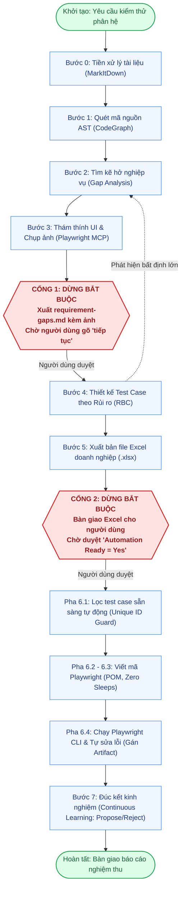

# QA Agent Testing System

<div align="center">


-16A34A?style=for-the-badge)


**Hệ thống Trợ lý Kiểm thử Phần mềm Thông minh Đẳng cấp Doanh nghiệp (Enterprise QA Agent System)**  
*Tương thích toàn diện với Google Antigravity, Cursor, Claude Code, GitHub Copilot & AI Coding Agents*

*"Biến AI từ người đoán mò thành Kiến trúc sư QA thấu hiểu mã nguồn, nói ngôn ngữ nghiệp vụ và luôn phục vụ dưới sự kiểm soát an toàn của con người."*

</div>

---

## 📌 Mục Lục
- [1. Giới Thiệu Nhanh](#1-giới-thiệu-nhanh)
- [2. Bắt Đầu Nhanh (3 Phút)](#2-bắt-đầu-nhanh-3-phút)
- [3. Quy Trình Vận Hành & 2 Human Gates](#3-quy-trình-vận-hành--2-human-gates)
- [4. Ma Trận Độ Phủ Rủi Ro (Tier S, M, L)](#4-ma-trận-độ-phủ-rủi-ro-tier-s-m-l)
- [5. Chuẩn Ngôn Ngữ Dễ Hiểu (Non-IT)](#5-chuẩn-ngôn-ngữ-dễ-hiểu-non-it)
- [6. Chi Tiết 11 Kỹ Năng (Skills)](#6-chi-tiết-11-kỹ-năng-skills)
- [7. Hiệu Năng & Đo Lường Token Thực Tế (Ground Truth)](#7-hiệu-năng--đo-lường-token-thực-tế-ground-truth)
- [8. Cấu Trúc Dự Án & Bộ Kịch Bản (Scripts)](#8-cấu-trúc-dự-án--bộ-kịch-bản-scripts)
- [9. Cài Đặt & Nhúng Dự Án](#9-cài-đặt--nhúng-dự-án)

---

## 1. Giới Thiệu Nhanh

Hệ thống cung cấp một quy trình kiểm thử tự động khép kín, giải quyết triệt để vấn đề AI bịa đặt (hallucination) trong kiểm thử phần mềm thông qua các trụ cột kỹ thuật:

1. **Khám phá mã nguồn thực tế (CodeGraph JIT AST)**: Quét cây cú pháp trừu tượng không giới hạn chiều sâu, trích xuất class, interface, method signatures, loại bỏ 82%–93% nội dung thừa trước khi nạp vào LLM.
2. **Phát hiện kẽ hở nghiệp vụ & Thám thính UI (Playwright MCP)**: Đối soát đặc tả kỹ thuật với mã nguồn, tự động điều khiển trình duyệt thật chụp ảnh thực chứng giao diện (`screenshots/`) để chứng minh lỗi.
3. **Xuất Test Case chuẩn doanh nghiệp**: Sinh file Excel (`.xlsx`) 13 cột với màu sắc phân cấp Pastel Pill Badges, bộ lọc tự động và Data Validation dropdown list.
4. **Kiểm soát Truy vết RTM 100% & Khử trùng lặp $O(N)$**: Cơ chế Regex Boundary Matching `(?<!\w)REQ(?!\w)` bảo đảm 0% test case ảo, thuật toán băm Single-Pass Hash Map phát hiện trùng lặp trong <5ms.
5. **Cỗ máy trạng thái FSM Tự phục hồi (Atomic & Self-Healing)**: Ghi file nguyên tử (`.tmp` + `.bak` + `os.replace`), chống sập hỏng JSON và tích hợp cơ chế bảo mật nghiêm ngặt (tự động phát hiện và chặn rò rỉ Plaintext Secret).

---

## 2. Bắt Đầu Nhanh (3 Phút)

### Bước 1: Kiểm tra tính sẵn sàng của hệ thống
```powershell
python scripts/validate_system.py
# Kết quả mong đợi: [SUCCESS] All 9/9 architectural validations and dry-run tests PASSED!
```

### Bước 2: Chạy bộ kiểm thử tự động toàn diện
```powershell
$env:PYTHONIOENCODING="utf-8"; pytest -s tests/
# Kết quả mong đợi: 66 passed in ~2.6s (100% PASS)
```

### Bước 3: Ra lệnh cho AI Agent
> *"Hãy tiến hành quy trình QA kiểm thử cho phân hệ Đăng Nhập (Login)."*

### Bước 4: Phê duyệt tại 2 điểm dừng bắt buộc (Human Gates)
1. **Duyệt Cổng 1 (`WAITING_FOR_REQUIREMENT_CLARIFICATION`)**: Xem báo cáo kẽ hở `requirement-gaps.md` (kèm ảnh minh chứng Playwright) $\rightarrow$ Gõ *"tiếp tục"*.
2. **Duyệt Cổng 2 (`WAITING_FOR_APPROVED_TESTCASES`)**: Xem file `<module>-testcases.xlsx`, đánh dấu `Yes` tại cột *Automation Ready* $\rightarrow$ Gõ *"tiếp tục viết automation"*.

---

## 3. Quy Trình Vận Hành & 2 Human Gates



> [!IMPORTANT]
> **2 Chốt Chặn Kiểm Soát Bắt Buộc (Human Gates):**  
> • **Cổng 1 (`WAITING_FOR_REQUIREMENT_CLARIFICATION`)**: AI dừng lại hoàn toàn sau khi xuất phiếu bất cập kèm ảnh thực chứng, chỉ tiếp tục khi người dùng gõ *"tiếp tục"*.  
> • **Cổng 2 (`WAITING_FOR_APPROVED_TESTCASES`)**: AI dừng lại sau khi xuất file Excel, tuyệt đối không tự viết code automation nếu người dùng chưa phê duyệt cột `Automation Ready`.  
> • **Cơ chế Hồi lui Hợp lệ (Rollback)**: FSM cho phép từ `TESTCASE_GENERATION` quay về `GAP_ANALYSIS` nếu phát hiện tài liệu yêu cầu phát sinh mâu thuẫn lớn.

---

## 4. Ma Trận Độ Phủ Rủi Ro (Tier S, M, L)

Số lượng kịch bản co giãn theo độ phức tạp nghiệp vụ ([`references/risk-based-coverage-matrix.md`](references/risk-based-coverage-matrix.md)):

| Phân Cấp Quy Mô | Đặc Điểm Nghiệp Vụ | Quy Mô Test Case | Ví Dụ Điển Hình |
| :--- | :--- | :---: | :--- |
| **Tier S — Đơn giản** | Màn tĩnh, form 1 bước, tra cứu đơn giản | **5 – 8 cases** | Đổi avatar, xem thông tin phòng ban |
| **Tier M — Tiêu chuẩn** | Form nhiều bước, CRUD, phân quyền, gửi đơn | **10 – 18 cases** | Đăng nhập đa kênh, duyệt đơn, chấm công |
| **Tier L — Phức tạp** | Thanh toán, tính lương, quy trình đa cấp | **18 – 30+ cases** | Cổng thanh toán, chốt lương cuối tháng |

* **Severity (Chặn / Sai / Nhỏ)**: Đánh giá hậu quả kỹ thuật (*Chặn* = sập luồng/mất tiền; *Sai* = sai lệch tính toán; *Nhỏ* = lệch giao diện/typo).
* **Priority (P0 / P1 / P2)**: Xác định thứ tự chạy kịch bản: $\text{Điểm Rủi Ro} = \text{Mức Độ Tác Động} \times \text{Xác Suất Lỗi}$.

---

## 5. Chuẩn Ngôn Ngữ Dễ Hiểu (Non-IT)

Mọi kịch bản đều dùng ngôn ngữ tự nhiên, không dùng tiếng lóng Dev để BA, Tester và Product Owner đều đọc hiểu ngay ([`references/business-terminology-guide.md`](references/business-terminology-guide.md)):

| Tránh Dùng (Tiếng lóng Dev) | Chuẩn Nghiệp Vụ (Ai cũng hiểu) |
| :--- | :--- |
| *Throttling / Phanh chống ngập* | **Giới hạn số lần gửi / Chặn spam liên tục** |
| *Silent drop (Chặn âm thầm)* | **Báo thành công chung để bảo mật, không tạo đơn mới** |
| *UI trả về thông báo...* | **Màn hình hiển thị thông báo...** |
| *DB không chèn dòng mới* | **Hệ thống dữ liệu không phát sinh bản ghi mới** |
| *Gọi RPC vai trò web_anon* | **Người dùng chưa đăng nhập thao tác qua đường dẫn** |

---

## 6. Chi Tiết 11 Kỹ Năng (Skills)

| Kỹ Năng (Skill) | Vai Trò & Nhiệm Vụ Cốt Lõi |
| :--- | :--- |
| [`module-intake`](skills/module-intake/SKILL.md) | Tiếp nhận spec, chuyển đổi PDF/Excel sang Markdown qua MarkItDown, khởi tạo `.qa-state.json`. |
| [`codegraph-context-discovery`](skills/codegraph-context-discovery/SKILL.md) | Quét cây AST mã nguồn qua CodeGraph SQLite; nạp theo cơ chế 5-Level Progressive Context. |
| [`requirement-gap-analysis`](skills/requirement-gap-analysis/SKILL.md) | Đối soát spec với code, lập phiếu làm rõ nghiệp vụ `requirement-gaps.md`. |
| [`playwright-investigation`](skills/playwright-investigation/SKILL.md) | Mở trình duyệt thật qua Playwright MCP, chụp ảnh thực chứng (`screenshots/`) $\rightarrow$ **Dừng tại Cổng 1**. |
| [`testcase-design`](skills/testcase-design/SKILL.md) | Thiết kế test case 13 cột chuẩn RTM 2 chiều (100% bao phủ, 0% test ảo). |
| [`testcase-review-export`](skills/testcase-review-export/SKILL.md) | Soát lỗi nội bộ, xuất Excel font Segoe UI, badge màu pastel $\rightarrow$ **Dừng tại Cổng 2**. |
| [`automation-readiness`](skills/automation-readiness/SKILL.md) | Đọc file Excel người dùng duyệt, lọc chính xác các dòng `Automation Ready = Yes`, chặn Duplicate ID. |
| [`automation-implementation`](skills/automation-implementation/SKILL.md) | Viết mã Playwright theo mô hình POM, Zero Sleeps, định danh collision-resistant. |
| [`test-execution-debugging`](skills/test-execution-debugging/SKILL.md) | Chạy Playwright CLI, chẩn đoán lỗi, tự sửa script tối đa 2 lần, đăng ký `automation_summary`. |
| [`continuous-learning`](skills/continuous-learning/SKILL.md) | Đúc kết bài học dự án (hỗ trợ `propose`, `approve`, `reject`), lưu cấu trúc vào JSON. |
| [`workflow-orchestrator`](skills/workflow-orchestrator/SKILL.md) | Điều phối trung tâm cỗ máy trạng thái FSM, kiểm soát checkpoint an toàn. |

---

## 7. Hiệu Năng & Đo Lường Token Thực Tế (Ground Truth)

Hệ thống áp dụng nguyên lý: **Optimize Context Consumption, NOT Discovery Coverage** (Tối ưu hóa tiêu thụ ngữ cảnh, không thu hẹp phạm vi khám phá).

### Mô Hình Đo Lường Độc Lập Ground Truth (Đã loại bỏ ảo tưởng System Prompt 88k)
Khác với các benchmark lý thuyết nhân khống token system prompt qua các lượt, [`scripts/token_benchmark.py`](scripts/token_benchmark.py) đo lường **dựa 100% trên sự cắt giảm dữ liệu vật lý**:

| Hạng Mục Tối Ưu | Trước Tối Ưu (Baseline Thô) | Sau Tối Ưu (Kiến Trúc Tinh Gọn) | Hiệu Quả Cắt Giảm |
| :--- | :---: | :---: | :---: |
| **Đọc mã nguồn (CodeGraph JIT AST)** | Đọc toàn bộ file thô (3.981 tokens) | Chỉ nạp Signature & Class Header (261 tokens) | **Giảm 93.4% Context** |
| **Ảnh minh chứng giao diện (Visual Evidence)** | Nhồi Base64 vào chat history (9.600 tokens/3 ảnh) | Lưu đĩa, tham chiếu link Markdown (54 tokens) | **Giảm 99.4% Ký Tự** |
| **Tổng Input Vật Lý (Ground Truth Session)** | **13.581 tokens** | **315 tokens** | **Tiết Kiệm 97.7% RÒNG** |

### Theo Dõi Viễn Trắc API Gemini Thật (Production Telemetry)
* **Ghi nhận API call thật:**
  ```powershell
  python scripts/token_benchmark.py record-telemetry --session-id "SESS-001" --step "Phase_1_Discovery" --prompt-tokens 3605 --output-tokens 240 --model "gemini-1.5-pro"
  ```
* **Xem bảng thống kê Telemetry sản xuất:**
  ```powershell
  python scripts/token_benchmark.py show-telemetry
  ```
  *Báo cáo xuất ra trực tiếp từ `telemetry/production-telemetry.jsonl` với chi phí thực tế tính trên đơn giá Gemini 1.5 Pro.*

---

## 8. Cấu Trúc Dự Án & Bộ Kịch Bản (Scripts)

```text
qa-agent-system/
├── AGENTS.md                      # Hướng dẫn quy tắc toàn cục cho AI Agent
├── plugin.json                    # Manifest đóng gói plugin Antigravity
├── skills/                        # 11 kỹ năng chuyên biệt hóa (SKILL.md)
├── scripts/
│   ├── state_manager.py           # Quản lý FSM nguyên tử (.tmp + .bak), set-field & --metadata CLI
│   ├── codegraph_discovery.py     # Tìm kiếm phương thức, 5-level context, đóng mở ngoặc chuẩn xác
│   ├── codegraph_preflight.py     # Tiền kiểm tra CodeGraph, loại trừ .venv/vendor, báo cáo trung thực
│   ├── export_testcases.py        # Xuất bản Excel format doanh nghiệp với Data Validation
│   ├── read_approved_testcases.py # Đọc file Excel người dùng duyệt, bảo vệ Primary Key (seen_ids)
│   ├── traceability_validator.py  # Ma trận RTM 2 chiều, thuật toán băm O(N) Hash Map Deduplication
│   ├── learn_manager.py           # Quản lý bài học dự án (propose, approve, reject, query)
│   ├── token_benchmark.py         # Đo lường token ground-truth & production telemetry logger
│   ├── verify_and_embed_images.py # Kiểm tra ảnh Playwright & nhúng link an toàn trong bảng
│   ├── generate_template.py       # Tự động sinh file Excel mẫu chuẩn
│   └── validate_system.py         # Bộ kiểm thử xác thực 9 bước kiến trúc toàn hệ thống
├── tests/
│   ├── test_qa_skills_regression.py # 38 bài test hồi quy FSM, bảo mật, RTM, Excel & Learning
│   └── test_codegraph_upgrades.py   # 28 bài test AST discovery, classification & token benchmark
├── templates/                     # File Excel mẫu chuẩn (testcase-template.xlsx)
├── telemetry/                     # Nhật ký đo lường token tự động (JSON/JSONL)
└── references/                    # Cẩm nang từ ngữ, ma trận rủi ro, tiêu chuẩn severity
```

---

## 9. Cài Đặt & Nhúng Dự Án

### Cài đặt công cụ phụ trợ (Chỉ cần chạy 1 lần):
```powershell
pip install openpyxl markitdown "markitdown[all]" tiktoken pytest
npm install -g codegraph playwright
npx playwright install
```

### Cách 1: Nhúng trực tiếp vào dự án bất kỳ:
```powershell
Copy-Item -Recurse ".\qa-agent-system" "C:\du_an_cua_ban\.agent"
```

### Cách 2: Cài đặt dạng Plugin trong Google Antigravity:
```powershell
agy plugin install .\qa-agent-system
```

---

<div align="center">
  <b>QA Agent Testing System — Tự Động Hóa Kiểm Thử Chuẩn Mực Cho Mọi Dự Án</b>
</div>
