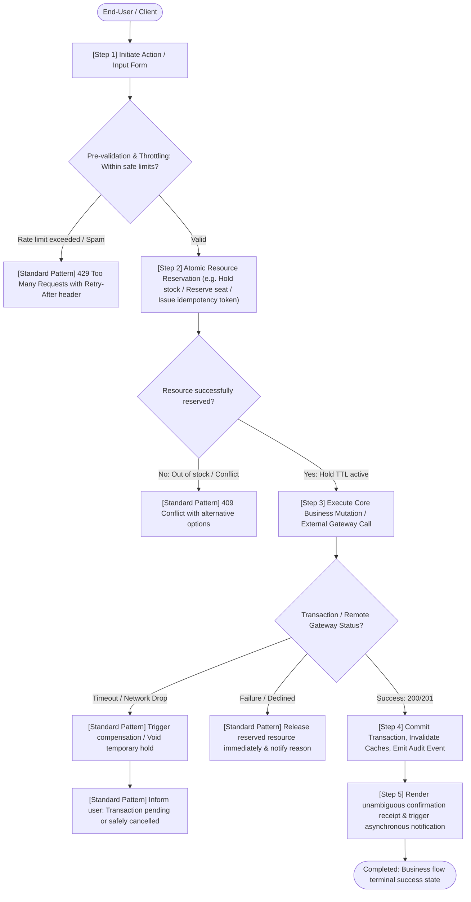

# Industry Benchmark & Reference System Flows

> **Target Module / Domain:** <Module / Feature Domain Name>  
> **Benchmark Reference Systems:** <Leading Platforms, e.g., Stripe, Shopify, Auth0, Amazon, Workday, GitHub>  
> **Discovery Mode:** Step 0 External Domain Research via Subagent (`flash`)  
> **Lifecycle Rule:** Generated once at Step 0 (`module-intake`) if missing. Reused across gap analysis and testcase design.

---

## 1. Domain Overview & Leading Reference Implementations

* **Core Business Problem Solved:** [What core user need or business transaction does this type of module handle?]
* **Top Industry Reference Implementations:**
  | Leading System | Key Architecture / Feature Highlights | Standard Fail-Safes & Best Practices |
  | :--- | :--- | :--- |
  | `[Reference System 1, e.g., Stripe / Shopify]` | [How they structure the workflow] | [Idempotency keys, atomic inventory hold, auto-reversal] |
  | `[Reference System 2, e.g., Auth0 / Okta]` | [Standard auth/session lifecycle] | [Exponential rate-limiting, step-up MFA, grace periods] |
  | `[Reference System 3, e.g., Amazon / Workday]` | [Multi-step state management] | [Optimistic locking, split-payment rollback, audit logs] |

---

## 2. Standard Industry Operational Flowchart (Mermaid)

Best-practice user journey and technical state transitions commonly implemented by mature industry platforms:

---

## 3. Universal Industry Edge Cases & Standard Fail-Safes

Mature industry systems invariably implement standard protections for this domain:
1. **Concurrency & Race Conditions:**
   - *Industry Standard:* Double-click prevention (Client-side disable + Server-side idempotency key), optimistic locking or atomic database decrement (`UPDATE ... WHERE qty >= 1`).
2. **State Expiration & Timeouts (TTL):**
   - *Industry Standard:* Temporary hold with explicit countdown timer (e.g., cart held for 15 mins), automatic expiration worker, clear user warning before session drop.
3. **Partial Failures & Auto-Compensation:**
   - *Industry Standard:* If payment succeeds but invoice generation fails, the system executes an automated retry queue (Saga pattern) rather than stranding the user in limbo.
4. **Rate Limiting & Abuse Prevention:**
   - *Industry Standard:* Progressive backoff (1s $\rightarrow$ 5s $\rightarrow$ 30s) after consecutive invalid attempts, CAPTCHA escalation, IP/Account throttling.
5. **Clear Error Differentiation:**
   - *Industry Standard:* Strictly distinguish between *User Actionable Errors* (wrong card number, field missing) vs *Transient System Errors* (gateway timeout, bank maintenance - please try again in 5 mins).

---

## 4. Common Inadequacies & Anti-Patterns Found in Substandard Systems

Substandard or immature applications frequently suffer from these common pitfalls:
* ❌ **Silent Failures:** The UI stops responding with no error banner or feedback when an API fails.
* ❌ **Missing Idempotency:** Submitting a form twice creates two duplicate orders or charges twice.
* ❌ **Infinite Spinners:** Failure to catch asynchronous Promise rejections leaves users stuck on loading overlays indefinitely.
* ❌ **Premature State Mutation:** Updating database records to "Paid" before receiving verified webhook confirmation from the payment provider.
* ❌ **Lost Context on Error:** Clearing all user form inputs when a single field validation fails.

---

## 5. Benchmark Comparison Checklist for Step 2 (`requirement-gap-analysis`)

When cross-referencing our target module against this benchmark:
* [ ] Does our module handle concurrent double-submissions safely like industry leaders?
* [ ] Does our module implement clear timeout thresholds and automatic rollbacks?
* [ ] Does our module distinguish user errors from technical infrastructure failures?
* [ ] Are there critical industry edge cases that our specification completely overlooked?
