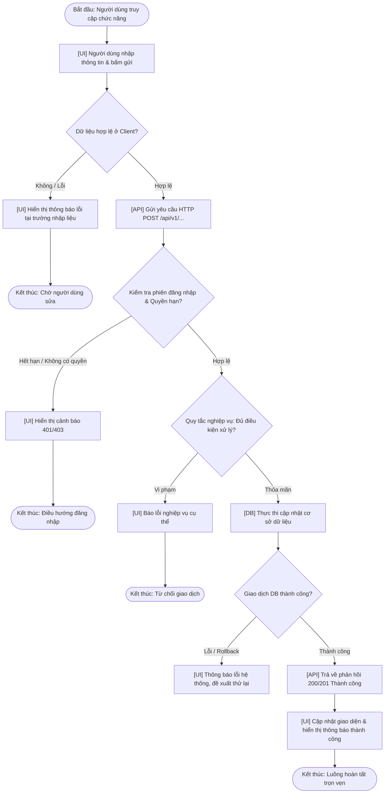

# Module Context: <Module Name>

> **Discovery Timestamp:** <YYYY-MM-DD HH:MM:SS>  
> **Source Commit / Hash:** `<git-commit-hash>`  
> **Repository Path:** `<repo-path>`  
> **Extraction Level:** Level 1-3 (Progressive JIT) / Level 4 (Selective Deep AST)

---

## 📌 PHẦN 1: BA CÂU HỎI CỐT LÕI (3 GOLDEN QUESTIONS)

### 1. Module này dùng để làm gì? (Purpose & Business Value)
* **Mục đích chính:** Mô tả súc tích chức năng nghiệp vụ trọng tâm của module (giải quyết bài toán gì cho người dùng hoặc hệ thống).
* **Giá trị mang lại:** Lợi ích kinh doanh, tác động trực tiếp đến người dùng cuối và vai trò trong hệ sinh thái phần mềm.
* **Các tính năng cốt lõi (Core Capabilities):**
  * Tính năng 1: [Mô tả ngắn gọn]
  * Tính năng 2: [Mô tả ngắn gọn]
  * Tính năng 3: [Mô tả ngắn gọn]

### 2. Ai dùng? (Target Users, Personas & Roles)
* **Tác nhân chính (Primary Actors):**
  * `[Khách vãng lai / Guest]`: Quyền hạn và phạm vi thao tác trước khi xác thực.
  * `[Người dùng định danh / Authenticated User]`: Thao tác nghiệp vụ thông thường.
  * `[Quản trị viên / Admin / Supervisor]`: Quyền phê duyệt, cấu hình, quản lý dữ liệu đặc quyền.
* **Tác nhân hệ thống (System & Machine Actors):**
  * `[Cron Job / Worker]`: Tiến trình ngầm định kỳ.
  * `[External Webhook / 3rd Party API]`: Hệ thống thanh toán, cổng thông báo bên ngoài.
* **Ràng buộc phân quyền (Access Control & Permissions):**
  * Ma trận phân quyền RBAC/ABAC hoặc các middleware route guards (`@UseGuards()`, `@Roles()`).

### 3. Luồng hoạt động ra sao? (Operational & Technical Flowchart)
Sơ đồ trực quan hóa toàn bộ hành trình người dùng và xử lý kỹ thuật, sử dụng chuẩn hình học:
* Hình chữ nhật `[...]`: Bước thao tác người dùng, gọi API, ghi DB.
* Hình thoi `{...}`: Điểm kiểm tra điều kiện, rẽ nhánh logic, xác thực dữ liệu.
* Hình elip/stadium `([...])`: Điểm bắt đầu và kết thúc luồng.

---

## 📌 PHẦN 2: CHI TIẾT KỸ THUẬT & TRUY VẾT MÃ NGUỒN (TECHNICAL SPECIFICATIONS)

### 4. Điểm Vào & Cây Gọi Phụ Thuộc (Entry Points & Call Tree)
* **Entry Points:** Danh sách UI Page, Controller, Route Handler (Kèm file path và dòng code).
* **Call Graph:** UI $\rightarrow$ Hooks $\rightarrow$ Services $\rightarrow$ API Clients $\rightarrow$ Database.

### 5. Dữ Liệu & Ràng Buộc Kiểm Tra (Data Models & Validations)
* Danh sách schema (Zod/Yup/DTO).
* Các điều kiện kiểm tra biên (Edge-case boundary rules).

### 6. Rủi Ro Tiềm Ẩn & Xử Lý Lỗi (Risks & Error Handling)
* Điểm nghẽn hiệu năng, race conditions, timeout, rò rỉ session.
