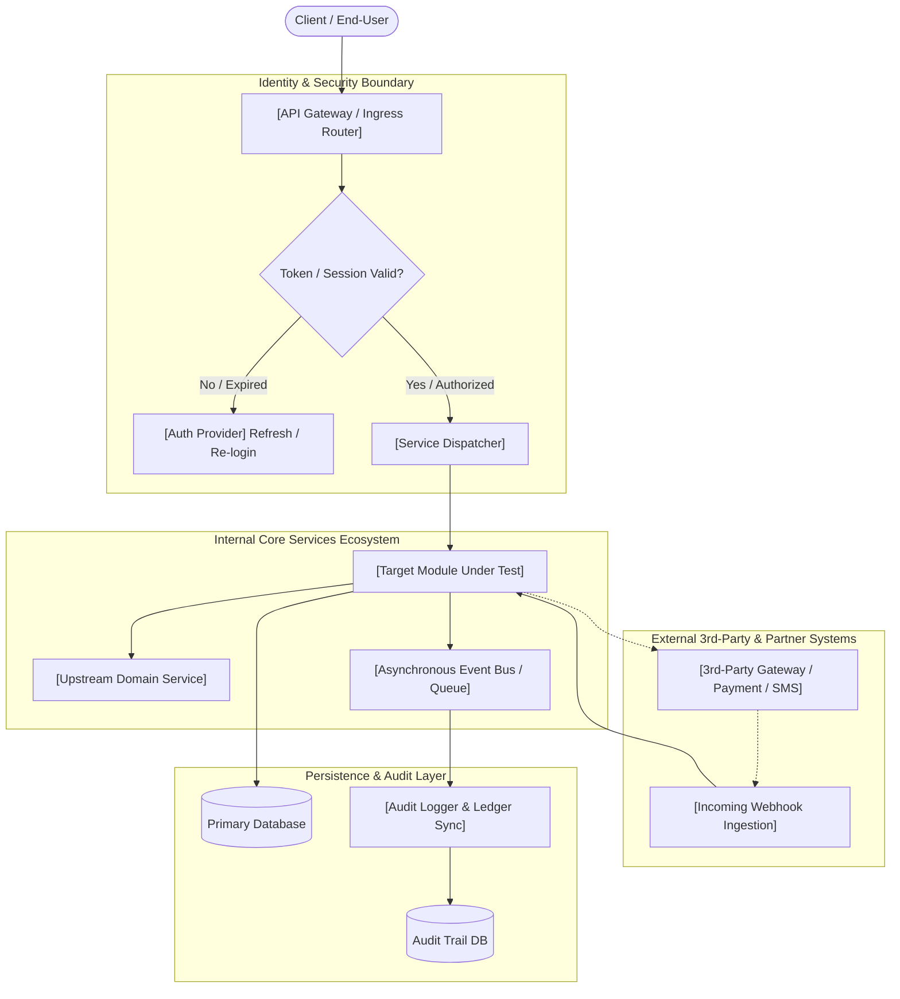

# Global System Architecture & Cross-System Interaction Flows

> **Discovery Timestamp:** <YYYY-MM-DD HH:MM:SS>  
> **Source Repository:** `<repo-path>`  
> **Scope:** High-Level System Topology & Cross-Subsystem Integration Landscape  
> **Lifecycle Rule:** Generated once at Step 0 (`module-intake`). Reused across all module testing cycles.

---

## 1. High-Level System Landscape & Subsystems Overview

* **Architecture Paradigm:** [Monolithic / Modular Monolith / Microservices / Serverless Event-Driven]
* **Core Subsystems / Service Domains:**
  | Subsystem / Service Name | Technical Stack | Primary Responsibility | Exposed Interfaces |
  | :--- | :--- | :--- | :--- |
  | `[Auth & Identity Service]` | Node.js / Keycloak | User authentication, token issuance, RBAC | JWT, OAuth2 / OIDC, `/api/v1/auth` |
  | `[Core Business Domain]` | TypeScript / Python | Primary business transactions & workflow engine | REST / tRPC / GraphQL, DB Tables |
  | `[Notification / Messaging]` | Redis / RabbitMQ / SES | Email, SMS, push notifications, webhooks | Message Queue, Event Bus |
  | `[Reporting / Analytics]` | PostgreSQL / ClickHouse | Auditing, ledger tracking, BI metrics | Read-only replicas, OLAP sync |

---

## 2. Cross-System & Inter-Module Interaction Flows (Mermaid Flowchart)

Global operational flow showing how user requests traverse across multiple subsystems and external systems:

---

## 3. External Integrations & 3rd-Party Boundaries

* **Third-Party Providers & APIs:**
  * `[Payment Gateways]`: Webhook callbacks, idempotency keys, timeout thresholds.
  * `[Authentication / Identity]`: OAuth2, SAML, Google/Microsoft SSO, LDAP.
  * `[Notification Providers]`: Twilio, SendGrid, Firebase Cloud Messaging.
* **Failure Modes & Fallback Strategies:**
  * Mismatch between local retry loops and 3rd-party rate limits.
  * Missing webhook signature verification or replay-attack vulnerabilities.

---

## 4. Shared Data Contracts, Event Bus & Global State Machines

* **Global Shared Entities & DTOs:**
  * User Identity Model (`userId`, `roles`, `tenantId`).
  * Transaction State Machine (e.g. `PENDING` $\rightarrow$ `PROCESSING` $\rightarrow$ `SETTLED` / `FAILED` / `REVERSED`).
* **Message Broker / Event Topics:**
  * Topic / Queue names, payload schemas, and serialization formats (JSON / Protobuf).

---

## 5. Architectural Inconsistencies & Cross-System Blindspots Checklist

*(Used by Step 2 `requirement-gap-analysis` to detect boundary bugs)*:
1. **Unbounded Upstream Timeouts:** Does the target module block indefinitely if a downstream external API hangs?
2. **Missing Distributed Idempotency:** Does the target module safely handle duplicate webhook deliveries or double-clicks?
3. **State Desynchronization (Split-Brain):** Can the target module's local status change without updating the global transaction ledger?
4. **Orphaned Side-Effects:** If a database transaction rolls back, are queued emails or external API calls also safely cancelled?
5. **Permission Escalation across Boundaries:** Does an internal RPC call inherit the original user's RBAC scope or run as root/unrestricted?
