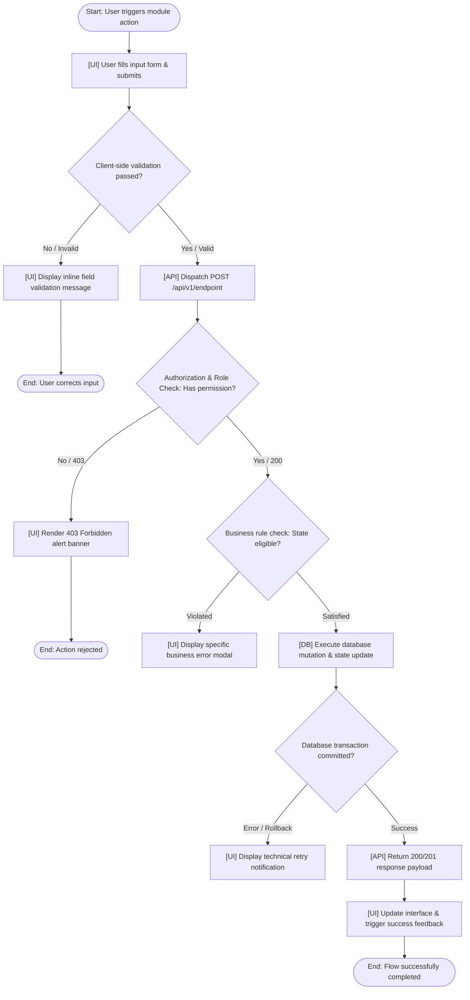

# Skill: CodeGraph Context Discovery (Step 1)

## 1. Description & Trigger Conditions
* **Purpose:** Discover and map structural and dependency context using **CodeGraph**, with deterministic, configurable, cycle-safe traversal and explicit completeness reporting.
* **Core Philosophy:** **Optimize Context Consumption, NOT Discovery Coverage.**
  * Graph discovery is bounded by configurable safety ceilings and never hides truncation.
  * LLM Context Loading is selective, on-demand, and progressive.
* **Triggers:**
  * Completed `module-intake`.
  * Invoked by `workflow-orchestrator` when entering `CONTEXT_DISCOVERY`.

## 2. Inputs
* **Required:**
  * Target module name and repository path.
  * Initialized `.qa-state.json`.
* **Optional:**
  * Specific entry file paths or suspected symbols.

## 3. Prerequisites
* **CodeGraph CLI** (`codegraph`) or **CodeGraph MCP** (`codegraph-mcp`) installed and operational.
* Target repository source code available locally.

## 4. Architectural Principles: Discovery vs. Context Loading

### 4.1. Controlled Dependency Discovery
* **NO Node Limits:** Strictly PROHIBIT artificial caps on the number of nodes CodeGraph is permitted to explore.
* **Configurable limits:** Traverse direct, indirect, and cross-module dependencies with configurable `max_depth` and `max_nodes` values appropriate to repository size.
* **NO Budget-Based Truncation:** Strictly PROHIBIT cutting short or pruning the dependency graph merely because a token budget was reached.
* **NO Arbitrary Stopping:** Strictly PROHIBIT halting exploration upon finding an arbitrary threshold of functions, classes, or modules.
* **No silent pruning:** Candidate or node ceilings are safety controls. When reached, preserve pending node identifiers and report `DISCOVERY_STATUS: TRUNCATED`.
* **Incomplete discovery:** Parser, SQLite, timeout, or index failures must produce `DISCOVERY_INCOMPLETE`; do not claim completion.
* **Technical Safety Guards Only:** Maintain robust safeguards against real technical obstacles:
  * Maintain `visited_set` tracking and cycle detection to prevent infinite loops in cyclic dependencies.
  * Exclude binary, vendor, and build artifact folders (`node_modules/`, `dist/`, `.git/`, test fixtures).
  * Enforce process timeout guards to safely terminate hanging commands on corrupted syntax or file locks.
* **Persistence:** Save the exhaustive knowledge graph locally to disk (`codegraph-out/`) for reuse across the entire QA lifecycle.

### 4.2. High-Efficiency Progressive Context Loading (5-Level Protocol)
* **Never Dump Full Graph or Monolithic Files:** Strictly PROHIBIT ingesting raw graph JSON or complete source files into prompt context.
* **5-Level Progressive Retrieval Protocol:**
  - **Level 1 (Symbol / Name Only):** Function, class, or object name with file path and line numbers. (~10-20 tokens).
  - **Level 2 (Signature & Types):** Parameters, return types, TypeScript interface, or object shape. (~50-100 tokens). *Sufficient for 80% of requirement validation and test case design.*
  - **Level 3 (Dependencies & Callers):** Upstream callers and downstream callees from CodeGraph edges. (~100-250 tokens).
  - **Level 4 (Implementation Snippet):** Targeted block extract (start_line to end_line) of the specific function or method. (~200-500 tokens). Fetched ONLY when inspecting complex branching, edge-case math, or regex.
  - **Level 5 (Full Source File):** Complete file loaded ONLY as an explicit exception when cross-cutting file context cannot be resolved at Level 4.
* **Intelligent Method Discovery & Multi-Declaration Pattern Engine:**
  - Leverage `python scripts/codegraph_discovery.py <action_name> --repo <repo_path>` to query candidates.
  - Recognizes 4 key JavaScript/TypeScript declaration patterns:
    1. ES6 Class Methods (`class Page { async login() {} }`).
    2. Named Function Declarations (`export function submitInquiry() {}`).
    3. Arrow Functions assigned to variables (`export const validateToken = () => {}`).
    4. Object Literals & Nested Methods (`export const basket = { add() {}, remove() {} }`).
  - Classifies candidates into 4 distinct reusability tiers:
    * `DIRECT_REUSE`: Signature and semantics match target action perfectly; reuse as-is.
    * `CONDITIONAL_REUSE`: Name matches but parameters, async behavior, or signatures differ slightly; adapt via wrapper.
    * `NOT_REUSABLE`: Symbol is internal, deprecated, or contradictory; do not reuse.
    * `NOT_FOUND`: No matching candidate found in CodeGraph or fallback directories; generate new method.
* **Deterministic Fallback Search:**
  - If a symbol or method is not indexed in CodeGraph (e.g., unindexed dynamic exports or new Page Objects), automatically scan designated Page Object and utility directories (`tests/pages/`, `e2e/pages/`, `page-objects/`, `04-src/tests/pages/`).
* **Signature-First Protocol:**
  * Query TypeScript interfaces, function contracts, export signatures, and Zod/Yup validation schemas first.
  * Read full implementation bodies ONLY on-demand when inspecting complex branching, custom regex, or exception handling.
* **Incremental Cache:** Validate git commit hashes (`git rev-parse HEAD`) or file content SHA-256 hashes. If source code is unchanged, reuse cached AST context; if modified, re-analyze only changed files and their dependent subgraphs.

## 5. Step-by-Step Execution Instructions

1. **Incremental Cache & Hash Verification:**
   * Inspect `.qa-state.json` against the current git commit hash.
   * If module source files have NOT changed and `module-context.md` exists:
     - Reuse cached AST context directly without re-running extraction (0 token consumption).
   * If changes exist: Analyze modified files and their extended dependency network.

2. **CodeGraph Environment Detection:**
   * Run `codegraph --version` to verify tool availability.
   * *If CodeGraph is missing or fails:* Stop immediately. Explain the technical limitation and obtain user permission before attempting static search fallbacks. Never fabricate CodeGraph outputs.

3. **Build / Refresh Exhaustive Knowledge Graph:**
   * Run `codegraph update <repo-path>` (or equivalent CodeGraph indexing command) to build or refresh the complete knowledge graph in `codegraph-out/`.
   * Persist all graph analysis locally.

4. **Trace Full Dependency Chains & Cross-Module Flows:**
   * Start from main entry points (Routes, Pages, Controllers, Event Handlers).
   * Traverse complete call flows: UI $\rightarrow$ Custom Hooks $\rightarrow$ Domain Services $\rightarrow$ API Clients/RPC $\rightarrow$ Data Models / Database Tables.
   * Map cross-module dependencies (e.g., Authentication invoking User Management, Notifications, Rate Limiters, Audit Logs).
   * Use `codegraph path "<EntryNode>" "<TargetNode>"` to trace call chains end-to-end without depth bounds.

5. **Signature-First Extraction, Method Discovery & Reuse Evaluation:**
   * Ingest data contracts, types, and schema validations for all involved symbols.
   * Query candidate methods using:
     `python scripts/codegraph_discovery.py "<action_name>" --repo "<repo_path>" -o "codegraph-out/<action>-discovery.json"`
   * Classify candidate reusability (`DIRECT_REUSE`, `CONDITIONAL_REUSE`, `NOT_REUSABLE`, `NOT_FOUND`).
   * Selectively inspect implementation bodies (Level 4) ONLY for high-risk zones (concurrency, account lockout, session token creation, error handling).

6. **Context Classification:**
   * Explicitly tag every piece of evidence:
     - `[CODE-CONFIRMED]`: Verified directly in source code AST.
     - `[DOC-CONFIRMED]`: Specified in written documentation.
     - `[RUNTIME-CONFIRMED]`: Verified through live runtime execution (Playwright MCP).
     - `[INFERRED]`: Deduced by pattern but lacking direct assertion.
     - `[UNKNOWN]`: Missing, contradictory, or unverified implementation.

7. **Generate Deliverable with Operational Flowchart & State Transition:**
   * Export `module-context.md` at workspace root detailing entry points, dependency trees, validation rules, identified risks, and a **Mandatory Mermaid Operational Flowchart** (`flowchart TD`) with standard process rectangles `[...]` and decision diamonds `{...}`.
   * **State Transition:**
     - If discovery completes without blockers: Transition state to `GAP_ANALYSIS` via `python scripts/state_manager.py transition GAP_ANALYSIS "Completed full CodeGraph context discovery"`.
     - If discovery cannot complete due to real technical obstacles (parser crash, timeout, resource exhaustion): Transition state to `DISCOVERY_INCOMPLETE` with detailed notes on untraversed files and technical causes. Never falsely report completion.

## 6. Expected Outputs

### 6.1. Mandatory Operational Business & Technical Flowchart Specification (Mermaid)
Every `module-context.md` MUST include a prominent, verified Mermaid flowchart (`flowchart TD`) visualizing the operational architecture, user journey, and decision logic of the module:
* **Standard Geometric Notation Requirements:**
  1. **Rectangles `[Step / Operation / Action]`:** For all sequential actions, user gestures, API calls, and DB mutations.
     * *Examples:* `[User inputs username & password]`, `[Client sends POST /api/v1/auth]`, `[Update last_login timestamp]`.
  2. **Diamonds `{Decision / Condition / Branch}`:** For every conditional check, input validation, role-based authorization check, or error threshold.
     * *Examples:* `{Is form input valid?}`, `{Failed attempts >= 5?}`, `{Password matches hash?}`, `{Token valid & not expired?}`.
  3. **Stadiums / Rounded Boxes `([Start / End / Outcome])`:** For entry points and terminal completion states.
     * *Examples:* `([Start: User opens /login])`, `([Redirect to Dashboard])`, `([Display Account Lockout Banner])`.
  4. **Subgraphs (`subgraph ... end`):** Visually separate layers:
     * `subgraph UI ["Frontend / Presentation Layer"]`
     * `subgraph API ["Backend Domain Services & Middleware"]`
     * `subgraph DB ["Database & External Identity Providers"]`
  5. **Explicit Branch Labels on Connectors:** Every arrow departing from a decision diamond MUST be explicitly labeled (e.g., `-->|Valid / Yes|`, `-->|Invalid / No|`, `-->|Timeout / Error|`).

* **Reference Mermaid Template:**

### 6.2. Document Structure (`module-context.md`)
Every `module-context.md` MUST adhere to `references/module-context-template.md` and prominently answer the **Three Golden Questions** upfront:
1. **Module Purpose (Module này dùng để làm gì?):** Business purpose, problems solved, and core capabilities in clear non-IT business language.
2. **Target Actors & Roles (Ai dùng?):** End-user personas, authorization roles (Guest, Authenticated, Admin), and machine/system actors.
3. **Operational Flow (Luồng hoạt động ra sao?):** Verified Mermaid flowchart (`flowchart TD`) employing strict geometric notation:
   - Rectangles `[...]` for sequential operations, UI inputs, API calls, and DB mutations.
   - Diamonds `{...}` for conditional decisions, validations, and role checks.
   - Stadiums `([...])` for start and terminal outcome states.
   - Explicit path labels on all outgoing branches (`|Valid|`, `|Invalid|`, `|Error|`).

Following the Three Golden Questions, include the technical deep-dive sections:
* Dependency Call Tree (Upstream / Downstream & Cross-Module) plus traversal status, configured ceilings, and any unvisited nodes.
* Business Flow Reconstruction & State Transitions.
* Data Models, Validations & Database Schemas.
* Security, Concurrency, Error Handling & Throttling Mechanisms.
* Evidence References (File paths, symbol names, exact line numbers).
* Updated `.qa-state.json` (`GAP_ANALYSIS` or `DISCOVERY_INCOMPLETE`).

## 7. Failure Handling & Incomplete Discovery Protocol
* **Parser / Syntax Errors:** Log exact file and syntax error; mark `DISCOVERY_INCOMPLETE` for that branch and continue exploring independent branches.
* **Process Timeout:** Safely kill hanging processes, log timeout error, and mark `DISCOVERY_INCOMPLETE`.
* **Missing Symbols:** Execute `codegraph query "<feature-keyword>"` to search topological clusters.
* **Zero False Completion:** Never claim discovery is complete if files were skipped due to token budgets. All incomplete traversals must be marked `DISCOVERY_INCOMPLETE`.

## 8. Human Approval Requirements
* None if CodeGraph discovery succeeds.
* Mandatory user confirmation required if `DISCOVERY_INCOMPLETE` is flagged or before switching to a static search fallback.

## 9. Completion Criteria
* `module-context.md` is generated with confirmed code references.
* All relevant dependencies are fully mapped, or any unreached branches are explicitly logged under `DISCOVERY_INCOMPLETE`.
