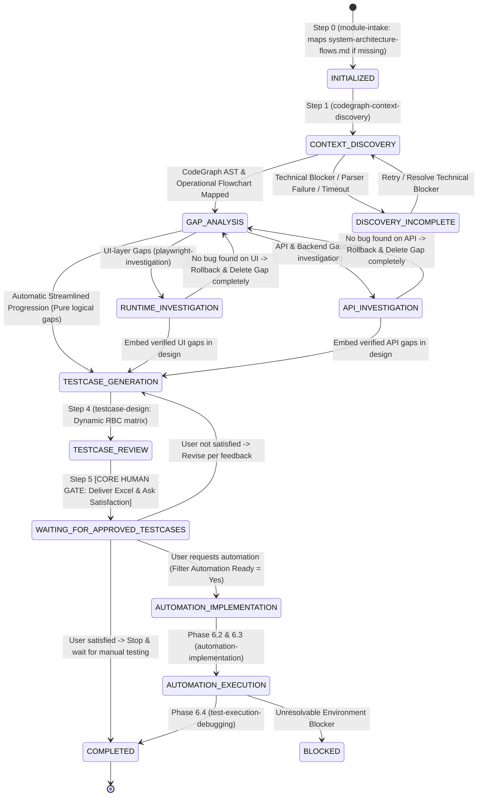

# Skill: QA Workflow Orchestrator

## 1. Description & Trigger Conditions
* **Purpose:** Serves as the central governor of the QA Agent System. Manages sequential lifecycle transitions, monitors checkpoint persistence in `.qa-state.json`, halts execution at mandatory human gates, and resumes interrupted sessions seamlessly.
* **Triggers:**
  * Invocation of master QA commands (e.g., *"Run full QA workflow on <Module>"*).
  * Session resumption after a user checkpoint response.
  * Direct invocation by `AGENTS.md`.

## 2. Inputs
* Target module name, user requirements, and repository context.
* Existing `.qa-state.json` (if resuming).

## 3. Workflow State Machine & Lifecycle Graph

## 4. Unrestricted Discovery & Incomplete Discovery Protocol
* **Core Rule:** **Optimize Context Consumption, NOT Discovery Coverage.**
* CodeGraph is permitted to traverse the entire dependency chain (direct, indirect, cross-module) without arbitrary hard limits on node count or depth.
* Analysis must never be truncated or culled purely to conserve token budgets.
* **Incomplete Discovery Protocol:** In the event of parser crashes, execution timeouts, or exhausted physical system resources, the system MUST transition to `DISCOVERY_INCOMPLETE` and report the exact technical bottleneck to the user. Reporting completion for incomplete analyses is strictly prohibited.

## 5. Core Human Review Gate (Test Case Satisfaction & Approval)

### Core Checkpoint: Test Case Satisfaction Review
* **When:** Right after Step 5 (`testcase-review-export` generates and audits `<module-name>-testcases.xlsx`).
* **State:** `WAITING_FOR_APPROVED_TESTCASES`.
* **Behavior:**
  1. Deliver `<module-name>-testcases.xlsx` and the executive test summary table in chat.
  2. Ask the user the central review question:
     **"Bạn có hài lòng với bộ testcase hiện tại không?"** *(Are you satisfied with the current test cases?)*
  3. **Handle User Responses:**
     * **If Satisfied ("Có" / "Hài lòng" / "OK"):**
       - **Stop and wait for manual testing:** The workflow halts and remains ready for manual QA execution.
       - **(Optional Automation):** If the user instructs to automate (or sets `Automation Ready = Yes`), transition to `AUTOMATION_IMPLEMENTATION`.
     * **If Not Satisfied / Revisions Requested ("Không" / "Chưa hài lòng" / "Cần sửa"):**
       - Gather user feedback and transition state back to `TESTCASE_GENERATION`.
       - Update, add, or refine test cases until the user is 100% satisfied.

## 6. Checkpoint Resumption Protocol
When starting a session or resuming:
1. Check if `.qa-state.json` exists in workspace root.
2. If it exists, run: `python scripts/state_manager.py validate`.
3. Check `changed_documents`:
   * If input documents or source files changed since last run, invalidate only the downstream affected analysis.
4. Read `current_state` and resume directly from the pending step.

## 7. Completion Criteria
* Workflow reaches `COMPLETED` state.
* All intermediate artifacts (`module-context.md`, `<module>-gaps.md`, optional `<module>-runtime-investigation.md`, `<module>-testcases.xlsx`, test spec files, `automation-summary.md`) are verified and recorded.
