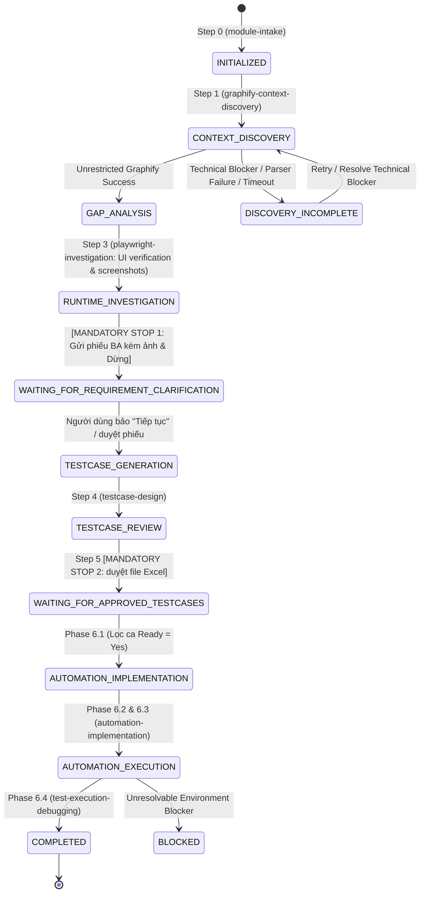

# Skill: QA Workflow Orchestrator

## 1. Description & Trigger Conditions
* **Purpose:** Serves as the central governor of the QA Agent System. Manages sequential lifecycle transitions, monitors checkpoint persistence in `.qa-state.json`, halts execution at mandatory human gates, and resumes interrupted sessions seamlessly.
* **Triggers:**
  * Invocation of master QA commands (e.g., *"Run full QA workflow on <Module>"*).
  * Session resumption after a user checkpoint response.
  * Direct invocation by `AGENTS.md`.

## 2. Inputs
* Target module name, user requirements, and repository context.
* Existing `.qa-state.json` (if resuming).

## 3. Workflow State Machine & Lifecycle Graph

## 4. Unrestricted Discovery & Incomplete Discovery Protocol
* **Core Rule:** **Optimize Context Consumption, NOT Discovery Coverage.**
* Graphify được phép duyệt toàn bộ chuỗi dependency (trực tiếp, gián tiếp, xuyên module) mà không bị giới hạn cứng về số node hay độ sâu (depth).
* Tuyệt đối không dừng phân tích hay cắt bớt dependency chỉ vì hết ngân sách token.
* **Xử lý khi Discovery chưa hoàn tất:** Nếu gặp lỗi parser, timeout hoặc tài nguyên bị cạn kiệt, hệ thống PHẢI chuyển sang trạng thái `DISCOVERY_INCOMPLETE` và thông báo cho người dùng. Nghiêm cấm tự ý báo hoàn thành khi phân tích còn dang dở.

## 5. Mandatory Human Approval Gates (Non-Negotiable)

### Gate 1: Requirement Clarification & Visual Evidence Checkpoint
* **When:** Right after Step 3 (`playwright-investigation` verifies UI gaps and captures screenshots).
* **State:** `WAITING_FOR_REQUIREMENT_CLARIFICATION`.
* **Behavior:**
  1. Xuất file báo cáo Markdown độc lập `<module-name>-gaps.md` đã tích hợp đầy đủ **bước tái hiện** và **ảnh chụp màn hình minh chứng thực tế từ Playwright MCP**.
  2. Gửi link clickable mở trực tiếp file báo cáo và bảng tóm tắt kèm ảnh minh chứng trong chat.
  3. **DỪNG LẠI HOÀN TOÀN.**
  4. **ĐIỀU KIỆN TIẾP TỤC BẮT BUỘC:** AI TUYỆT ĐỐI KHÔNG ĐƯỢC PHÉP tự ý chuyển sang bước tiếp theo (`testcase-design`). AI chỉ được tiếp tục khi và chỉ khi:
     - Người dùng gõ: **`tiếp tục`** (hoặc `proceed`, `ok tiếp tục`), HOẶC
     - Người dùng cung cấp phản hồi / câu trả lời giải đáp từ BA/PO.

### Gate 2: Approved Test Cases Workbook Checkpoint
* **When:** Right after Step 5 (`testcase-review-export`).
* **State:** `WAITING_FOR_APPROVED_TESTCASES`.
* **Behavior:** The agent MUST PAUSE and deliver `<module-name>-testcases.xlsx`. The agent must NEVER start writing automation test scripts until the user reviews, marks `Automation Ready = Yes`, and uploads/confirms the file.

## 6. Checkpoint Resumption Protocol
When starting a session or resuming:
1. Check if `.qa-state.json` exists in workspace root.
2. If it exists, run: `python scripts/state_manager.py validate`.
3. Check `changed_documents`:
   * If input documents or source files changed since last run, invalidate only the downstream affected analysis.
4. Read `current_state` and resume directly from the pending step.

## 7. Completion Criteria
* Workflow reaches `COMPLETED` state.
* All intermediate artifacts (`module-context.md`, `<module>-gaps.md`, optional `<module>-runtime-investigation.md`, `<module>-testcases.xlsx`, test spec files, `automation-summary.md`) are verified and recorded.
