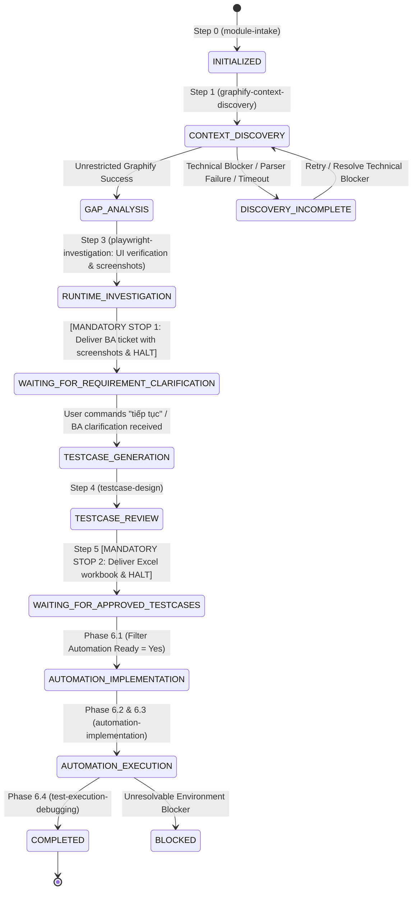

# Skill: QA Workflow Orchestrator

## 1. Description & Trigger Conditions
* **Purpose:** Serves as the central governor of the QA Agent System. Manages sequential lifecycle transitions, monitors checkpoint persistence in `.qa-state.json`, halts execution at mandatory human gates, and resumes interrupted sessions seamlessly.
* **Triggers:**
  * Invocation of master QA commands (e.g., *"Run full QA workflow on <Module>"*).
  * Session resumption after a user checkpoint response.
  * Direct invocation by `AGENTS.md`.

## 2. Inputs
* Target module name, user requirements, and repository context.
* Existing `.qa-state.json` (if resuming).

## 3. Workflow State Machine & Lifecycle Graph

## 4. Unrestricted Discovery & Incomplete Discovery Protocol
* **Core Rule:** **Optimize Context Consumption, NOT Discovery Coverage.**
* Graphify is permitted to traverse the entire dependency chain (direct, indirect, cross-module) without arbitrary hard limits on node count or depth.
* Analysis must never be truncated or culled purely to conserve token budgets.
* **Incomplete Discovery Protocol:** In the event of parser crashes, execution timeouts, or exhausted physical system resources, the system MUST transition to `DISCOVERY_INCOMPLETE` and report the exact technical bottleneck to the user. Reporting completion for incomplete analyses is strictly prohibited.

## 5. Mandatory Human Approval Gates (Non-Negotiable)

### Gate 1: Requirement Clarification & Visual Evidence Checkpoint
* **When:** Right after Step 3 (`playwright-investigation` verifies UI gaps and captures screenshots).
* **State:** `WAITING_FOR_REQUIREMENT_CLARIFICATION`.
* **Behavior:**
  1. Generate standalone Markdown report `<module-name>-gaps.md` (in Vietnamese) embedding concrete end-user reproduction steps and Playwright MCP screenshot evidence.
  2. Deliver clickable file link and executive summary table directly in chat.
  3. **HALT EXECUTION COMPLETELY.**
  4. **MANDATORY RESUMPTION CONDITION:** The agent is STRICTLY FORBIDDEN from automatically proceeding to `testcase-design`. The agent proceeds if and only if:
     - User explicitly types: **`tiếp tục`** (or `proceed`, `ok tiếp tục`), OR
     - User provides clarification feedback / BA decisions.

### Gate 2: Approved Test Cases Workbook Checkpoint
* **When:** Right after Step 5 (`testcase-review-export`).
* **State:** `WAITING_FOR_APPROVED_TESTCASES`.
* **Behavior:** The agent MUST PAUSE and deliver `<module-name>-testcases.xlsx`. The agent must NEVER start writing automation test scripts until the user reviews, marks `Automation Ready = Yes`, and uploads/confirms the file.

## 6. Checkpoint Resumption Protocol
When starting a session or resuming:
1. Check if `.qa-state.json` exists in workspace root.
2. If it exists, run: `python scripts/state_manager.py validate`.
3. Check `changed_documents`:
   * If input documents or source files changed since last run, invalidate only the downstream affected analysis.
4. Read `current_state` and resume directly from the pending step.

## 7. Completion Criteria
* Workflow reaches `COMPLETED` state.
* All intermediate artifacts (`module-context.md`, `<module>-gaps.md`, optional `<module>-runtime-investigation.md`, `<module>-testcases.xlsx`, test spec files, `automation-summary.md`) are verified and recorded.
