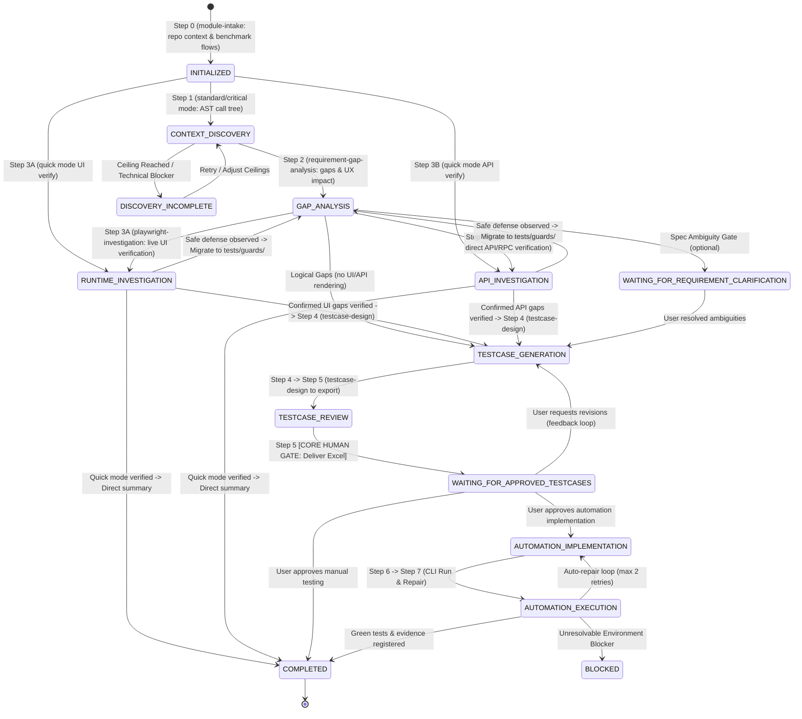

# Skill: QA Workflow Orchestrator

## 1. Description & Trigger Conditions
* **Purpose:** Serves as the central governor of the QA Agent System. Manages sequential lifecycle transitions, monitors checkpoint persistence in `.qa-state.json`, halts execution at mandatory human gates, and resumes interrupted sessions seamlessly.
* **Triggers:**
  * Invocation of master QA commands (e.g., *"Run full QA workflow on <Module>"*).
  * Session resumption after a user checkpoint response.
  * Direct invocation by `AGENTS.md`.

## 2. Inputs
* Target module name, user requirements, repository context, and execution mode.
* Existing `.qa-state.json` (if resuming).

---

## 3. Adaptive Execution Modes (Lean & Safe Execution)

The orchestrator dynamically scales lifecycle depth based on module risk tier and user intent:

| Mode | Target Scope | Lifecycle Sequence | Deliverables Required |
| :--- | :--- | :--- | :--- |
| **`quick`** | Hotfix, single bug repro, smoke test | Minimal Intake $\rightarrow$ Step 3 (UI / API Verification) $\rightarrow$ Summary Report | Repro spec or guard proof + executive chat summary. **No 3-sheet Excel export, no external benchmark research.** |
| **`standard`** | Standard business feature modules | Step 0 Intake $\rightarrow$ Step 1 CodeGraph $\rightarrow$ Step 2 Gap Analysis $\rightarrow$ Step 3 Verification $\rightarrow$ Step 4/5 Testcase Design & Excel $\rightarrow$ Human Gate $\rightarrow$ Step 6/7 Automation | `module-context.md`, `<module>-gaps.md`, `<module>-testcases.xlsx`, automated specs. |
| **`critical`** | Financial checkout, billing, RBAC, sensitive data | Full Lifecycle + Dual-Track (Step 3A UI & Step 3B API) + Idempotency/Concurrency check + **Production Safety Gate** + Human Gate | Complete audit trail, repro & guard specs in `tests/guards/`, 3-sheet Excel with 100% bidirectional traceability. |

> [!TIP]
> **Lean Execution Rule:** If the user only wants to investigate, reproduce, or verify a specific defect or hotfix, default to **`quick` mode**. Never force a single-bug investigation through 3-sheet Excel exports or multi-industry benchmark surveys.

### 3.1. Hybrid UI Investigation Architecture (CLI Primary + MCP Fallback)
During Step 3A (`RUNTIME_INVESTIGATION`):
* **Primary Engine (White-Box / Grey-Box): Playwright CLI Execution**
  When repository source code, Page Objects, or local fixtures are available, author and execute quick repro scripts (`tests/repro/` or `tests/guards/`) via `npx playwright test`. Fast (~1.5s), consumes ~90% fewer tokens, and directly outputs version-controlled, CI-ready test artifacts.
* **Secondary / Fallback Engine (Black-Box / Obfuscated DOM): Playwright MCP Interactive Tools**
  When targeting external systems without source code, dynamic selectors are obfuscated, or interactive exploratory probing is needed: use Playwright MCP interactive tools (`browser_navigate`, `browser_snapshot`, `browser_click`, `browser_console_messages`, `browser_network_requests`).

---

## 4. Workflow State Machine & Lifecycle Graph

---

## 5. Production Safety Gate (Pre-Execution Protection)

Prior to executing any destructive API mutations (`POST`, `PUT`, `DELETE`, `PATCH`), database seeding, or concurrency/race-condition testing:
1. **Target Environment Classification:**
   - Verify `environment.tier` against the safe allowlist: `local` (`localhost`, `127.0.0.1`), `test` (`*.test`, `dev.*`, `sandbox.*`), or `staging` (`staging.*`, `uat.*`).
   - If target is **Production** or unverified: **HALT IMMEDIATELY**. Request explicit user confirmation before executing any state-mutating requests.
2. **Deterministic Test Data Prefix:**
   - All generated entities (users, orders, vouchers) MUST use the collision-resistant prefix `[QA-TEST]` or `qa_<timestamp>_<uuid>` to facilitate safe identification and batch purging.
3. **Automated Teardown & Cleanup:**
   - Every mutating script must register an automated cleanup hook (`afterAll` or teardown script) to roll back or delete seeded test entities.
4. **Credential & Token Redaction:**
   - Prohibit echoing raw tokens, authorization headers, or environment variables to stdout or log files.
5. **Concurrency Ceiling:**
   - Concurrency tests must be capped at a maximum of **5 concurrent requests** to prevent accidental denial of service (DoS).

---

## 6. Valuable Repro Guard Retention Protocol

When live verification in Step 3A or Step 3B discovers that a suspected gap is not an active defect:
1. **Defective / Broken Script:** If the script failed due to syntax errors, invalid locators, or bad mock data $\rightarrow$ **DELETE the script immediately** to prevent test suite rot.
2. **System Guard Confirmed:** If the script proves that the system successfully rejected the invalid payload (e.g. backend returned `400/403` or UI displayed clear validation banner):
   - **DO NOT DISCARD.**
   - Move the verified test script to `tests/guards/<module>-guard-<id>.spec.ts`.
   - Update issue ID from `GAP-xxx` to `GUARD-xxx`.
   - Register the test as an active security guard in `.qa-state.json` (`state["guards"]`).
   - Retain as permanent regression protection.

---

## 7. Industry Benchmark Triaging (Advisory vs. Defect)

Differences identified from external industry benchmark flows (`industry-benchmark-flows.md`) MUST be strictly triaged:
* **Default Classification (Advisory Only):**
  - `Improvement Opportunity`: UX enhancement or smoother interaction pattern.
  - `BA Clarification Request`: Ambiguity for Product Owner / BA to decide.
  - `Residual Architectural Risk`: Non-functional consideration or technical debt.
* **Defect Promotion Rule:**
  - A benchmark difference may ONLY be promoted to a defect (`GAP-xxx`) if accompanied by at least one of four empirical grounds:
    1. **Explicit Business Rule Violation**
    2. **Written Specification Contradiction**
    3. **Internal Code Logic Contradiction**
    4. **Empirical Runtime Failure (Crash / Unhandled 500 / Hang)**

---

## 8. Controlled Discovery & DISCOVERY_INCOMPLETE Protocol
* **Core Rule:** **Optimize Context Consumption, NOT Discovery Coverage.**
* CodeGraph is authorized to traverse the full dependency tree (direct, indirect, cross-module) bounded by configurable operational ceilings (`max_depth`, `max_nodes`, execution timeout) to safeguard host memory and runtime.
* **Incomplete Discovery Protocol:** In the event of reaching operational ceilings, parser crashes, SQLite locks, or execution timeouts, the system MUST transition to `DISCOVERY_INCOMPLETE` and report the exact technical bottleneck and untraversed node identifiers. Falsely declaring completion when traversal was truncated or partial is strictly prohibited.
* **Mandatory Step 3 Gate (Zero-Bypass Enforcement - LRN-014):**
  - In standard and critical modes, the orchestrator is STRICTLY PROHIBITED from bypassing Step 3 (`playwright-investigation` / `api-investigation`).

---

## 9. Core Human Review Gate (Test Case Satisfaction & Approval)

### Core Checkpoint: Test Case Satisfaction Review
* **When:** Right after Step 5 (`testcase-review-export` generates and audits `<module-name>-testcases.xlsx`).
* **State:** `WAITING_FOR_APPROVED_TESTCASES`.
* **Behavior:**
  1. Deliver `<module-name>-testcases.xlsx` and the executive test summary table in chat.
  2. Ask the user the central review question:
     **"Bạn có hài lòng với bộ testcase hiện tại không?"** *(Are you satisfied with the current test cases?)*
  3. **Handle User Responses:**
     * **If Satisfied ("Có" / "Hài lòng" / "OK"):**
       - **Stop and wait for manual testing:** The workflow halts and remains ready for manual QA execution.
       - **(Optional Automation):** If the user instructs to automate (or sets `Automation Ready = Yes`), transition to `AUTOMATION_IMPLEMENTATION`.
     * **If Not Satisfied / Revisions Requested ("Không" / "Chưa hài lòng" / "Cần sửa"):**
       - Gather user feedback and transition state back to `TESTCASE_GENERATION`.
       - Update, add, or refine test cases until the user is 100% satisfied.

---

## 10. Checkpoint Resumption Protocol
When starting a session or resuming:
1. Check if `.qa-state.json` exists in workspace root.
2. If it exists, run: `python scripts/state_manager.py validate`.
3. Check `changed_documents`:
   * If input documents or source files changed since last run, invalidate only the downstream affected analysis.
4. Read `current_state` and resume directly from the pending step.

---

## 11. Completion Criteria
* Workflow reaches `COMPLETED` state.
* All intermediate artifacts (`module-context.md`, `<module>-gaps.md`, optional `<module>-runtime-investigation.md`, `<module>-testcases.xlsx`, test spec files, `automation-summary.md`) are verified and recorded.
