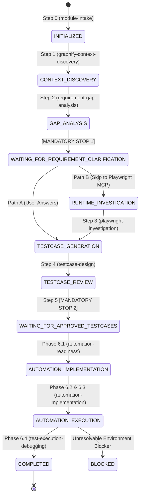

# Skill: QA Workflow Orchestrator

## 1. Description & Trigger Conditions
* **Purpose:** Serves as the central governor of the QA Agent System. Manages sequential lifecycle transitions, monitors checkpoint persistence in `.qa-state.json`, halts execution at mandatory human gates, and resumes interrupted sessions seamlessly.
* **Triggers:**
  * Invocation of master QA commands (e.g., *"Run full QA workflow on <Module>"*).
  * Session resumption after a user checkpoint response.
  * Direct invocation by `AGENTS.md`.

## 2. Inputs
* Target module name, user requirements, and repository context.
* Existing `.qa-state.json` (if resuming).

## 3. Workflow State Machine & Lifecycle Graph

## 4. Mandatory Human Approval Gates (Non-Negotiable)

### Gate 1: Requirement Clarification Checkpoint
* **When:** Right after Step 2 (`requirement-gap-analysis`).
* **State:** `WAITING_FOR_REQUIREMENT_CLARIFICATION`.
* **Behavior:** The agent MUST PAUSE and ask the user to choose between supplying BA/PO answers (Path A) or verifying actual behavior with Playwright MCP (Path B). The agent must NEVER proceed to test case generation without this user decision.

### Gate 2: Approved Test Cases Workbook Checkpoint
* **When:** Right after Step 5 (`testcase-review-export`).
* **State:** `WAITING_FOR_APPROVED_TESTCASES`.
* **Behavior:** The agent MUST PAUSE and deliver `<module-name>-testcases.xlsx`. The agent must NEVER start writing automation test scripts until the user reviews, marks `Automation Ready = Yes`, and uploads/confirms the file.

## 5. Checkpoint Resumption Protocol
When starting a session or resuming:
1. Check if `.qa-state.json` exists in workspace root.
2. If it exists, run: `python scripts/state_manager.py validate`.
3. Check `changed_documents`:
   * If input documents or source files changed since last run, invalidate only the downstream affected analysis.
4. Read `current_state` and resume directly from the pending step.

## 6. Completion Criteria
* Workflow reaches `COMPLETED` state.
* All intermediate artifacts (`module-context.md`, `<module>-testcases.xlsx`, test spec files, `automation-summary.md`) are verified and recorded.
